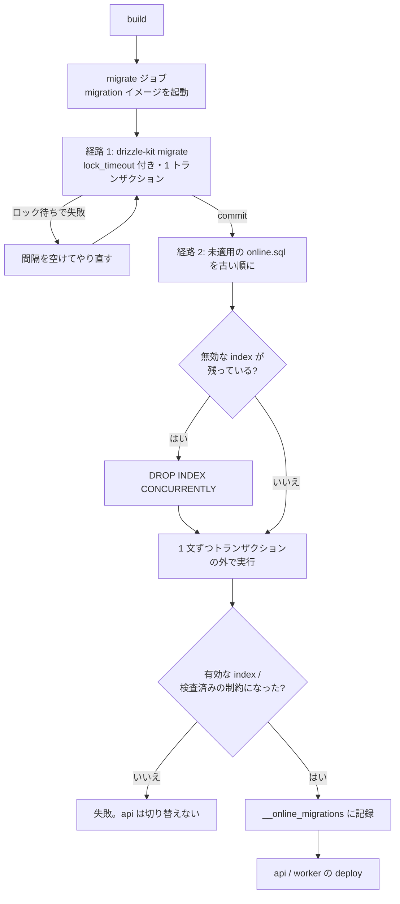
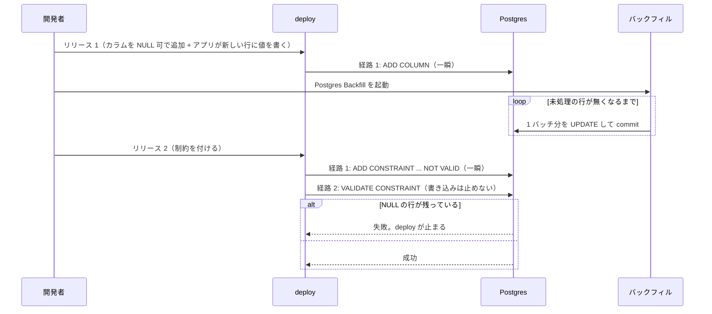

# ノンブロッキングなマイグレーション

> **状態: index の作成（step1、PR #136）まで実装済み。残りは、行数の多いテーブルができるまで保留**（2026-11-14）。判断は `judge-yourself.md` のとおり（Q1: `online.sql` に置く / Q2: バックフィルの仕組みは作らず、必要になったら手動で流す / Q3: CI での検出は入れない / Q4: deploy は完了を待つ）。保留にした節（バックフィルの仕組み、`VALIDATE CONSTRAINT`、`lock_timeout`、待ちの上限）は、作るときの案として残している。

行数の多いテーブルに対する **index の追加・カラムの追加や制約の変更・データの移行を、書き込みを止めずに本番へ適用できるようにする。**

現状は Drizzle のマイグレーション（`db:migrate`）が唯一の経路で、未適用のマイグレーションをまとめて 1 つのトランザクションで流す。素直に書いた `CREATE INDEX` や全行の `UPDATE` は、終わるまで対象テーブルへの書き込みを止め、その間も旧バージョンの api は本番のリクエストを受けている。回避策は `docs/tech-stack/drizzle.md` の手動手順（本番の DB に手で `CREATE INDEX CONCURRENTLY` を流す）だけで、接続手段・実行忘れ・失敗時の扱いが決まっていない。

このドキュメントは **仕様（What）** と **設計（How）** を分けて記述する：

- **仕様**：どの変更が書き込みを止めるか、開発者が変更の種類ごとにやること、守られること
- **設計**：変更を流す 3 つの経路の作り、Drizzle との分担、deploy への組み込み、検出の仕組み

## 関連 spec

- [`../clickhouse-migration/README.md`](../clickhouse-migration/README.md) — migration イメージと deploy の migrate ジョブの構成。本 spec は同じイメージ・同じジョブに処理を足す
- [`../minimal-deploy/README.md`](../minimal-deploy/README.md) — min 環境は PgBouncer（transaction pooling）経由で接続する。セッション単位の機能が使えない制約を本 spec も受ける
- [`../../tech-stack/drizzle.md`](../../../tech-stack/drizzle.md) — マイグレーションの挙動の正本。「CREATE INDEX CONCURRENTLY は書けない」の手動手順を、本 spec の仕組みで置き換える

## 目次

- [仕様](#仕様)
  - [書き込みを止める変更と、止めない書き方](#書き込みを止める変更と止めない書き方)
  - [変更を流す 3 つの経路](#変更を流す-3-つの経路)
  - [変更の種類ごとの作業](#変更の種類ごとの作業)
  - [守られること](#守られること)
  - [スコープ外](#スコープ外)
- [設計](#設計)
  - [前提（確認済みの挙動）](#前提確認済みの挙動)
  - [経路 1: トランザクション内のマイグレーション](#経路-1-トランザクション内のマイグレーション)
  - [経路 2: オンライン操作](#経路-2-オンライン操作)
  - [経路 3: バックフィル（保留）](#経路-3-バックフィル保留)
  - [危険な DDL の検出](#危険な-ddl-の検出)
  - [deploy への組み込み](#deploy-への組み込み)
  - [botchan-platform との違い](#botchan-platform-との違い)
  - [未確認の事項](#未確認の事項)
  - [MVP 対象外（将来検討）](#mvp-対象外将来検討)
  - [step の切り方](#step-の切り方)
- [必要な画面](#必要な画面)
- [必要な API](#必要な-api)
- [必要な DB 設計](#必要な-db-設計)
- [フロー図](#フロー図)

---

## 仕様

### 書き込みを止める変更と、止めない書き方

Postgres 12 以降を前提にする（ローカルと CI は 16）。「止める」は、終わるまで対象テーブルへの INSERT / UPDATE / DELETE（強いロックでは SELECT も）が待たされること。

| 変更 | 素直に書いたとき | 止めない書き方 |
| --- | --- | --- |
| index の追加 | 作成が終わるまで書き込みを止める | `CREATE INDEX CONCURRENTLY`（トランザクションの外で流す） |
| index の削除 | 一瞬だが読み書きを止めるロックを取る | `DROP INDEX CONCURRENTLY` |
| カラムの追加（NULL 可、または default が定数） | テーブルを書き換えないので一瞬で終わる | そのままでよい |
| カラムの追加（default が行ごとに変わる式。`gen_random_uuid()` など） | 全行を書き換え、終わるまで読み書きを止める | default 無しで追加 → default を設定（以降の INSERT にだけ効き、書き換えない）→ バックフィル |
| カラムに `NOT NULL` を付ける | 全行を検査する間、読み書きを止める | `CHECK (col IS NOT NULL) NOT VALID` を追加 → `VALIDATE CONSTRAINT` → `SET NOT NULL` → CHECK を削除 |
| CHECK 制約 / 外部キーの追加 | 全行を検査する間、ロックを保持する | `NOT VALID` で追加 → `VALIDATE CONSTRAINT` |
| カラムの型の変更 | 多くの場合、全行を書き換えて読み書きを止める | 新しいカラムを追加 → 両方に書く → バックフィル → 読み先を切り替え → 古いカラムを削除 |
| データの移行（全行の `UPDATE`） | 1 つの長いトランザクションになり、更新した行のロックを最後まで保持する | 小さなバッチに分け、1 バッチ 1 トランザクションで流す |

- `@repo/domain` の定数から作る CHECK 制約（`docs/tech-stack/drizzle.md`）は、値を足すと `DROP CONSTRAINT` + `ADD CONSTRAINT` が生成され、全行を検査する。行数の多いテーブルでは表の「CHECK 制約の追加」の書き方にする
- 一瞬で終わる DDL も、強いロックを取るときに長いトランザクションの後ろで待つと、その後ろに来た読み書きも一緒に待たされる。これは待ち時間の上限（`lock_timeout`）で防ぐ（[守られること](#守られること)）

### 変更を流す 3 つの経路

| 経路 | 置き場所 | 流し方 | 載せるもの |
| --- | --- | --- | --- |
| 1. トランザクション内のマイグレーション | `migrations/{name}/migration.sql` | 未適用分をまとめて 1 トランザクション（`online.sql` を持つフォルダがあれば、そこで区切る） | 一瞬で終わる DDL（テーブル / カラムの追加、`NOT VALID` の制約など） |
| 2. オンライン操作 | `migrations/{name}/online.sql` | 同じフォルダの `migration.sql` の commit 後に、トランザクションの外で 1 文ずつ | 時間はかかるが書き込みを止めないもの（`CREATE INDEX CONCURRENTLY` / `DROP INDEX CONCURRENTLY` / `VALIDATE CONSTRAINT`） |
| 3. バックフィル | （仕組みは作らない） | 行数の多いテーブルは、必要になった時点で手動で SQL を流す | 既存の行の値を埋める・移す処理 |

- 経路 1 と 2 は `db:migrate` の 1 コマンドで続けて流れる。ローカル・テスト・CI・本番で同じ
- 経路 3 は、流すバージョンの deploy が済んだ後に、GitHub Actions から環境と名前を指定して起動する。途中で止まっても、もう一度起動すれば続きから進む

### 変更の種類ごとの作業

**index を足す（行数の多いテーブル）**

1. スキーマの index に `.concurrently()` を付ける
2. `db:generate` する。`CREATE INDEX CONCURRENTLY` は自動で `online.sql` に入る
3. PR を出してマージする。deploy の migrate が作成まで行う

行数の少ないテーブルや、同じマイグレーションで作るテーブルの index は、今までどおり `.concurrently()` 無しでよい。

**NOT NULL のカラムを足す（行数の多いテーブル）**

リリースを 2 回に分ける。

| リリース | 経路 | 内容 |
| --- | --- | --- |
| 1 | 経路 1 | カラムを NULL 可で追加する |
| 1 | アプリ | 新しい行には値を書く |
| （1 の deploy 後） | 経路 3 | 既存の行をバックフィルする |
| 2 | 経路 1 | `CHECK (col IS NOT NULL) NOT VALID` を追加する |
| 2 | 経路 2 | `VALIDATE CONSTRAINT` する |
| 3（任意） | 経路 1 | `SET NOT NULL` して CHECK を削除する（検査済みの CHECK があるので一瞬で終わる） |

**データを別のカラム・別の形に移す**

カラムの型の変更もこれに当たる。新しいカラムを足す（リリース 1）→ アプリが両方に書く（リリース 1）→ バックフィル → アプリが新しい方を読む（リリース 2）→ 古いカラムを消す（リリース 3）。

### 守られること

- **書き込みを止める DDL の検出は、レビューに任せる。** CI での検出は入れない（[危険な DDL の検出](#危険な-ddl-の検出)）。どの変更が止めるかは、上の表と `docs/tech-stack/drizzle.md` に書く
- **ロック待ちは数秒で打ち切る。** 経路 1 は `lock_timeout` を付けて流し、待たされたら失敗してやり直す。後ろの読み書きを巻き込まない
- **作りかけの index を残さない。** `CREATE INDEX CONCURRENTLY` が途中で失敗すると無効な index が残る。次の実行で無効な index を消して作り直し、最後に有効になったことを確かめる
- **バックフィルが終わる前に制約を付けようとすると、deploy が止まる。** `VALIDATE CONSTRAINT` が失敗するので、不正な状態のまま api が切り替わらない

### スコープ外

- パーティションテーブル（今は無い。親テーブルには `CONCURRENTLY` が使えず、別の手順が要る）
- テーブルの書き換えを伴う操作そのものを無停止にする仕組み（`pg_repack` など）
- カラムやテーブルのリネーム・削除で旧バージョンの api が壊れないようにする手順（ロックの問題ではなく互換性の問題。別途 `docs/tech-stack/drizzle.md` に規約として書く）
- ClickHouse の migration（`clickhouse-migration` の範囲）

---

## 設計

### 前提（確認済みの挙動）

drizzle-kit `1.0.0-rc.4` と Postgres 16 の使い捨てコンテナで確かめた（2026-11-14）。

| 挙動 | 結果 |
| --- | --- |
| 未適用のマイグレーション 2 本のうち 2 本目が失敗 | 1 本目もロールバックされる（まとめて 1 トランザクション） |
| `migration.sql` に `CREATE INDEX CONCURRENTLY` を書く | `PreventInTransactionBlock` で失敗する |
| スキーマの index に `.concurrently()` を付けて `db:generate` | `CREATE INDEX CONCURRENTLY ...` が生成される（unique も同じ） |
| 生成後に `migration.sql` からその文を消して、もう一度 `db:generate` | 差分なし（snapshot には index が入っているため） |
| マイグレーションのフォルダに `online.sql` を置いて `db:migrate` | 無視され、`migration.sql` だけが流れる |
| `PGOPTIONS='-c lock_timeout=3s'` を付けて `db:migrate` | マイグレーションの接続に効く |
| `.concurrently()` を付けた index をスキーマから消して `db:generate` | 素の `DROP INDEX "..."` が生成される（`CONCURRENTLY` は付かない） |
| その `DROP INDEX` を `migration.sql` に残して、空の DB に `db:migrate` | `index does not exist` で失敗する（`online.sql` は後で流れるため、index がまだ無い） |
| コメントだけ・空の `migration.sql` | 適用できる |
| `drizzle.config.ts` の `out` を差し替えて、途中までのフォルダだけを見せて `migrate` | そこまでだけが適用される。DB のほうが進んでいても、エラーにならず何も変わらない |
| index を足したフォルダまで適用 → `online.sql` → 残り（index のあるカラムの rename）を適用 | 空の DB でも通り、index は rename 後のカラムを指す |

コードから読み取ったもの。

- deploy の migrate ジョブは ECS の one-shot タスクを起動し、`aws ecs wait tasks-stopped` で待つ（`.github/actions/run-one-shot-task`）。この待ちは 6 秒おきに 100 回、**10 分で打ち切られる**
- deploy と「Postgres Migrate」は同じ concurrency group で、同じ環境で同時に走らない
- min 環境は PlanetScale の PgBouncer（transaction pooling）経由。セッション単位の advisory lock と `SET` は使えない

### 経路 1: トランザクション内のマイグレーション

- `db:migrate` は `PGOPTIONS` で `lock_timeout`（5 秒）を付けて `drizzle-kit migrate` を呼ぶ。ロック待ちで失敗したら、間隔を空けて数回やり直す（全体が 1 トランザクションなので、失敗すれば何も適用されていない）
- 経路 1 に時間のかかる文を入れない。先に取ったロックを、後ろの文が終わるまで（commit まで）保持するため。CI での検出は入れないので（[危険な DDL の検出](#危険な-ddl-の検出)）、レビューと `docs/tech-stack/drizzle.md` の説明で担保する

### 経路 2: オンライン操作

**定義の置き場所**

- マイグレーションのフォルダに `online.sql` を置く。`migration.sql` と同じ名前・同じ順序で版管理される
- index はスキーマが唯一の定義元。`.concurrently()` を付けた index は、`db:generate` の後処理が `migration.sql` から `online.sql` に移し、`IF NOT EXISTS` を付ける。手で SQL を動かさない
- `VALIDATE CONSTRAINT` は `online.sql` に手で書く（Drizzle は `NOT VALID` / `VALIDATE` を生成しない。`NOT VALID` は `migration.sql` を手で直す）。step1 では扱わない

**書ける文を絞る**

`online.sql` に書ける文を次に限り、それ以外は実行前にエラーにする。どれも何度流しても同じ結果になる。

- `CREATE [UNIQUE] INDEX CONCURRENTLY IF NOT EXISTS ...`
- `DROP INDEX CONCURRENTLY IF EXISTS ...`
- `ALTER TABLE ... VALIDATE CONSTRAINT ...`（後の step で足す）

**流し方**

- **フォルダの名前順に、`migration.sql` と `online.sql` を交互に流す。** `online.sql` を持つ未適用のフォルダごとに、そこまでの `migration.sql` を適用してから、そのフォルダの `online.sql` を流す。最後に残りの `migration.sql` を適用する
  - `online.sql` を、書かれた時点のスキーマに対して流すため。未適用の `migration.sql` を全部適用してから流す作り（最初の実装）は、空の DB で、後のマイグレーションの変更（カラムの rename、index の作り直し、別ブランチのマイグレーション）と順序が入れ替わって壊れた
  - drizzle-kit migrate は「ここまで適用する」を指定できないので、そこまでのフォルダだけを写した一時ディレクトリを見せて流す（`drizzle.config.ts` の `out` を環境変数 `DRIZZLE_MIGRATIONS_DIR` で差し替える）
  - 代償: 未適用分は 1 トランザクションでなくなり、`online.sql` を持つフォルダごとに区切って commit される。`drizzle-kit migrate` を直接実行すると `online.sql` が飛ばされるので、必ず `db:migrate` を使う
- `db:generate` / `db:migrate` は、drizzle-kit を子プロセスで呼ぶ TypeScript のスクリプトにする（`pnpm db:generate --name=x` の引数を drizzle-kit に渡すため）。ローカル・テスト・CI も同じコマンドなので、index がある環境と無い環境に分かれない
- `online.sql` を適用したフォルダは `drizzle.__online_migrations` テーブルに記録し、次からは飛ばす
- 1 文ずつ、トランザクションを張らずに流す。フォルダの全文が成功したら記録する。途中で失敗したら記録せず、次の実行で先頭からやり直す（文が冪等なので安全）
- `CREATE INDEX` の前に、同じ名前の無効な index（`pg_index.indisvalid = false`）があれば `DROP INDEX CONCURRENTLY` する。作成後に有効になっていなければエラーにする
- 同時実行の排他は deploy の concurrency group に任せ、advisory lock は使わない（min の PgBouncer で使えないため）
- `statement_timeout` は付けない。`CONCURRENTLY` は対象テーブルを触っている既存のトランザクションが終わるのを待つので、時間で切ると無効な index を量産する

### 経路 3: バックフィル（保留）

**仕組みは作らない**（Q2。2026-11-14）。行数の多いテーブルの埋め戻しは頻度が低く、1 回分の件数・待ち時間・流す時間帯を毎回見て決めるので、必要になった時点で手動で SQL を流す。空の DB には対象の行が無いので、全環境で再現できる形にしておく必要も無い。

| 場面 | やり方 |
| --- | --- |
| 定数を入れるだけ | `ADD COLUMN ... DEFAULT ...`。Postgres が既存の行にも一瞬で値を持たせるので、埋め戻しは不要 |
| 行数の少ないテーブルの埋め戻し | `db:generate --custom` で作った `migration.sql` に `UPDATE` を書く |
| 行数の多いテーブルの埋め戻し | 手動で、少しずつに分けた SQL を流す。その後で制約を付けるマイグレーションを入れる |

本番の DB に手で SQL を流す経路は、今は無い（RDS は private subnet。踏み台は CDC 用で既定は無効）。必要になった時点で、migration イメージを起動コマンドを差し替えて動かす（「Admin Create」と同じ方法）か、接続の経路を作るかを決める。

以下は、仕組みを作るときの案として残す。

**書き方**

`packages/db/drizzle/backfills/{name}.ts` に、対象のテーブル・1 バッチの行数・1 バッチ分の更新を定義する。共通の実行部が次を受け持つ。

- 主キーの順に、未処理の行（例: 新しいカラムが NULL）を 1 バッチ分だけ選んで更新する。1 バッチ 1 トランザクション
- バッチの間に待ちを入れる（書き込みの負荷とレプリカの遅延を抑える）
- 進んだ件数と残りの件数をログに出す。残りが 0 になったら正常終了する
- 条件が「未処理の行」なので、途中で止めても再実行で続きから進む。進捗を別に記録しない

値の計算に業務のルールが要るときは `@repo/domain` の純粋関数を使う（`@repo/db` は既に依存している）。

**起動**

- GitHub Actions の「Postgres Backfill」（`workflow_dispatch`。環境と名前を指定）が、最後に deploy した migration イメージを、起動コマンドを差し替えて動かす。「Admin Create」と同じ作り（`run-deployed-migration`）
- バックフィルは 10 分を超えうるので、one-shot タスクの待ち方を、上限を指定できるポーリングに変える。上限を超えたら workflow は失敗させるが、タスクは止めない（ログで続きを追える）
- 終わったバックフィルの定義は、制約を付けるリリース（契約側）の後に消す

### 危険な DDL の検出

**CI での検出は入れない**（Q3 は c で確定。2026-11-14）。squawk は行数を見ないので、指摘は「この書き方は、行数が多いテーブルだと書き込みを止める」という注意で、実際に問題が起きるかは判定しない。今のテーブルの規模では、ほぼすべてが除外コメントを書いて通すだけになる。行数の多いテーブルができて、複数人がマイグレーションを書くようになったら入れる。

入れるときのために、[squawk](https://github.com/sbdchd/squawk) 2.72.0 を drizzle-kit の生成する形の SQL にかけて確かめた結果を残す。

- drizzle-kit の SQL（`--> statement-breakpoint` 付き）をそのまま読める。設定は `.squawk.toml` に `pg_version = "16.0"` と `assume_in_transaction = true`
- 検出できた: 既存テーブルへの素の `CREATE INDEX`（`require-concurrent-index-creation`。同じファイルで作ったテーブルは対象外）/ `NOT VALID` の無い CHECK 制約（`constraint-missing-not-valid`）/ 外部キーの追加（`adding-foreign-key-constraint`）/ `SET NOT NULL`（`adding-not-nullable-field`）/ 型の変更（`changing-column-type`）/ 行ごとに変わる default 付きのカラム追加（`adding-field-with-default`）/ default の無い `NOT NULL` のカラム追加（`adding-required-field`）/ UNIQUE 制約の追加（`disallowed-unique-constraint`）
- 検出しなかった（正しい）: `NOT VALID` 付きの制約、NULL 可・定数の default のカラム追加
- 検出できない: 全行の `UPDATE`、`migration.sql` に残った `CREATE INDEX CONCURRENTLY`（後者は `db:migrate` の事前検査が止める）
- 指摘が 1 件でもあれば終了コード 1。`-- squawk-ignore <rule>` を文の直前に書くと、その文だけ通る（次の文には効かない）
- 既定のルールのままでは、既存の 3 つのマイグレーションに 42 件出る。書き方の好みのルール 8 つ（`prefer-*`、`require-lock-timeout`、`require-statement-timeout`）を除外すると 1 件（適用済みの CHECK 制約の追加）になる。CI では、PR で足した `migration.sql` だけを対象にする
- `@repo/domain` の定数に値を足すと、CHECK 制約の `DROP` + `ADD` が生成され、毎回 `constraint-missing-not-valid`（と `ban-drop-constraint`）が出る
- 旧バージョンの api が壊れる変更（`renaming-column`、`ban-drop-column`、`ban-drop-constraint`、`require-concurrent-index-deletion`）も既定で出る。書き込みを止める DDL だけを見るなら、これらも除外する
- npm の `squawk-cli` で入る（バイナリは OS ごとの optionalDependencies。postinstall は無い。Apache-2.0 / MIT）。CI を落とさずに PR へコメントするだけの `upload-to-github` もある

### deploy への組み込み

Q4 は「待つ」で確定（PR #136 の実装のとおり）。待ちの上限を伸ばす対応は保留。

- migrate ジョブは 1 つのまま、経路 1 → 経路 2 を続けて流す。api の切り替えは両方が終わってから。新しい api が unique index を前提にする（`ON CONFLICT` など）ことがあるため
- one-shot タスクの待ちの上限を 10 分から伸ばす（バックフィルと同じ改修）
- 「Postgres Migrate」（流し直し）も同じコマンドなので、経路 2 が途中で失敗したときの再実行に使える

### botchan-platform との違い

botchan-platform は、Drizzle の migrate の後にスクリプト（`ensure-online-partition-indexes.mjs`）で `CREATE INDEX CONCURRENTLY` を流す。考え方（commit 後にトランザクションの外で流す・無効な index を作り直す・最後に有効かを確かめる）は同じで、次が違う。

| | botchan-platform | 本 spec |
| --- | --- | --- |
| index の定義 | スキーマと、スクリプト内の配列の 2 か所 | スキーマだけ（`.concurrently()`） |
| 生成された SQL | 手で `CREATE INDEX` を削る | 後処理が `online.sql` に移す |
| 適用の管理 | 毎回、配列の全 index を確かめる（消されても戻る） | フォルダ単位で 1 回だけ流す |
| index 以外 | 対象外 | `VALIDATE CONSTRAINT` も載る |
| パーティション | 対応（親は `ON ONLY`、子を `ATTACH`） | 対象外 |
| 排他 | セッション単位の advisory lock | deploy の concurrency group |
| バックフィル | この仕組みには無い | 経路 3 |

### 未確認の事項

実装の step で確かめ、だめなら括弧内の代替にする。

- min（PgBouncer 経由）で `CREATE INDEX CONCURRENTLY` と `PGOPTIONS` の `lock_timeout` が通るか（通らなければ、migration のタスクにだけ PgBouncer を通さない接続文字列を渡す）
- drizzle-kit を上げたときに、フォルダ内の `online.sql` を無視する挙動と、途中までのフォルダだけを見せて適用できる挙動が変わらないか（RC に固定しているので、上げるときに上の表の確認をやり直す）

### MVP 対象外（将来検討）

- 経路 2 を api の deploy と並行で流す（index の作成が長く、deploy を待たせたくなったとき）
- バックフィルの速度を、レプリカの遅延や負荷を見て自動で調整する
- パーティションテーブルの index
- カラムの型の変更を手順ごと自動化するヘルパ

### step の切り方

step1 だけを実装した。残りは、行数の多いテーブルができて必要になった時点で着手する。

| step | 内容 |
| --- | --- |
| 1 | 経路 2 のうち index の作成・削除: `online.sql` の実行部、`db:generate` の後処理、`drizzle.__online_migrations` テーブル、`db:migrate` への組み込み（[step1](./tasks/step1-db-online-index.md)、PR #136） |
| 1b | （保留）経路 2 に `VALIDATE CONSTRAINT` を足す |
| 2 | （保留）経路 1 の `lock_timeout` とやり直し、one-shot タスクの待ちの上限 |
| 3 | （入れない）危険な DDL の検出（CI）。Q3 は c で確定 |
| 4 | （作らない）経路 3: バックフィルの実行部と「Postgres Backfill」workflow |
| 5 | 書き込みを止める変更と、止めない書き方・埋め戻しのやり方を `docs/tech-stack/drizzle.md` に書く |

---

## 必要な画面

無し。

## 必要な API

無し。

## 必要な DB 設計

経路 2 の適用履歴を持つテーブルを 1 つ足す。Drizzle のスキーマには載せず、実行部が無ければ作る（Drizzle の `drizzle.__drizzle_migrations` テーブルと同じ扱い）。

`drizzle.__online_migrations` テーブル

| カラム | 型 | 内容 |
| --- | --- | --- |
| `name` | `text`（主キー） | マイグレーションのフォルダ名 |
| `applied_at` | `timestamptz` | `online.sql` の全文が成功した時刻 |

## フロー図

**deploy での流れ**

**NOT NULL のカラムを足すときの、リリースをまたぐ流れ**

