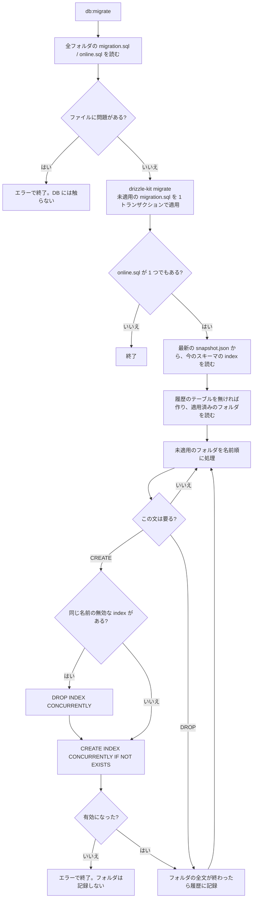

# step1: index をトランザクションの外で作る・消す（online.sql）

`.concurrently()` を付けた index を、`db:generate` が `online.sql` に振り分け、`db:migrate` が `migration.sql` の適用後にトランザクションの外で流すようにする。README の「経路 2: オンライン操作」のうち、**index の作成と削除だけ**を扱う最初の step。

この step の前は、`db:generate` / `db:migrate` は drizzle-kit をそのまま呼ぶだけで、`CREATE INDEX CONCURRENTLY` を書く手段が無い。この step の後は、スキーマに `.concurrently()` を付けるだけで、ローカル・テスト・CI・本番のどこでも同じコマンドで index が作られる。

`VALIDATE CONSTRAINT`、`lock_timeout`、deploy の待ちの上限、危険な DDL の検出、バックフィルは後の step で扱う。

> この step ファイルは実装（PR #136）と同時に書いた。コードの正本は PR で、ここには構成と主要な処理だけを載せる。

## 目次

- [対象コマンド](#対象コマンド)
- [依存](#依存)
- [処理フロー](#処理フロー)
  - [処理の流れ](#処理の流れ)
- [流す文の選び方](#流す文の選び方)
- [設計方針](#設計方針)
- [対応内容](#対応内容)
- [動作確認](#動作確認)
- [次の step での利用](#次の-step-での利用)

## 対象コマンド

| コマンド | 変更前 | 変更後 |
|---|---|---|
| `pnpm --filter @repo/db db:generate` | `drizzle-kit generate` | `drizzle-kit generate` → `online.sql` への振り分け |
| `pnpm --filter @repo/db db:migrate` | `drizzle-kit migrate` | ファイルの検査 → `drizzle-kit migrate` → 未適用の `online.sql` の適用 |

- 引数（`--name=...`、`--custom`）は drizzle-kit にそのまま渡す
- `apps/api` の `db:generate` / `db:migrate` / `test` / `test:ci`、migration イメージの `CMD` は、上のコマンドを呼んでいるので変更しない

## 依存

| 依存先 | 何を使うか | 本 step での扱い |
|---|---|---|
| drizzle-kit `1.0.0-rc.4` | フォルダ内の `online.sql` を無視する挙動、`snapshot.json`（version 8）の `ddl` 配列 | 必須前提。版を上げるときに確認し直す |
| deploy の concurrency group | 同じ環境で `db:migrate` が同時に走らないこと | 必須前提（排他は自前で持たない） |

## 処理フロー



### 処理の流れ

1. 全フォルダの `migration.sql` と `online.sql` を名前順に読む（`readMigrationFolders`）
2. ファイルを検査する（`verifyMigrationFiles`）。問題があれば、drizzle-kit を起動せずにエラーで終わる
3. `drizzle-kit migrate` を子プロセスで起動し、未適用の `migration.sql` を適用する
4. `online.sql` が 1 つも無ければ終わる（DB に接続せず、履歴のテーブルも作らない）
5. 最新のフォルダの `snapshot.json` から、今のスキーマにある index を読む（`readSchemaIndexKeys`。読めない形ならエラー）
6. `drizzle.__online_migrations` テーブルを無ければ作り、適用済みのフォルダ名を読む
7. 全フォルダの `online.sql` の文を順に並べ、流す文を決める（`planStatements`。下の表）
8. 未適用のフォルダを名前順に、1 文ずつトランザクションを張らずに流す
9. `CREATE` の前に、同じ名前の無効な index があれば `DROP INDEX CONCURRENTLY` する。作成後に有効でなければエラー
10. フォルダの全文が成功したら、フォルダ名を履歴に記録する（失敗したフォルダは記録せず、次の実行で先頭から流し直す）

## 流す文の選び方

drizzle-kit は未適用の `migration.sql` を先にすべて流すので、`online.sql` との前後関係が失われる。空の DB では、古い `online.sql` の対象のテーブルやカラムがもう無いことがある。そこで「同じ index への最後の文か」と「今のスキーマにその index があるか」で流す文を選ぶ。

| 文 | 流す条件 |
|---|---|
| `CREATE INDEX` | 同じ index への最後の文で、かつ今のスキーマにその index がある |
| `DROP INDEX` | 後に同じ index への文がある（作り直すための DROP）、または今のスキーマにその index が無い |

| 場面 | 適用済みの DB | 空の DB |
|---|---|---|
| A で作る | A: CREATE | A: CREATE |
| A で作り、B で消す | B: DROP | A: 飛ばす、B: DROP（何も起きない） |
| A で作り、B で定義を変える（DROP + CREATE） | B: DROP、B: CREATE | A: 飛ばす、B: DROP、B: CREATE |
| A で作り、後でテーブルごと消す（DROP の文は無い） | —（テーブルと一緒に消える） | A: 飛ばす |
| A で作り、B で消し、後で `.concurrently()` 無しで足し直す | B: DROP（その後 `migration.sql` が作る） | A: 飛ばす、B: 飛ばす（`migration.sql` が作ったものを消さない） |

## 設計方針

- **`online.sql` に書ける文を 2 種類に限る**（`CREATE [UNIQUE] INDEX CONCURRENTLY IF NOT EXISTS` / `DROP INDEX CONCURRENTLY IF EXISTS`）。どちらも何度流しても同じ結果になるので、途中で失敗したフォルダを先頭から流し直せる。それ以外の文は、DB に触る前にエラーにする
- **`DROP INDEX` も `online.sql` に移す。** `.concurrently()` を付けた index を消すと、drizzle-kit は素の `DROP INDEX` を生成する。`migration.sql` に残すと、空の DB では index がまだ無く（`online.sql` は後で流れる）、`index does not exist` で失敗する
- **流す文は、最新の `snapshot.json` を基準に選ぶ。** 「テーブルが無ければ飛ばす」「カラムが無ければ飛ばす」と個別に判定するより、今のスキーマにある index だけを作るほうが漏れが無い。`snapshot.json` は内部形式なので、読めなければ黙って空にせずエラーで止める
- **履歴はフォルダ単位で持つ。** 文ごとに持つと、文を書き足したときの扱いが複雑になる。文が冪等なので、フォルダ単位で足りる
- **`online.sql` が無いうちは DB に何も作らない。** 既存の環境の挙動を変えず、最初の `online.sql` を足した PR で初めて履歴のテーブルができる
- **`.concurrently()` で作った index の `ALTER INDEX`（rename）は、適用前にエラーにする。** 空の DB では index がまだ無く失敗するため。名前を変えるときは、消して作り直す
- **`db:generate` / `db:migrate` は TypeScript のスクリプトにする。** `"a && b"` の scripts では `pnpm db:generate --name=x` の引数が後ろのコマンドに付いてしまう。子プロセスで drizzle-kit を呼び、入出力を引き継ぐ（generate の対話をそのまま使う）
- **排他は持たない。** min 環境は PgBouncer（transaction pooling）経由で、セッション単位の advisory lock が使えない。deploy の concurrency group が直列にしている
- **`statement_timeout` は付けない。** `CONCURRENTLY` は対象テーブルを触る既存のトランザクションの終了を待つので、時間で切ると無効な index が残る
- **実 DB を使う自動テストは入れない。** 実行部は SQL を流す口（`SqlExecutor`）を受け取る形にして、偽の executor でユニットテストする。実 DB での挙動は、使い捨ての Postgres で手動で確かめる

## 対応内容

### 構成

```
packages/db/
├── migrate/
│   ├── tsconfig.json
│   ├── paths.ts                    # マイグレーションのディレクトリ、drizzle-kit のパス
│   ├── online-statement.ts         # online.sql の解析（書ける文の判定、index 名と schema の取り出し）
│   ├── migration-folders.ts        # フォルダの読み込み、snapshot.json からの index の読み出し
│   ├── online-index-keys.ts        # online.sql が作った index を、フォルダの順に積み上げる
│   ├── split-online-statements.ts  # generate の後処理（migration.sql → online.sql への振り分け）
│   ├── verify-migration-files.ts   # 適用前の検査
│   ├── run-online-migrations.ts    # online.sql の適用
│   ├── run-drizzle-kit.ts          # drizzle-kit の起動
│   ├── generate.ts                 # db:generate の入口
│   └── migrate.ts                  # db:migrate の入口
├── test/migrate/                   # ユニットテスト（vitest）
└── vitest.config.ts
```

### `packages/db/package.json`

```json
{
  "scripts": {
    "build": "tsc && tsc -p migrate/tsconfig.json",
    "db:generate": "tsx migrate/generate.ts",
    "db:migrate": "tsx migrate/migrate.ts",
    "lint": "eslint 'src/**/*.ts' 'migrate/**/*.ts'",
    "lint:fix": "eslint 'src/**/*.ts' 'migrate/**/*.ts' --fix",
    "test": "vitest run",
    "test:ci": "vitest run"
  }
}
```

`devDependencies` に `vitest` を足す。`eslint.config.js` は `packages/data-warehouse` と同じく、`migrate/**/*.ts` の型情報を `migrate/tsconfig.json` から取る。

### `packages/db/migrate/online-statement.ts`

```typescript
export type OnlineStatement = {
  indexName: string
  kind: "createIndex" | "dropIndex"
  schema: string
  sql: string
}

export const parseOnlineSql = (onlineSql: string): OnlineStatement[] => {
  const statements = removeSqlComments(onlineSql)
    .split(";")
    .map((statement) => statement.trim())
    .filter((statement) => statement.length > 0)

  const invalidStatements: string[] = []
  const parsed: OnlineStatement[] = []
  for (const statement of statements) {
    const onlineStatement = parseStatement(statement)
    if (onlineStatement) {
      parsed.push(onlineStatement)
    } else {
      invalidStatements.push(statement)
    }
  }
  if (invalidStatements.length > 0) {
    throw new Error(`${INVALID_STATEMENT_MESSAGE}:\n${invalidStatements.join("\n")}`)
  }
  return parsed
}
```

`schema` は、`CREATE` では対象テーブルの schema、`DROP` では index 名に付いた schema。省略時は `public`。

### `packages/db/migrate/split-online-statements.ts`

```typescript
const convertToOnlineStatement = (statement: string, onlineIndexKeys: Set<string>): string | undefined => {
  if (CREATE_INDEX_CONCURRENTLY_IF_NOT_EXISTS_PATTERN.test(statement)) return terminateStatement(statement)
  if (CREATE_INDEX_CONCURRENTLY_PATTERN.test(statement)) {
    return terminateStatement(statement.replace(CREATE_INDEX_CONCURRENTLY_PATTERN, "$1IF NOT EXISTS "))
  }

  const dropped = DROP_INDEX_PATTERN.exec(statement)
  if (!dropped) return undefined
  const [, qualifiedName, indexSchema, indexName] = dropped
  const indexKey = buildIndexKey(indexSchema ? normalizeIdentifier(indexSchema) : DEFAULT_SCHEMA, normalizeIdentifier(indexName))
  return onlineIndexKeys.has(indexKey) ? `DROP INDEX CONCURRENTLY IF EXISTS ${qualifiedName};` : undefined
}

export const moveOnlineStatements = async (migrationsDir: string): Promise<string[]> => {
  const onlineIndexKeys = new Set<string>()
  const changedFolderNames: string[] = []
  for (const folder of await readMigrationFolders(migrationsDir)) {
    const { migrationSql, onlineStatements } = splitOnlineStatements(folder.migrationSql, onlineIndexKeys)
    let onlineSql = folder.onlineSql
    if (onlineStatements.length > 0) {
      onlineSql = `${folder.onlineSql ?? ""}${onlineStatements.join("\n")}\n`
      await writeFile(path.join(migrationsDir, folder.name, MIGRATION_FILE_NAME), migrationSql)
      await writeFile(path.join(migrationsDir, folder.name, ONLINE_FILE_NAME), onlineSql)
      changedFolderNames.push(folder.name)
    }
    addOnlineIndexKeys(onlineIndexKeys, onlineSql)
  }
  return changedFolderNames
}
```

`migration.sql` は `--> statement-breakpoint` で文に分ける。すべての文を移したら、`migration.sql` にはコメントの 1 行だけを残す（drizzle-kit はコメントだけのファイルを適用できる）。

### `packages/db/migrate/verify-migration-files.ts`

`verifyMigrationFiles(folders): string[]` は、次の問題を返す。

| 問題 | 理由 |
|---|---|
| `migration.sql` に `INDEX CONCURRENTLY` がある | トランザクション内で実行できない |
| `migration.sql` が、前の `online.sql` で作った index を `DROP` / `ALTER` している | 空の DB では index がまだ無い |
| `online.sql` に書けない文がある | 冪等でない文を流さない |

### `packages/db/migrate/run-online-migrations.ts`

```typescript
export type SqlExecutor = {
  query: (sql: string, params?: unknown[]) => Promise<{ rows: Record<string, unknown>[] }>
}

const createIndex = async (executor: SqlExecutor, statement: OnlineStatement, log: (message: string) => void): Promise<void> => {
  const qualifiedName = `${quoteIdentifier(statement.schema)}.${quoteIdentifier(statement.indexName)}`
  if (await findIndexValidity(executor, statement) === false) {
    log(`dropping invalid index ${qualifiedName} left by a failed build`)
    await executor.query(`DROP INDEX CONCURRENTLY IF EXISTS ${qualifiedName}`)
  }
  await executor.query(statement.sql)
  if (await findIndexValidity(executor, statement) !== true) {
    throw new Error(`index ${qualifiedName} is not valid after: ${statement.sql}`)
  }
}

const planStatements = (folders: MigrationFolder[], schemaIndexKeys: Set<string>): PlannedStatement[] => {
  const statements = folders.flatMap((folder) =>
    folder.onlineSql === undefined ? [] : parseOnlineSql(folder.onlineSql).map((statement) => ({ folderName: folder.name, statement })),
  )
  const lastPositionByIndexKey = new Map<string, number>()
  statements.forEach(({ statement }, position) => {
    lastPositionByIndexKey.set(buildIndexKey(statement.schema, statement.indexName), position)
  })

  return statements.map(({ folderName, statement }, position) => {
    const indexKey = buildIndexKey(statement.schema, statement.indexName)
    const isLast = lastPositionByIndexKey.get(indexKey) === position
    const isInSchema = schemaIndexKeys.has(indexKey)
    return {
      folderName,
      shouldRun: statement.kind === "createIndex" ? isLast && isInSchema : !isLast || !isInSchema,
      statement,
    }
  })
}
```

履歴のテーブルは、Drizzle のスキーマには載せず、実行部が無ければ作る。

```sql
CREATE SCHEMA IF NOT EXISTS "drizzle";
CREATE TABLE IF NOT EXISTS "drizzle"."__online_migrations" ("name" text PRIMARY KEY, "applied_at" timestamptz NOT NULL DEFAULT now());
```

### `packages/db/migrate/migrate.ts`

```typescript
const main = async (): Promise<void> => {
  const folders = await readMigrationFolders(MIGRATIONS_DIR)
  const problems = verifyMigrationFiles(folders)
  if (problems.length > 0) {
    throw new Error(`invalid migration files:\n${problems.join("\n")}`)
  }

  await runDrizzleKit("migrate", process.argv.slice(2))

  if (folders.every((folder) => folder.onlineSql === undefined)) return

  const schemaIndexKeys = await readSchemaIndexKeys(MIGRATIONS_DIR)
  const client = new Client({ connectionString: buildConnectionString() })
  await client.connect()
  try {
    const appliedFolderNames = await runOnlineMigrations(
      { query: (sql, params) => client.query(sql, params) },
      { folders, log: (message) => console.log(`[online] ${message}`), schemaIndexKeys },
    )
    console.log(`[online] applied ${appliedFolderNames.length} online migration(s)`)
  } finally {
    await client.end()
  }
}
```

### ドキュメント

- `docs/tech-stack/drizzle.md`: 「CREATE INDEX CONCURRENTLY は書けない」（手動の手順）を、「行数の多いテーブルの index は online.sql で作る」に書き換える
- `packages/db/README.md`: ディレクトリ構成とコマンドの説明を更新する

## 動作確認

| 区分 | 内容 |
|---|---|
| ユニットテスト | `packages/db/test/migrate/*.test.ts`（解析 / 振り分け / 適用前の検査 / 実行。実行は偽の `SqlExecutor`） |
| Lint / Build | `pnpm turbo run build lint test --filter=@repo/db` がすべて成功 |
| 実 DB | 使い捨ての Postgres 16 に `db:generate` / `db:migrate` を流す（下の手順） |

ユニットテストの抜粋。

```typescript
describe("runOnlineMigrations", () => {
  describe("正常系", () => {
    it("無効な index が残っていれば、消してから作り直す", async () => {
      const fake = createFakeSqlExecutor({ indexes: { [OWNER_INDEX_KEY]: false } })

      await run(fake, [buildFolder("0002_add", [CREATE_OWNER_INDEX])], [OWNER_INDEX_KEY])

      expect(fake.indexStatements()).toEqual([
        "DROP INDEX CONCURRENTLY IF EXISTS \"public\".\"items_owner_id_idx\"",
        CREATE_OWNER_INDEX,
      ])
      expect(fake.indexes.get(OWNER_INDEX_KEY)).toBe(true)
    })

    it("空の DB では、後のマイグレーションで消した index は作らず、DROP だけを流す", async () => {
      const fake = createFakeSqlExecutor()

      const applied = await run(fake, [buildFolder("0002_add", [CREATE_OWNER_INDEX]), buildFolder("0003_drop", [DROP_OWNER_INDEX])], [])

      expect(applied).toEqual(["0002_add", "0003_drop"])
      expect(fake.indexStatements()).toEqual([DROP_OWNER_INDEX])
    })
  })

  describe("異常系", () => {
    it("index の作成に失敗したら throw し、そのフォルダは履歴に記録しない", async () => {
      const fake = createFakeSqlExecutor({ failingIndexKeys: [OWNER_INDEX_KEY] })

      await expect(run(fake, [buildFolder("0002_add", [CREATE_OWNER_INDEX])], [OWNER_INDEX_KEY])).rejects.toThrow("could not create unique index")

      expect([...fake.appliedFolderNames]).toEqual([])
    })
  })
})
```

実 DB での手順（確認用の変更はコミットしない）。

1. 使い捨ての Postgres を起動し、`DATABASE_URL` を向けて `db:migrate` する（`drizzle` schema に履歴のテーブルができないこと）
2. どれかのテーブルの index に `.concurrently()` を付けて `db:generate --name=check` する（`online.sql` に `CREATE INDEX CONCURRENTLY IF NOT EXISTS` が入ること）
3. `db:migrate` する（index が有効で、`drizzle.__online_migrations` テーブルに記録されること）。もう一度流して何も起きないこと
4. `pg_index.indisvalid` を `false` にして履歴を消し、`db:migrate` する（作り直されて有効になること）
5. index をスキーマから消して `db:generate` する（`DROP INDEX CONCURRENTLY IF EXISTS` が `online.sql` に入ること）
6. 適用済みの DB と空の DB の両方で `db:migrate` する（どちらも成功し、index が無いこと）

## 次の step での利用

- **`VALIDATE CONSTRAINT` の step**: `online-statement.ts` の書ける文に `ALTER TABLE ... VALIDATE CONSTRAINT` を足す。index と違って `snapshot.json` に「検査済みか」は無いので、流す文の選び方を制約用に足す
- **`lock_timeout` と待ちの上限の step**: `migrate.ts` が drizzle-kit を起動するところに `PGOPTIONS` とやり直しを足す。deploy の one-shot タスクの待ちを 10 分から伸ばす
- **危険な DDL の検出の step**: `verify-migration-files.ts` は「この仕組みで壊れる書き方」だけを見る。書き込みを止める DDL の検出（squawk）は CI に別に足す
- **意図的に省略したもの**: 実 DB を使う自動テスト、同時実行の排他、`REINDEX CONCURRENTLY`、パーティションテーブル、min 環境（PgBouncer 経由）での確認
