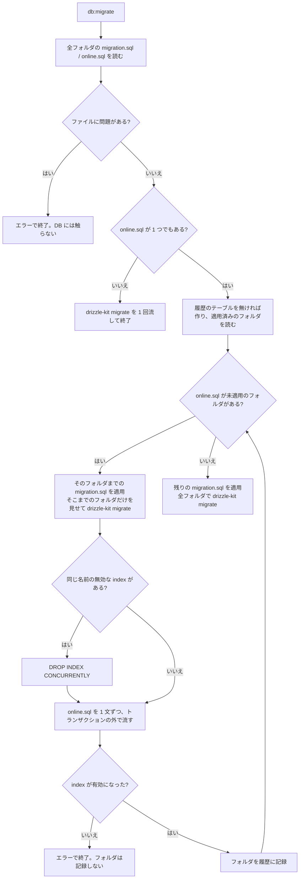

# step1: index をトランザクションの外で作る（online.sql）

`.concurrently()` を付けた index を、`db:generate` が `online.sql` に振り分け、`db:migrate` がトランザクションの外で流すようにする。README の「経路 2: オンライン操作」のうち、**index の作成（と、手で書く削除）だけ**を扱う最初の step。

この step の前は、`db:generate` / `db:migrate` は drizzle-kit をそのまま呼ぶだけで、`CREATE INDEX CONCURRENTLY` を書く手段が無い。この step の後は、スキーマに `.concurrently()` を付けるだけで、ローカル・テスト・CI・本番のどこでも同じコマンドで index が作られる。

`VALIDATE CONSTRAINT`、`lock_timeout`、deploy の待ちの上限、危険な DDL の検出、バックフィルは後の step で扱う。

> この step ファイルは実装（PR #136）と並行して書いた。コードの正本は PR で、ここには構成と主要な処理だけを載せる。最初の実装（未適用の `migration.sql` を全部適用してから `online.sql` を流す）は、セルフレビューで順序の入れ替わりによる誤りが 3 件見つかり、下の「フォルダの順に交互に流す」作りに変えた。

## 目次

- [対象コマンド](#対象コマンド)
- [依存](#依存)
- [処理フロー](#処理フロー)
  - [処理の流れ](#処理の流れ)
- [流す順序](#流す順序)
- [設計方針](#設計方針)
- [対応内容](#対応内容)
- [動作確認](#動作確認)
- [次の step での利用](#次の-step-での利用)

## 対象コマンド

| コマンド | 変更前 | 変更後 |
|---|---|---|
| `pnpm --filter @repo/db db:generate` | `drizzle-kit generate` | `drizzle-kit generate` → `CREATE INDEX CONCURRENTLY` を `online.sql` に移す |
| `pnpm --filter @repo/db db:migrate` | `drizzle-kit migrate` | ファイルの検査 → フォルダの名前順に `migration.sql` と `online.sql` を適用 |

- 引数（`--name=...`、`--custom`）は drizzle-kit にそのまま渡す
- `apps/api` の `db:generate` / `db:migrate` / `test` / `test:ci`、migration イメージの `CMD` は、上のコマンドを呼んでいるので変更しない

## 依存

| 依存先 | 何を使うか | 本 step での扱い |
|---|---|---|
| drizzle-kit `1.0.0-rc.4` | フォルダ内の `online.sql` を無視する挙動、`out` に渡したディレクトリのマイグレーションだけを適用する挙動 | 必須前提。版を上げるときに確認し直す |
| deploy の concurrency group | 同じ環境で `db:migrate` が同時に走らないこと | 必須前提（排他は自前で持たない） |

## 処理フロー



### 処理の流れ

1. 全フォルダの `migration.sql` と `online.sql` を名前順に読む（`readMigrationFolders`）
2. ファイルを検査する（`verifyMigrationFiles`）。問題があれば、drizzle-kit を起動せずにエラーで終わる
3. `online.sql` が 1 つも無ければ、`drizzle-kit migrate` を 1 回流して終わる（DB に接続せず、履歴のテーブルも作らない）
4. `drizzle.__online_migrations` テーブルを無ければ作り、`online.sql` を適用済みのフォルダ名を読む
5. `online.sql` が未適用のフォルダを名前順に処理する。まず、そのフォルダまでの `migration.sql` を適用する（そこまでのフォルダだけを写した一時ディレクトリを `DRIZZLE_MIGRATIONS_DIR` に渡して `drizzle-kit migrate`）
6. そのフォルダの `online.sql` を、1 文ずつトランザクションを張らずに流す
7. `CREATE` の前に、同じ名前の無効な index があれば `DROP INDEX CONCURRENTLY` する。作成後に有効でなければエラー
8. フォルダの全文が成功したら、フォルダ名を履歴に記録する（失敗したフォルダは記録せず、次の実行で先頭から流し直す）
9. 最後に、全フォルダで `drizzle-kit migrate` を流して、残りの `migration.sql` を適用する

## 流す順序

A（index を `online.sql` で足す）の後に、B（`migration.sql` だけ）、C（`online.sql` あり）が続く場合。

| DB の状態 | 流れる順 |
|---|---|
| 空の DB | A までの `migration.sql` → A の `online.sql` → C までの `migration.sql`（B と C）→ C の `online.sql` → 残り（無し） |
| A まで適用済み | C までの `migration.sql`（B と C）→ C の `online.sql` → 残り（無し） |
| すべて適用済み | 全フォルダで `drizzle-kit migrate`（何も適用しない） |

`online.sql` は必ず、同じフォルダの `migration.sql` の直後に流れる。B がカラムの rename でも、A の index は rename の前に作られ、Postgres が rename に追従させる。

## 設計方針

- **フォルダの順に交互に流す。** `online.sql` を、書かれた時点のスキーマに対して流すため。未適用の `migration.sql` を全部適用してから流す作りは、空の DB で順序が入れ替わる（index のあるカラムを後で rename すると `column does not exist` で止まる）。入れ替わりを個別に補う処理（`snapshot.json` の解析、流す文の選別、`DROP INDEX` の書き換え）は、補うたびに別の場面が漏れたのでやめた
- **「ここまで適用する」は、見せるフォルダを絞って実現する。** drizzle-kit migrate に適用の上限を指定する手段が無い。`drizzle.config.ts` の `out` を環境変数で差し替え、そこまでのフォルダを写した一時ディレクトリを渡す
- **未適用分が 1 トランザクションでなくなることは受け入れる。** トランザクションの外で流す文を順序どおりに挟む以上、区切りは避けられない。区切りは `online.sql` を持つフォルダだけで、途中で失敗しても流し直せば続きから進む
- **`online.sql` に書ける文を 2 種類に限る**（`CREATE [UNIQUE] INDEX CONCURRENTLY IF NOT EXISTS` / `DROP INDEX CONCURRENTLY IF EXISTS`）。どちらも何度流しても同じ結果になるので、途中で失敗したフォルダを先頭から流し直せる。それ以外の文は、DB に触る前にエラーにする
- **`db:generate` が移すのは `CREATE INDEX CONCURRENTLY` だけ。** `.concurrently()` の index を消したときの素の `DROP INDEX` は `migration.sql` に残す（フォルダの順に流すので、空の DB でも index がある状態で流れる。ロックは一瞬）。書き込みを止めずに消したいときは、`online.sql` に `DROP INDEX CONCURRENTLY IF EXISTS` を手で書く
- **履歴はフォルダ単位で持つ。** 文が冪等なので、フォルダ単位で足りる
- **`online.sql` が無いうちは DB に何も作らない。** 既存の環境の挙動を変えず、最初の `online.sql` を足した PR で初めて履歴のテーブルができる
- **取り出す文の無い `migration.sql` は 1 文字も変えない。** 後処理は全フォルダを見るので、空白の違いだけで適用済みのマイグレーションを書き換えないようにする
- **`db:generate` / `db:migrate` は TypeScript のスクリプトにする。** `"a && b"` の scripts では `pnpm db:generate --name=x` の引数が後ろのコマンドに付いてしまう。子プロセスで drizzle-kit を呼び、入出力を引き継ぐ（generate の対話をそのまま使う）
- **排他は持たない。** min 環境は PgBouncer（transaction pooling）経由で、セッション単位の advisory lock が使えない。deploy の concurrency group が直列にしている。ローカルなどで 2 つの `db:migrate` が重なったときのために、無効な index が別のセッションで作成中（`pg_stat_progress_create_index` に行がある）なら、消さずにエラーで止める
- **実 DB を使う自動テストは入れない。** 実行部は SQL を流す口（`SqlExecutor`）と「ここまで適用する」関数（`migrateThrough`）を受け取る形にして、偽物でユニットテストする。実 DB での挙動は、使い捨ての Postgres で手動で確かめる

## 対応内容

### 構成

```
packages/db/
├── drizzle/
│   └── drizzle.config.ts           # out を DRIZZLE_MIGRATIONS_DIR で差し替えられるようにする
├── migrate/
│   ├── tsconfig.json
│   ├── paths.ts                    # マイグレーションのディレクトリ、drizzle-kit のパス
│   ├── online-statement.ts         # online.sql の解析（書ける文の判定、index 名と schema の取り出し）
│   ├── migration-folders.ts        # フォルダの読み込み、どのフォルダまでを drizzle-kit に見せるかの選択
│   ├── split-online-statements.ts  # generate の後処理（CREATE INDEX CONCURRENTLY を online.sql に移す）
│   ├── verify-migration-files.ts   # 適用前の検査
│   ├── run-migrations.ts    # フォルダの順の適用
│   ├── run-drizzle-kit.ts          # drizzle-kit の起動
│   ├── generate.ts                 # db:generate の入口
│   └── migrate.ts                  # db:migrate の入口
├── test/migrate/                   # ユニットテスト（vitest）
└── vitest.config.ts
```

### `packages/db/package.json`

```json
{
  "scripts": {
    "build": "tsc && tsc -p migrate/tsconfig.json",
    "db:generate": "tsx migrate/generate.ts",
    "db:migrate": "tsx migrate/migrate.ts",
    "lint": "eslint 'src/**/*.ts' 'migrate/**/*.ts'",
    "lint:fix": "eslint 'src/**/*.ts' 'migrate/**/*.ts' --fix",
    "test": "vitest run",
    "test:ci": "vitest run"
  }
}
```

`devDependencies` に `vitest` を足す。`eslint.config.js` は `packages/data-warehouse` と同じく、`migrate/**/*.ts` の型情報を `migrate/tsconfig.json` から取る。

### `packages/db/drizzle/drizzle.config.ts`

```typescript
export default defineConfig({
  dbCredentials: {
    url: buildConnectionString(),
  },
  dialect: "postgresql",
  out: process.env.DRIZZLE_MIGRATIONS_DIR ?? "./drizzle/migrations",
  schema: "./src/drizzle/schema/index.ts",
})
```

### `packages/db/migrate/online-statement.ts`

```typescript
export type OnlineStatement = {
  indexName: string
  kind: "createIndex" | "dropIndex"
  schema: string
  sql: string
}

export const parseOnlineSql = (onlineSql: string): OnlineStatement[] => {
  const invalidStatements: string[] = []
  const parsed: OnlineStatement[] = []
  for (const statement of splitSqlStatements(onlineSql)) {
    const onlineStatement = parseStatement(statement)
    if (onlineStatement) {
      parsed.push(onlineStatement)
    } else {
      invalidStatements.push(statement)
    }
  }
  if (invalidStatements.length > 0) {
    throw new Error(`${INVALID_STATEMENT_MESSAGE}:\n${invalidStatements.join("\n")}`)
  }
  return parsed
}
```

`splitSqlStatements` は、引用符の中かどうかを追いながら文に分ける（部分 index の `WHERE` に書いた文字列リテラルの中の `;` や `--` を、文の区切りやコメントと取り違えない）。`schema` は、`CREATE` では対象テーブルの schema、`DROP` では index 名に付いた schema。省略時は `public`。

### `packages/db/migrate/split-online-statements.ts`

```typescript
const convertToOnlineStatement = (statement: string): string | undefined => {
  if (CREATE_INDEX_CONCURRENTLY_IF_NOT_EXISTS_PATTERN.test(statement)) return terminateStatement(statement)
  if (CREATE_INDEX_CONCURRENTLY_PATTERN.test(statement)) {
    return terminateStatement(statement.replace(CREATE_INDEX_CONCURRENTLY_PATTERN, "$1IF NOT EXISTS "))
  }
  return undefined
}

export const moveOnlineStatements = async (migrationsDir: string): Promise<string[]> => {
  const changedFolderNames: string[] = []
  for (const folder of await readMigrationFolders(migrationsDir)) {
    const { migrationSql, onlineStatements } = splitOnlineStatements(folder.migrationSql)
    if (onlineStatements.length === 0) continue
    await writeFile(path.join(migrationsDir, folder.name, MIGRATION_FILE_NAME), migrationSql)
    await writeFile(path.join(migrationsDir, folder.name, ONLINE_FILE_NAME), `${folder.onlineSql ?? ""}${onlineStatements.join("\n")}\n`)
    changedFolderNames.push(folder.name)
  }
  return changedFolderNames
}
```

`migration.sql` は `--> statement-breakpoint` で文に分ける。すべての文を移したら、`migration.sql` にはコメントの 1 行だけを残す（drizzle-kit はコメントだけのファイルを適用できる）。

### `packages/db/migrate/verify-migration-files.ts`

`verifyMigrationFiles(folders): string[]` は、次の問題を返す。

| 問題 | 理由 |
|---|---|
| `migration.sql` に `INDEX CONCURRENTLY` がある | トランザクション内で実行できない |
| `online.sql` に書けない文がある | 冪等でない文を流さない |

### `packages/db/migrate/run-migrations.ts`

```typescript
export type SqlExecutor = {
  query: (sql: string, params?: unknown[]) => Promise<{ rows: Record<string, unknown>[] }>
}

type RunMigrationsParams = {
  folders: MigrationFolder[]
  log: (message: string) => void
  migrateThrough: (lastFolderName?: string) => Promise<void>
}

const createIndex = async (executor: SqlExecutor, statement: OnlineStatement, log: (message: string) => void): Promise<void> => {
  const qualifiedName = `${quoteIdentifier(statement.schema)}.${quoteIdentifier(statement.indexName)}`
  if (await findIndexValidity(executor, statement) === false) {
    log(`dropping invalid index ${qualifiedName} left by a failed build`)
    await executor.query(`DROP INDEX CONCURRENTLY IF EXISTS ${qualifiedName}`)
  }
  await executor.query(statement.sql)
  if (await findIndexValidity(executor, statement) !== true) {
    throw new Error(`index ${qualifiedName} is not valid after: ${statement.sql}`)
  }
}

export const runMigrations = async (executor: SqlExecutor, params: RunMigrationsParams): Promise<string[]> => {
  await createHistoryTable(executor)
  const appliedFolderNames = await findAppliedFolderNames(executor)

  const newlyAppliedFolderNames: string[] = []
  for (const folder of params.folders) {
    if (folder.onlineSql === undefined || appliedFolderNames.has(folder.name)) continue

    await params.migrateThrough(folder.name)
    for (const statement of parseOnlineSql(folder.onlineSql)) {
      params.log(`running: ${statement.sql}`)
      if (statement.kind === "createIndex") {
        await createIndex(executor, statement, params.log)
      } else {
        await executor.query(statement.sql)
      }
    }
    await executor.query(`INSERT INTO ${HISTORY_TABLE} ("name") VALUES ($1) ON CONFLICT ("name") DO NOTHING`, [folder.name])
    newlyAppliedFolderNames.push(folder.name)
  }

  await params.migrateThrough()
  return newlyAppliedFolderNames
}
```

履歴のテーブルは、Drizzle のスキーマには載せず、実行部が無ければ作る。

```sql
CREATE SCHEMA IF NOT EXISTS "drizzle";
CREATE TABLE IF NOT EXISTS "drizzle"."__online_migrations" ("name" text PRIMARY KEY, "applied_at" timestamptz NOT NULL DEFAULT now());
```

### `packages/db/migrate/migrate.ts`

```typescript
const migrateThroughFolder = async (folders: MigrationFolder[], lastFolderName: string, args: string[]): Promise<void> => {
  const partialMigrationsDir = await mkdtemp(path.join(tmpdir(), "drizzle-migrations-"))
  try {
    for (const folder of selectFoldersThrough(folders, lastFolderName)) {
      await cp(path.join(MIGRATIONS_DIR, folder.name), path.join(partialMigrationsDir, folder.name), { recursive: true })
    }
    await runDrizzleKit("migrate", args, { migrationsDir: partialMigrationsDir })
  } finally {
    await rm(partialMigrationsDir, { force: true, recursive: true })
  }
}

const main = async (): Promise<void> => {
  const args = process.argv.slice(2)
  const folders = await readMigrationFolders(MIGRATIONS_DIR)
  const problems = verifyMigrationFiles(folders)
  if (problems.length > 0) {
    throw new Error(`invalid migration files:\n${problems.join("\n")}`)
  }

  if (folders.every((folder) => folder.onlineSql === undefined)) {
    await runDrizzleKit("migrate", args)
    return
  }

  const client = new Client({ connectionString: buildConnectionString() })
  await client.connect()
  try {
    const appliedFolderNames = await runMigrations(
      { query: (sql, params) => client.query(sql, params) },
      {
        folders,
        log: (message) => console.log(`[online] ${message}`),
        migrateThrough: async (lastFolderName) =>
          lastFolderName === undefined ? runDrizzleKit("migrate", args) : migrateThroughFolder(folders, lastFolderName, args),
      },
    )
    console.log(`[online] applied ${appliedFolderNames.length} online migration(s)`)
  } finally {
    await client.end()
  }
}
```

### ドキュメント

- `docs/tech-stack/drizzle.md`: 「CREATE INDEX CONCURRENTLY は書けない」（手動の手順）を、「行数の多いテーブルの index は online.sql で作る」に書き換える
- `packages/db/README.md`: 「マイグレーション」の節を足し、ディレクトリ構成とコマンドの説明を更新する

## 動作確認

| 区分 | 内容 |
|---|---|
| ユニットテスト | `packages/db/test/migrate/*.test.ts`（解析 / 振り分け / 適用前の検査 / フォルダの順の適用。適用は偽の `SqlExecutor` と `migrateThrough`） |
| Lint / Build | `pnpm turbo run build lint test --filter=@repo/db` がすべて成功 |
| 実 DB | 使い捨ての Postgres 16 に `db:generate` / `db:migrate` を流す（下の手順） |

ユニットテストの抜粋。

```typescript
describe("runMigrations", () => {
  describe("正常系", () => {
    it("online.sql を持つフォルダまでの migration.sql を適用してから online.sql を流し、最後に残りを適用する", async () => {
      const fake = createFakeSqlExecutor()

      const { appliedFolderNames, steps } = await run(fake, [
        buildFolder("0001_init"),
        buildFolder("0002_add", [CREATE_OWNER_INDEX]),
        buildFolder("0003_rename_column"),
        buildFolder("0004_add", [CREATE_NAME_INDEX]),
        buildFolder("0005_last"),
      ])

      expect(steps).toEqual([
        "migrate through 0002_add",
        CREATE_OWNER_INDEX,
        "migrate through 0004_add",
        CREATE_NAME_INDEX,
        "migrate through the last folder",
      ])
      expect(appliedFolderNames).toEqual(["0002_add", "0004_add"])
    })
  })

  describe("異常系", () => {
    it("index の作成に失敗したら throw し、そのフォルダを履歴に記録せず、先の migration.sql も適用しない", async () => {
      const fake = createFakeSqlExecutor({ failingIndexKeys: [OWNER_INDEX_KEY] })

      const { appliedFolderNames, steps } = await run(fake, [buildFolder("0002_add", [CREATE_OWNER_INDEX]), buildFolder("0003_last")])

      expect(appliedFolderNames).toEqual(new Error("could not create unique index \"items_owner_id_idx\""))
      expect(steps).toEqual(["migrate through 0002_add", CREATE_OWNER_INDEX])
      expect([...fake.appliedFolderNames]).toEqual([])
    })
  })
})
```

実 DB での手順（確認用の変更はコミットしない）。

1. 使い捨ての Postgres を起動し、`DATABASE_URL` を向けて `db:migrate` する（`drizzle` schema に履歴のテーブルができないこと）
2. どれかのテーブルの index に `.concurrently()` を付けて `db:generate --name=check` する（`online.sql` に `CREATE INDEX CONCURRENTLY IF NOT EXISTS` が入ること）
3. `db:migrate` する（index が有効で、`drizzle.__online_migrations` テーブルに記録されること）。もう一度流して何も起きないこと
4. `pg_index.indisvalid` を `false` にして履歴を消し、`db:migrate` する（作り直されて有効になること）
5. `db:generate --custom` で、index のあるカラムを rename するマイグレーションを足す。適用済みの DB と空の DB の両方で `db:migrate` する（どちらも成功し、index が rename 後のカラムを指すこと）
6. index をスキーマから消して `db:generate` する。適用済みの DB と空の DB の両方で `db:migrate` する（どちらも成功し、index が無いこと）

## 次の step での利用

- **`VALIDATE CONSTRAINT` の step**: `online-statement.ts` の書ける文に `ALTER TABLE ... VALIDATE CONSTRAINT` を足す。`runMigrations` の流し方はそのまま使える
- **`lock_timeout` と待ちの上限の step**: `run-drizzle-kit.ts` が drizzle-kit を起動するところに `PGOPTIONS` とやり直しを足す。deploy の one-shot タスクの待ちを 10 分から伸ばす
- **危険な DDL の検出の step**: `verify-migration-files.ts` は「この仕組みで壊れる書き方」だけを見る。書き込みを止める DDL の検出（squawk）は CI に別に足す
- **意図的に省略したもの**: 実 DB を使う自動テスト、同時実行の排他、`REINDEX CONCURRENTLY`、パーティションテーブル、min 環境（PgBouncer 経由）での確認、`.concurrently()` の index を消すときの `DROP INDEX` を自動で `CONCURRENTLY` にすること
