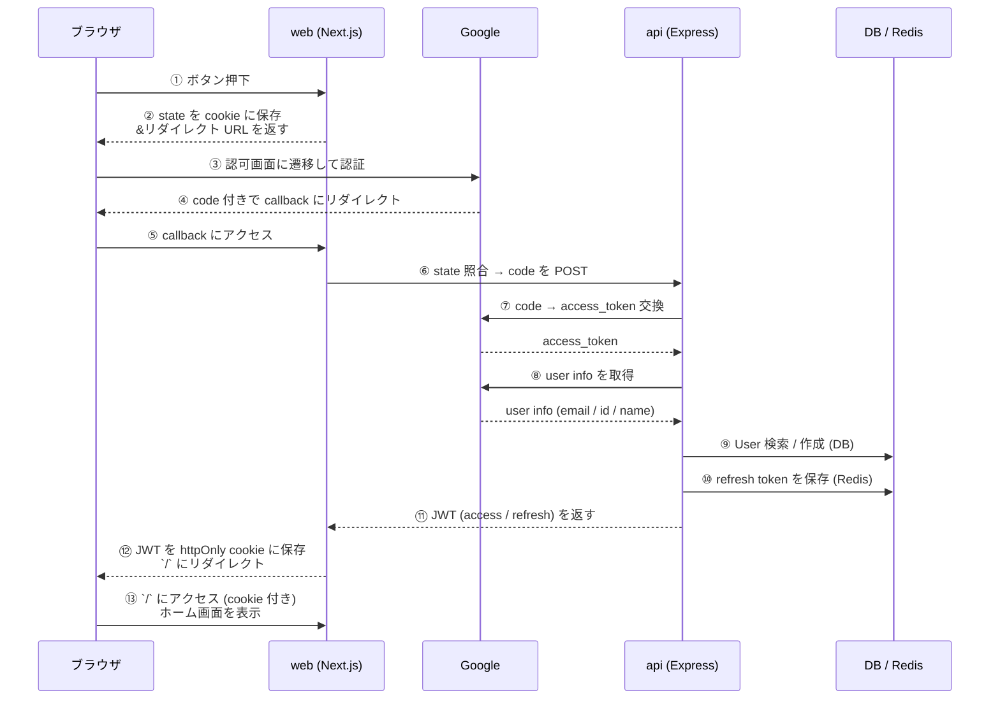

# 認証まわりのルール

認証は **Google OAuth でサインイン → 自前 JWT を発行**する方式。web が「ブラウザ ↔ api の翻訳役」として前段に立ち、api は「code をもらって JWT を返すだけ」のステートレスな変換器に保つ。

## 目次

- [サインインの流れ](#サインインの流れ)
  - [各ステップの補足](#各ステップの補足)
- [トークン設計](#トークン設計)
- [cookie と認証ガード](#cookie-と認証ガード)
- [access token の更新](#access-token-の更新)
- [なぜ web を間に挟むのか](#なぜ-web-を間に挟むのか)
- [URL の注意（Next.js Route Handler と Express の混同）](#url-の注意nextjs-route-handler-と-express-の混同)
- [セキュリティ設計のまとめ](#セキュリティ設計のまとめ)
- [新しいプロバイダを追加するには](#新しいプロバイダを追加するには)
- [関連ファイル](#関連ファイル)
- [関連ドキュメント](#関連ドキュメント)

## サインインの流れ



### 各ステップの補足

**前半: 認証情報の取得（①〜④）**

- **①〜②**: ユーザが「Googleでサインイン」ボタンを押すと、web は **state**（ランダム文字列）を cookie に保存して、Google の認可画面 URL を返す
- **③**: ブラウザが Google に遷移し、ユーザが認証
- **④**: 認証成功すると Google が **`code`**（使い捨てチケット）を付けて web の callback にリダイレクト

> 💡 `state` は **CSRF 対策**。攻撃者が他人を罠サイト経由で勝手にログインさせるのを防ぐ

**中盤: code を JWT に変換（⑤〜⑪）**

- **⑤〜⑥**: web は cookie の state と URL の state を照合（一致しなければエラー）。OK なら `code` を api に POST
- **⑦〜⑧**: api が `code` を Google に送って **access_token** に交換 → その token で **user info（メール・名前・ID）** を取得
- **⑨**: DB を検索して「この Google ID は既存ユーザ？」を判定。なければ新規作成（User + AuthAccount を1トランザクションで）
- **⑩〜⑪**: api が自前の **JWT を発行** → refresh は Redis に保存 → web に返す

**後半: cookie に保存して認証完了（⑫〜⑬）**

- **⑫**: web が JWT を **httpOnly cookie** に保存
- **⑬**: ホームに遷移。以降のリクエストは web の proxy が cookie の有無で認証ガード

## トークン設計

| トークン | 有効期限 | 保存先 | 用途 |
|---|---|---|---|
| **access token** | 15 分 | httpOnly cookie（`app_access_token`） | 各リクエストの認証 |
| **refresh token** | 7 日 | httpOnly cookie（`app_refresh_token`）+ jti を Redis 管理 | access の再発行 |

- Google の access_token は **使い捨て**。ユーザー情報取得後は破棄し、以降はすべて**アプリ独自の JWT** で認証する。
- refresh token の **jti を Redis で管理**することで、サーバー側から個別失効・ローテーション運用ができる。
- access が短命（15 分）なので漏洩時の影響時間を抑えつつ、利便性は refresh（7 日）で確保する。

## cookie と認証ガード

- JWT は **httpOnly cookie** に保存する（JavaScript から触れないので XSS で盗まれない）。cookie 操作は web 側（`apps/web/src/libs/auth.ts`）で完結させる。
- cookie は **`sameSite=lax`**（OAuth コールバックの cross-site 連鎖ナビゲーションでも送信されるようにするため）。
- 認証ガードは web の **proxy**（`apps/web/src/proxy.ts`。Next.js 16 で middleware から改名）が cookie の有無で行う。未認証は `/sign-in` へリダイレクト。access token の更新もここで行う（次の節）。
- CSRF 対策として **state**（ランダム文字列）を cookie に保存し、コールバック時に照合する。
- api 側は現状 `PUBLIC_PATHS` で認証要否を制御する。Admin API（`/api/admin/`）は現時点は認証なし（将来 Admin 専用認証を追加予定）。

## access token の更新

access token（15 分）の期限が近づいたら、**web の proxy** が refresh token で新しい access / refresh token を受け取る。api-client は更新しない。

```mermaid
flowchart TD
    A[リクエスト] --> C{access の cookie があり<br/>期限まで 30 秒以上?}
    C -- はい --> Z[そのまま通す]
    C -- いいえ --> D{refresh の cookie がある?}
    D -- いいえ --> P{公開パス?}
    P -- はい --> Z
    P -- いいえ --> S[/sign-in へ]
    D -- はい --> E[POST /api/auth/refresh]
    E -- 200 --> F[レスポンスに新しい cookie を付け<br/>リクエストの Cookie ヘッダーも書き換えて通す]
    E -- 401 --> Q{公開パス?}
    Q -- はい --> Z
    Q -- いいえ --> S
    E -- 5xx / 通信エラー --> Z
```

- **proxy で行う理由**: Next.js は Server Component の中で cookie を書き換えられない（Server Action と Route Handler だけ）。api-client で「401 なら refresh」をすると、api 側では refresh token が作り直されたのに cookie は古いままになり、次の refresh で失敗してセッションが切れる。proxy なら、レスポンスに新しい cookie を付けると同時に、同じリクエストの Cookie ヘッダーも書き換えて先に渡せるので、その画面の Server Component が新しい access token で api を呼べる
- **公開パスでも更新する**: ログイン中のユーザーが公開パス（`/memos` など）を開いたときも access token を新しくしておき、行動イベントに `user_id` が付くようにする。更新に失敗しても公開パスはそのまま通す
- **refresh が 401 でも cookie は消さない**: 同時に来た別のリクエスト（画面の先読みなど）が先に更新に成功していると、この refresh token はもう使用済み。ここで消すと、成功した側が付けた新しい cookie まで消える。`/sign-in` は有効な access の cookie があればトップに戻す
- **api の 401（更新した後でも弾かれた）**: api-client が `/api/auth/signout`（cookie を消す Route Handler）に送り、そこから `/sign-in` へ。cookie を消さずに `/sign-in` に送ると、`/sign-in` がトップに戻して往復が止まらなくなる。api-client の redirect は例外で実現しているので、認証必須の api の呼び出しを try/catch で囲むときは catch の先頭で `unstable_rethrow` する

## なぜ web を間に挟むのか

Google の `redirect_uri` を直接 Express api に向けず、web が前段で受けて api に転送する設計にしている。理由:

1. **JWT を httpOnly cookie に保存するのは Next.js 側のみ** — Express から `Set-Cookie` を返してもドメインが違うと保存させづらい（CORS / SameSite 制約）。
2. **state cookie の照合は web で完結** — web で発行した cookie を web で読む方がシンプル。
3. **api はステートレスに保てる** — api は「code もらって JWT を返すだけ」の純粋な変換器でいられる。

## URL の注意（Next.js Route Handler と Express の混同）

`/api/` で始まる URL でも Express api とは限らない。**Next.js の Route Handler も `/api/...` を使う**ので混同しないこと。

| URL | 実体 | サーバ | ファイル |
|---|---|---|---|
| `localhost:3000/api/auth/callback/google` | **Next.js Route Handler** | web (:3000) | `apps/web/src/app/api/auth/callback/google/route.ts` |
| `localhost:8080/api/auth/google` | **Express の POST エンドポイント** | api (:8080) | `apps/api/src/controller/auth/google.ts` |

Google に渡す `redirect_uri`（`apps/web/src/app/sign-in/actions.ts`）は `${NEXT_PUBLIC_APP_URL}/api/auth/callback/google` で、`NEXT_PUBLIC_APP_URL` は web の URL。
Next.js は `app/api/foo/route.ts` があると `/api/foo` を HTTP エンドポイントとして公開するので、この `/api/...` は web の Route Handler を指す。

## セキュリティ設計のまとめ

| 仕組み | 目的 |
|---|---|
| `code` → `access_token` の 2 段階交換 | パスワード相当の access_token をブラウザに渡さない |
| **state** cookie | CSRF 対策 |
| **httpOnly** cookie | XSS で JWT を盗まれない |
| **access(15分) + refresh(7日)** の 2 種類 | 漏洩時の影響を短時間化しつつ利便性を確保 |
| **Client Secret は api だけ**が持つ | ブラウザに漏れない |
| refresh の **jti を Redis 管理** | サーバー側で個別失効・ローテーション運用が可能 |
| cookie は **sameSite=lax** | OAuth コールバックの cross-site ナビでも cookie が送信される |

## 新しいプロバイダを追加するには

GitHub / Apple / X 等を追加する場合、`apps/api/src/client/*-oauth.ts` を新設して `AuthAccount.provider` の文字列を増やすだけで対応できる。`auth-service.ts` の既存ユーザー検索 / JWT 発行 / refresh 保存ロジックは**プロバイダ非依存**に作られている。

## 関連ファイル

**web (Next.js)**
- `apps/web/src/app/sign-in/page.tsx` — サインインボタン
- `apps/web/src/app/sign-in/actions.ts` — `startGoogleOAuth`（Server Action）
- `apps/web/src/app/api/auth/callback/google/route.ts` — Google callback Route Handler
- `apps/web/src/libs/auth.ts` — cookie 操作（`setAuthCookies` ほか）と access token の期限の判定
- `apps/web/src/proxy.ts` — 認証ガードと access token の更新
- `apps/web/src/libs/api-client.ts` — api の呼び出し（401 なら `/api/auth/signout` へ）
- `apps/web/src/app/api/auth/signout/route.ts` — cookie を消して `/sign-in` へ

**api (Express)**
- `apps/api/src/controller/auth/google.ts` — `POST /api/auth/google`
- `apps/api/src/service/auth-service.ts` — `authenticateWithGoogle` / `refreshTokens` / `logout`
- `apps/api/src/client/google-oauth.ts` — Google OAuth クライアント
- `apps/api/src/lib/jwt.ts` — JWT 発行・検証
- `apps/api/src/repository/redis/refresh-token-repository.ts` — refresh token の Redis 永続化
- `apps/api/src/repository/drizzle/auth-account-repository.ts` — User と AuthAccount の DB 操作

## 関連ドキュメント

| ドキュメント | 内容 |
|---|---|
| [`../../apps/api/CLAUDE.md`](../../apps/api/CLAUDE.md) | Admin API 設計方針 / PUBLIC_PATHS |
| [`../../apps/web/CLAUDE.md`](../../apps/web/CLAUDE.md) | web の API 通信ルール（Server Component / Server Action / Route Handler の使い分け） |
