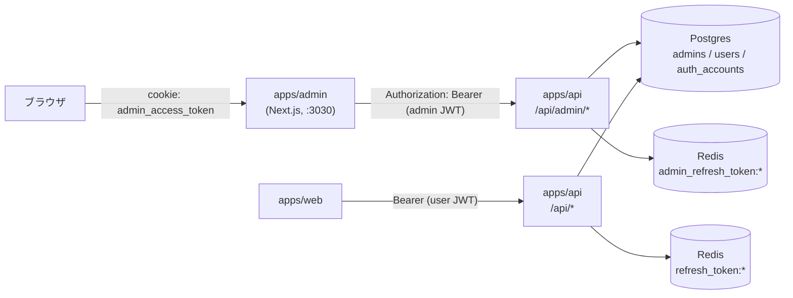
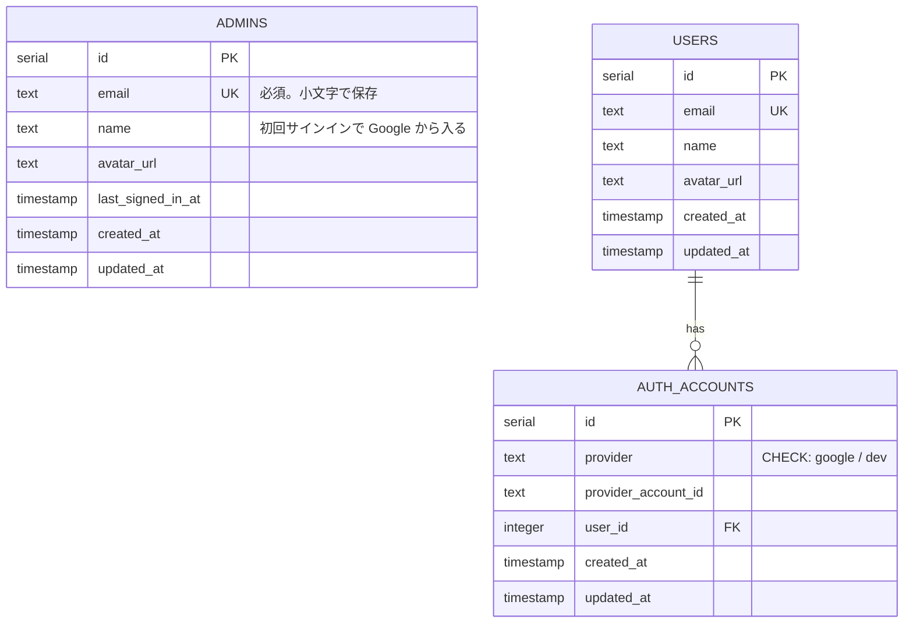
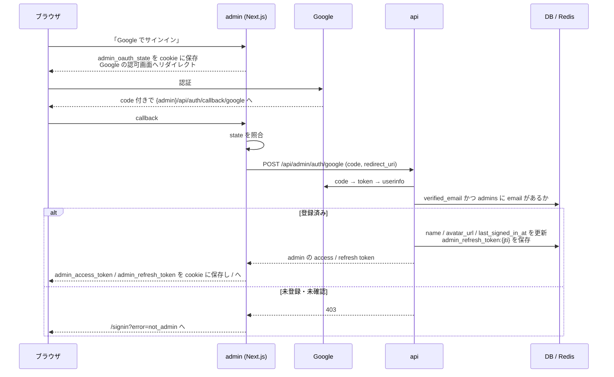
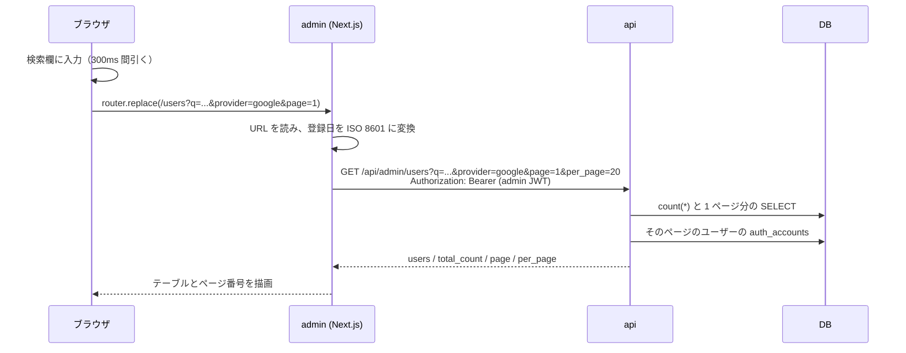

# admin-template

`apps/admin` を、実プロジェクトにコピーしてそのまま使い始められる管理画面のテンプレートにする。今の `apps/admin` は TailAdmin のデモ画面がそのまま入っており、認証が無く、API にも繋がっていない。どのプロジェクトでも最初に「デモを消す」「ヘッダーを作り直す」「認証を足す」が必要になっている。

この機能では、デモと土台を分け（消すときは決まったディレクトリを消すだけにする）、admin 専用の認証（`admins` テーブル）を入れる。その上で、API に繋いだユーザー管理画面を「一覧・検索・絞り込み・詳細」の見本として 1 つ作る。ヘッダーの通知・ユーザーメニュー・検索は、データを外から渡す作りに変える。共通の UI 部品として Tooltip も足す。

このドキュメントは **仕様（What）** と **設計（How）** を分けて記述する：

- **仕様**：ユーザーから見える挙動・ルール・データの意味
- **設計**：実装にあたっての技術的な選択と制約

## 関連 spec

- [`../dev-login/README.md`](../dev-login/README.md) — admin の dev ログインは同じ作り（seed 済みの admin で、Google を通さずにログインする）
- [`../../onboarding/auth.md`](../../onboarding/auth.md) — 一般ユーザーの認証（Google OAuth → 自前 JWT）。admin 認証は同じ流れで、鍵・cookie・テーブルを分ける

## 目次

- [仕様](#仕様)
  - [デモと土台](#デモと土台)
  - [アプリ名・ロゴ・表示の設定](#アプリ名ロゴ表示の設定)
  - [Tooltip](#tooltip)
  - [admin のサインイン](#admin-のサインイン)
  - [admin の登録](#admin-の登録)
  - [ユーザー管理](#ユーザー管理)
  - [ヘッダー](#ヘッダー)
  - [マイページ](#マイページ)
- [設計](#設計)
  - [全体構成](#全体構成)
  - [デモの置き場所](#デモの置き場所)
  - [アプリの設定ファイル](#アプリの設定ファイル)
  - [Tooltip の作り](#tooltip-の作り)
  - [admin 認証](#admin-認証)
  - [admin の JWT の鍵の配布](#admin-の-jwt-の鍵の配布)
  - [admin の登録コマンド](#admin-の登録コマンド)
  - [ユーザー一覧の検索・絞り込み・ページング](#ユーザー一覧の検索絞り込みページング)
  - [DataTable のサーバー側モード](#datatable-のサーバー側モード)
  - [ヘッダーへのデータの渡し方](#ヘッダーへのデータの渡し方)
  - [ADMIN_USE_DUMMY の廃止](#admin_use_dummy-の廃止)
  - [MVP 対象外（将来検討）](#mvp-対象外将来検討)
- [必要な画面](#必要な画面)
- [必要な API](#必要な-api)
- [必要な DB 設計](#必要な-db-設計)
- [フロー図](#フロー図)
- [step 一覧](#step-一覧)

---

## 仕様

### デモと土台

- TailAdmin のデモ画面（ダッシュボードの EC サンプル、カレンダー、フォーム・テーブル・UI 部品・グラフの見本、サインアップ画面など）は、URL `/demo/...` の下にまとめる。サイドバーでは「デモ」という見出しの下に並べる
- デモの画面は、UI 部品の使い方の見本として残す。実プロジェクトで要らなくなったら、[消す手順](#デモの置き場所)のとおり決まったディレクトリと依存を消すだけで、土台の画面は壊れない
- ホーム（`/`）は空のダッシュボードにする。実プロジェクトで中身を作る

### アプリ名・ロゴ・表示の設定

- アプリ名・説明・ロゴ・言語・タイムゾーンを 1 つの設定ファイルで変えられる。サイドバー・ヘッダー・サインイン画面のロゴとアプリ名、ブラウザのタブのタイトル（`<ページ名> | <アプリ名>`）がすべてここから決まる
- 言語は日本語（`lang="ja"`）。土台の画面の文言（サイドバーの見出し、ヘッダーのメニューなど）は日本語にする。デモの画面の文言は TailAdmin のまま（英語）
- 日時はすべて設定のタイムゾーン（既定は `Asia/Tokyo`）で表示する

### Tooltip

- 要素にマウスを乗せる、またはキーボードでフォーカスすると、説明の吹き出しが出る。外れると消える。Esc キーでも消える
- 吹き出しの位置は上・右・下・左から選べる。画面の端で切れるときは反対側に出る
- 種類は TailAdmin のデモと同じ 4 つ（白・黒・矢印なしの黒・矢印なしの白）。見た目はデモと同じにする（ライト / ダークの両方）
- デモに Tooltip の見本の画面を足す。土台の画面でも、ユーザー一覧の列見出し（ログイン方法）の説明に使う

### admin のサインイン

- サインイン画面には「Google でサインイン」ボタンだけを置く。`admins` に email が登録されている Google アカウントだけがサインインできる
  - 登録されていない Google アカウントでは「このアカウントには管理画面の権限がありません」と表示し、サインインさせない
  - Google 側で email が確認済みでないアカウントもサインインさせない
- サインインした admin の名前とアイコンは、サインインのたびに Google のものに更新される。最終サインイン日時も記録する
- 一般ユーザー（`users`）としてのサインインと admin のサインインは完全に別。一般ユーザーのトークンでは admin の画面にも API にも入れない（逆も同じ）
- ログイン状態は、操作が無くても 7 日間保たれる（一般ユーザーと同じ。15 分ごとに裏で更新する）。ユーザーメニューの「ログアウト」でいつでも終えられる
- ローカルなど production 以外では、サインイン画面に「dev admin でログイン」ボタンを出す。seed で入れた dev 用の admin として、Google を通さずにログインできる

### admin の登録

- 管理画面から admin を追加する画面は作らない（[MVP 対象外](#mvp-対象外将来検討)）
- 本番の admin は、GitHub Actions の「Admin Create」workflow に環境と email を入れて実行して登録する。最初の 1 人も 2 人目以降も同じ手順
- 登録済みの email をもう一度登録しても何も変わらない（エラーにもならない）

### ユーザー管理

サイドバーの「ユーザー管理」から開く。一般ユーザー（`users`）の一覧と詳細を見る画面で、編集・削除はしない。

**一覧（`/users`）**

| 列 | 内容 |
| --- | --- |
| ユーザー | アイコン + 名前（名前が無ければ「名前未設定」） |
| メールアドレス | email（無ければ「-」） |
| ログイン方法 | 使っているログイン方法のバッジ（Google / 開発用）。複数あれば並べる。列見出しに Tooltip で説明を付ける |
| 登録日時 | `YYYY/MM/DD HH:mm` |

- 検索欄に入れた文字で、名前と email を部分一致（大文字小文字を区別しない）で絞る。入力を止めて 0.3 秒後に反映する
- 「Filter」を押すと条件の入力欄が出て、「適用」で反映する。条件が入っているとボタンに件数のバッジが付き、「リセット」で外せる
  - ログイン方法: すべて / Google / 開発用
  - 登録日: 開始日と終了日（どちらか片方でもよい）。両端の日を含む
- 並び順は登録日時の新しい順で固定
- 1 ページの件数は 10 / 20 / 50 から選べる（既定 20）。フッターに「全 N 件中 X〜Y 件」とページ番号を出す
- 検索語・絞り込み・ページ・件数は URL に残る。リロード・URL の共有・ブラウザの戻るで同じ状態に戻る。条件を変えると 1 ページ目に戻る
- 該当が 0 件なら「該当するユーザーがいません」と表示する
- 行をクリックすると、そのユーザーの詳細に移る

**詳細（`/users/{id}`）**

- 基本情報: ID / アイコン / 名前 / email / 登録日時 / 更新日時
- ログイン方法: 紐付いているログイン方法と、それぞれを紐付けた日時
- 「一覧に戻る」で、開く前の検索条件の一覧に戻る
- 存在しない ID なら「ユーザーが見つかりません」の画面を出す

### ヘッダー

- **通知**: ベルを押すと通知の一覧が出る。未読があればベルに印が付く。「すべて既読にする」で印が消える。通知の中身（何を通知するか、どこから取るか）はプロジェクトごとに作るため、テンプレートでは通知の元を持たず、常に「通知はありません」と表示する
- **ユーザーメニュー**: サインイン中の admin のアイコン・名前・email を出す。メニューは「マイページ」と「ログアウト」
- **検索**: 検索欄に入れて Enter を押すと、ユーザー一覧をその語で検索した状態で開く。⌘K（Windows は Ctrl+K）で検索欄にフォーカスする

### マイページ

- サインイン中の admin の情報（アイコン・名前・email・登録日時・最終サインイン日時）を表示する。名前とアイコンは Google のものなので、ここでは編集しない

---

## 設計

### 全体構成

admin は DB を直接触らず、Next.js のサーバー側（Server Component / Route Handler / Server Action）から Express の `/api/admin/*` を呼ぶ。ブラウザから API へは直接通信しない（web と同じ原則）。

api の中では、admin 用の認証ミドルウェアを `/api/admin` の mount の中に置き、そこを通らないと admin の Router に届かないようにする。一般ユーザー用の認証ミドルウェアは `/api/admin/*` を対象から外す。Controller / Service / Repository は共通のものを使い、admin 専用のものだけを足す（`apps/api/CLAUDE.md` の Admin API 設計方針）。

### デモの置き場所

デモは route group（`(demo)`）ではなく **URL も `/demo/...` に分ける**。route group は URL に出ないので、デモの `/profile`（TailAdmin のプロフィール見本）や `/signin`（email + パスワードのフォーム見本）が、土台のマイページやサインイン画面と同じ URL になってぶつかる。

| 置き場所 | 中身 |
| --- | --- |
| `src/app/(dashboard)/demo/` | サイドバー付きのデモ画面 |
| `src/app/(auth)/demo/` | サインイン・サインアップのフォームの見本 |
| `src/components/demo/` | デモの画面だけが使う部品（`components/features/example/` などから移す） |
| `src/components/demo/demo-nav-items.tsx` | サイドバーの「デモ」の項目 |
| `public/images/demo/` | デモだけが使う画像 |

土台（`src/components/ui/` など）はデモを import しない。逆向き（デモ → 土台）だけを許す。これを lint で強制し（`import/no-restricted-paths`）、デモを消したときに土台が壊れないことを保証する。

**実プロジェクトでデモを消す手順**（`apps/admin/README.md` に書く）:

1. 上の表のディレクトリを消す
2. `AppSidebar.tsx` から「デモ」の項目の import を消す
3. `package.json` からデモだけが使う依存を消し、`pnpm install` する（一覧は step1）

### アプリの設定ファイル

`src/config/app.ts` にアプリ名・説明・言語・タイムゾーンを置く。ロゴは `AppLogo` 部品にまとめ、既定ではアプリ名の頭文字のアイコン + アプリ名の文字で描く（画像を差し替えなくてもアプリ名を変えればロゴも変わる）。画像のロゴを使うプロジェクトは `AppLogo` の中身を差し替える。

- ページの `<title>` は root layout の `metadata.title.template`（`%s | <アプリ名>`）で組み立て、各ページは自分の名前だけを `title` に書く
- favicon は `public/favicon.svg` に置き、root layout の `metadata.icons` で指す（`app/icon.svg` にすると、`*.svg` を React 部品に変える svgr の設定と衝突するおそれがある）
- フォントは TailAdmin の Outfit を残し、日本語は `Hiragino Sans` / `Noto Sans JP` 系にフォールバックさせる
- 日時の表示は `formatDateTime()`（`Intl.DateTimeFormat` + 設定のタイムゾーン）に集約する。Server Component はサーバーのタイムゾーン（本番は UTC のことが多い）で動くため、`toLocaleString()` を直接使わない

### Tooltip の作り

`@floating-ui/react` を使う。TailAdmin のデモの Tooltip は `@floating-ui/dom`（同じライブラリの DOM 版）で作られており、見た目だけでなく動き（位置の決め方・反転・はみ出しの補正）も同じにするため。

- 吹き出しは `body` の直下に出す（`FloatingPortal`）。CSS の `absolute` だけで作ると、`overflow: hidden` の親（DataTable の枠など）の中で切れる。ユーザー一覧の列見出しで使うので、これは避けられない
- 位置はデモと同じ設定（トリガーとの間 10px、はみ出したら反対側へ反転、画面端から 8px 内側へずらす）
- hover・focus・Esc・`aria-describedby` は floating-ui の interaction hooks（`useHover` / `useFocus` / `useDismiss` / `useRole`）に任せる
- 見た目（色・角丸・余白・矢印・影）は TailAdmin のデモから実測した値に合わせる（step3）

### admin 認証

一般ユーザーの認証（[`docs/onboarding/auth.md`](../../onboarding/auth.md)）と同じ流れ（Google OAuth → api が code を検証 → 自前の JWT → httpOnly cookie）で、次を分ける。

| | 一般ユーザー | admin |
| --- | --- | --- |
| テーブル | `users` + `auth_accounts` | `admins` |
| JWT の payload | `{ userId }` | `{ adminId }` |
| JWT の鍵 | `JWT_ACCESS_SECRET` / `JWT_REFRESH_SECRET` | `JWT_ADMIN_ACCESS_SECRET` / `JWT_ADMIN_REFRESH_SECRET` |
| refresh token の Redis のキー | `refresh_token:{jti}` | `admin_refresh_token:{jti}` |
| api の認証ミドルウェア | `authMiddleware`（全体に適用。`/api/admin/*` は見ない） | `adminAuthMiddleware`（`app.use("/api/admin", adminAuthMiddleware, adminRouter(...))` で mount の中だけに適用） |
| cookie | `app_access_token` / `app_refresh_token` / `app_oauth_state` | `admin_access_token` / `admin_refresh_token` / `admin_oauth_state` / `admin_oauth_redirect` |
| Google の redirect URI | `{web}/api/auth/callback/google` | `{admin}/api/auth/callback/google` |

- **鍵を分ける理由**: 権限の境界を「種別の確認を忘れないこと」ではなく、鍵の違いで守る。一般ユーザーのトークンは admin の鍵の検証で必ず失敗する。加えて、env の検証で admin の鍵が一般ユーザーの鍵と同じ値なら起動を止め、admin のトークンの検証では payload の `adminId` が数値であることも確かめる（鍵を写し間違えたときの保険）
- **admin のミドルウェアを mount の中に置く理由**: Express 5 の mount（`app.use("/api/admin", ...)`）は URL の大文字小文字を区別しない。全体に適用するミドルウェアで `req.path` を文字列で比べると、`/API/Admin/users` が admin の判定をすり抜けて Router に届く。mount の中に置けば、Router に届くリクエストは必ず admin の認証を通る（見落としても閉じる側に倒れる）
- **cookie 名を分ける理由**: cookie はポートが違っても同じホストなら共有される。ローカルの web（:3000）と admin（:3030）が同じ名前だと上書きし合う
- **admin の判定は email**: Google の userinfo の `verified_email` が `true` で、その email（小文字にそろえる）が `admins` にあれば admin とする。`verified_email` が無い応答は未確認として扱う。`admins` は事前登録制で、ログイン時に行を作ることはない
- **トークンの有効期限**は一般ユーザーと同じ env（`JWT_ACCESS_EXPIRATION` / `JWT_REFRESH_EXPIRATION`）を使う
- refresh / logout の処理は `service/auth-service.ts` の `refreshTokens` / `logout` をそのまま使う（検証関数・発行関数・Repository を引数で受け取る作りになっているため、admin 用のものを渡すだけでよい）。logout は refresh token だけを受け取る公開のパスにする（access token が切れていてもログアウトできるように）

**トークンの更新（refresh）は proxy で行う。** Next.js は Server Component の中で cookie を書き換えられない（Server Action と Route Handler だけ）。web の api-client のように「api が 401 なら refresh して cookie を書き直す」を Server Component から呼ぶと、api 側で refresh token は作り直されたのに cookie は古いまま、という状態になりセッションが切れる。そのため admin では次のように分ける。

- `proxy.ts`: access の cookie が無い（または期限まで 30 秒を切っている。payload を検証せずに読んで `exp` を見る）かつ refresh の cookie があれば、`/api/admin/auth/refresh` を呼ぶ。成功したら、レスポンスに新しい cookie を付け、同じリクエストの Cookie ヘッダーも書き換えて先に渡す（その画面の Server Component が新しい access token で api を呼べる）
- refresh が 401 のときは cookie を消さずに `/signin?redirect=...` へ送る。同時に来た別のリクエストが先に refresh に成功していることがあり（refresh token は 1 回使うと無効になる）、ここで消すと成功した側の新しい cookie まで消すため。サインイン画面は有効な access の cookie があれば `redirect` に戻す
- api-client（`libs/api-client.ts`）は Bearer を付けて呼ぶだけで、refresh も cookie の書き込みもしない。401 は `ApiClientError` で投げ、画面（layout）がサインイン画面に送る

web の api-client にも同じ問題がある（Server Component からの refresh で cookie を書けず、`page.tsx` の try/catch で隠れている）。この機能では直さない。

### admin の JWT の鍵の配布

`JWT_ADMIN_ACCESS_SECRET` / `JWT_ADMIN_REFRESH_SECRET` を、今の JWT の鍵と同じ経路に足す。

| 場所 | 対応 |
| --- | --- |
| `apps/api/src/env.ts` | 必須（`min(32)`）として足す |
| `apps/api/.env.local` | dotenvx で足す |
| `apps/api/test/vitest.setup.ts` / `turbo.json`（`test:ci` の `env`） | テスト用の既定値と、CI で渡すキーに足す |
| Terraform `env/{dev,min,prd}/main.tf` | `random_password` を 2 つ足し、`module.app_secrets` の `initial_values` と ECS の `secret_keys.api` に足す |
| `.github/workflows/deploy-aws-min.yml` | Lambda に渡す `SECRET_KEYS_JSON` に足す |
| `scripts/deploy/seed-secrets.sh` | Secrets Manager に無ければ生成して足す（既にあれば触らない）。今の secret の読み込みに失敗したら止める（今は失敗を `{}` として扱うため、生成した鍵だけで secret 全体を上書きしてしまう） |

**既存の環境では Terraform だけでは鍵が入らない。** `module.app_secrets` は初回 apply でしか `initial_values` を書かない（以降は `ignore_changes`）。一方で ECS は Secrets Manager に無いキーを参照するとタスクの起動に失敗する。そのため既存の環境は次の順で反映する（step4 に手順を書く）。

1. `scripts/deploy/seed-secrets.sh <env>` で鍵を Secrets Manager に足す
2. Terraform を apply する（`secret_keys` が増える）
3. deploy する（新しい api が鍵を読む）

### admin の登録コマンド

`packages/db` に `admin:create` コマンド（`pnpm --filter @repo/db admin:create --email <email>`）を作る。`admins` に email を upsert するだけで、名前とアイコンは初回サインイン時に Google から入る。

本番では、deploy 済みの migration イメージを ECS の one-shot タスクで起動する仕組み（`.github/actions/run-deployed-migration`）に、起動コマンドを差し替える入力を足し、`admin-create.yml`（workflow_dispatch: 環境・email）から `admin:create` を流す。

- migration イメージは `packages/db` 一式と `tsx` を含むので、イメージを増やさずに済む。ただし `@repo/domain`（`normalizeEmail` / `AUTH_PROVIDERS`）は `dist/` を読むので、`Dockerfile.migration` のビルドの対象に `@repo/db` の依存を足す
- 実行の記録は GitHub Actions のログに残る（email も入力として残る）
- ローカルは seed で `admin@dev.local` を入れる。dev ログインはこの admin でログインする

### ユーザー一覧の検索・絞り込み・ページング

検索・絞り込み・ページングはサーバー側（api）で行う。ユーザーは増え続けるため、全件をブラウザに渡さない。

- **ページング**: ページ番号で移動する画面なので、`page` / `per_page` のオフセット方式にする（既存の共通スキーマのカーソル方式は「もっと見る」向き）。総件数は同じ条件の `count(*)` で取る。`per_page` は 1〜100
- **並び順**: `created_at` の降順、同じなら `id` の降順（ページをまたいで順序がぶれないように一意にする）
- **検索**: `name` と `email` に `ILIKE '%語%'`。入力中の `%` `_` `\` はエスケープして文字そのものとして扱う。件数が増えて遅くなったら `pg_trgm` の索引を足す（今回はしない）
- **ログイン方法**: `EXISTS (SELECT 1 FROM auth_accounts WHERE user_id = users.id AND provider = ?)`。値の集合は `@repo/domain` に `AUTH_PROVIDERS`（`google` / `dev`）として足し、api-schema の `z.enum` と `auth_accounts.provider` の `CHECK` 制約をそこから作る（`packages/domain/README.md` の方針）
- **登録日**: 画面では日付（`YYYY-MM-DD`、両端を含む）で持ち、api には設定のタイムゾーンでの日の始まりを ISO 8601（オフセット付き）で渡す。api は `created_from` 以上・`created_before` 未満で絞る（終了日は「翌日の 0 時より前」に変換する）。タイムゾーンの変換を api に持たせないため、api は日時の範囲だけを受け取る
- **一覧の各行のログイン方法**: そのページのユーザー ID で `auth_accounts` をまとめて引いて付ける（行ごとに引かない）

### DataTable のサーバー側モード

`components/ui/table/DataTable.tsx` に `server` の props を足す。指定しないときは今のまま（受け取った配列をブラウザ側で絞る）。

- `server` を指定すると、検索語・絞り込み・ページ・件数を URL の検索パラメータで持つ。入力が変わったら `router.replace` で URL を書き換え、ページ（Server Component）が URL を読んで api を呼び直す。`data` はその 1 ページ分、総件数は `server.totalCount` で受け取る
- 中では、状態の持ち方だけが違う 2 つの部品（URL で持つ / state で持つ）が、同じ見た目の部品を描く。`useSearchParams()` は server モードの部品の中だけで呼ぶ（client モードの静的なページで `<Suspense>` が要らないように）
- 検索語の反映は 300ms 間引く（debounce）。条件を変えたら `page` を外して 1 ページ目に戻す
- 絞り込みの種類に「期間（`dateRange`）」を足す（server モードだけ）。既存の select と同じポップオーバーに、開始日・終了日の入力（既存の `DatePicker`）を並べる
- Filter のポップオーバーと日付の入力のカレンダーは、Tooltip と同じく `body` の直下に出す（`@floating-ui/react` / flatpickr の `static: false`）。表の枠の `overflow-hidden` の中に置くと、行が少ないときに切れる
- client モードの見本として、デモに `DataTable` を使う表（`/demo/tables/data-table`）を足す（今は `DataTable` を使う画面が無い）
- 行のリンク（`getRowHref`）を足す。行のクリックで遷移し、名前のセルは `Link` にしてキーボードでも辿れるようにする
- 該当 0 件の表示（`emptyMessage`）を足す
- 絞り込みは、ポップオーバーの「適用」で反映する（デモと同じ）。期間の開始・終了をそろえてから 1 回だけ api を呼ぶため
- 見た目を TailAdmin のデモに合わせ直す。今の `DataTable` / `Pagination` は TailAdmin の無料版と独自の調整が混ざっており、デモ（検索・Filter・ページング付きの表 `/products-list` と、表示件数の選択がある `/data-tables`）と枠線・検索欄・Filter ボタン・ポップオーバー・ページ番号が違う。どの部分をどちらに合わせるかは step6
- デモのページ番号には不具合がある（最後のページのボタンが出ない、0 件で「1 to 0」と出る）。これは合わせずに直す

### ヘッダーへのデータの渡し方

`(dashboard)/layout.tsx` を Server Component にし、サインイン中の admin（`GET /api/admin/me`）と通知を取ってから、クライアント側のシェル（`AdminShell`: サイドバー・ヘッダー・本文の枠）に props で渡す。サイドバーの開閉状態は今の Context のまま。

| 部品 | props |
| --- | --- |
| `UserDropdown` | `admin`（名前・email・アイコン） |
| `NotificationDropdown` | `notifications`（id・本文・リンク・日時・既読）、`markAllAsReadAction`（Server Action、省略可） |
| `HeaderSearch` | `action`（検索の遷移先のパス）、`placeholder`。省略すると検索欄を出さない |

- 通知は `features/notification/notification.api.ts` の `notificationApi.getList()` で取る。テンプレートでは空配列を返すだけにし、プロジェクトで API に繋ぐ。既読の処理（`markAllAsRead`）も同じファイルに置き、Server Action（`markAllAsReadAction`）を layout → `AdminShell` → `AppHeader` → `NotificationDropdown` と props で渡す
- api の 401（refresh も済んだ上での 401）は layout でサインイン画面に送る
- 検索は `<form action="/users">` の GET 送信にする（JavaScript が無くても動き、URL は一覧の検索と同じ `?q=` になる）

### ADMIN_USE_DUMMY の廃止

`ADMIN_USE_DUMMY`（DB なしでダミーデータを返すモード）は、ドキュメントにだけ書かれていて実装が無い。ローカルは docker compose + seed で本物のデータが揃い、admin 認証が入ると admins テーブル無しでは画面を開けなくなるため、作らずに消す。`apps/api/src/env.ts` の定義と、`apps/admin/CLAUDE.md` / `apps/admin/README.md` / `apps/api/CLAUDE.md` の記述を消す。`docs/onboarding/auth.md` の「Admin API は現時点は認証なし」も admin 認証の説明に書き換える（step5）。

### MVP 対象外（将来検討）

以下は今回作らない。必要になったプロジェクトで足す。

- admin を管理画面から追加・削除する画面（今回は `admin:create` コマンドだけ）
- admin の権限（role）。今回は `admins` にいれば全権限
- 通知の実体（テーブル・API・リアルタイム配信）
- ユーザーの編集・停止・削除
- 一覧の並び替え（列見出しのクリック）、CSV 出力
- 名前・email の検索の索引（`pg_trgm`）
- admin の操作の監査ログ

---

## 必要な画面

| 画面 | パス | 概要 |
| --- | --- | --- |
| サインイン | `/signin` | Google でサインイン。production 以外は dev admin でのログインも出す |
| ホーム | `/` | 空のダッシュボード（プロジェクトで作る） |
| ユーザー一覧 | `/users` | 検索・絞り込み・ページング。行から詳細へ |
| ユーザー詳細 | `/users/{id}` | 基本情報とログイン方法 |
| マイページ | `/profile` | サインイン中の admin の情報 |
| デモ | `/demo/...` | TailAdmin の画面と UI 部品の見本（Tooltip の見本を含む） |

## 必要な API

admin（Next.js）のサーバー側からだけ呼ぶ。`/api/admin/auth/google` / `refresh` / `logout` / `dev-login` 以外は admin の access token が必要（logout は refresh token で本人を確かめる）。

| メソッド | パス | 説明 |
| --- | --- | --- |
| POST | `/api/admin/auth/google` | Google の code を検証し、`admins` に登録された email なら admin のトークンを返す（未登録は 403） |
| POST | `/api/admin/auth/refresh` | admin の refresh token をローテーションする |
| POST | `/api/admin/auth/logout` | admin の refresh token を無効にする |
| POST | `/api/admin/auth/dev-login` | production 以外だけ。seed 済みの admin のトークンを返す |
| GET | `/api/admin/me` | サインイン中の admin |
| GET | `/api/admin/users` | ユーザー一覧（`q` / `provider` / `created_from` / `created_before` / `page` / `per_page`） |
| GET | `/api/admin/users/:id` | ユーザー詳細（ログイン方法を含む） |

admin（Next.js）側の Route Handler:

| メソッド | パス | 説明 |
| --- | --- | --- |
| GET | `/api/auth/callback/google` | Google からの戻り先。state を照合し、api で code を検証して cookie に保存する |
| GET | `/api/dev/login` | production 以外だけ。dev admin でログインする |

リクエスト・レスポンスの形は step4（認証・`/me`）/ step6（ユーザー）に書く。

## 必要な DB 設計

| テーブル | 主要カラム | 説明 |
| --- | --- | --- |
| `admins`（新設） | `id`, `email`（一意・必須）, `name`, `avatar_url`, `last_signed_in_at`, `created_at`, `updated_at` | 管理画面にサインインできる人。`users` とは関係を持たない |
| `auth_accounts`（変更） | `provider` に `CHECK (provider IN ('google', 'dev'))` を足す | 値の集合は `@repo/domain` の `AUTH_PROVIDERS` |

## フロー図

**admin のサインイン**

**ユーザー一覧の検索**

## step 一覧

1 step = 1 PR。上から順に積む（後の step は前の step に依存する）。admin 認証は api 側（DB・鍵・Terraform・workflow を含む）と画面側で PR を分ける。

| step | 内容 | 主な対象 |
| --- | --- | --- |
| [step1](./tasks/step1-admin-demo-isolation.md) | デモを `/demo` に分け、ホームを空にする。使われていない依存・画像を消す | admin |
| [step2](./tasks/step2-admin-app-config.md) | アプリ名・ロゴ・言語・タイムゾーンを設定ファイルにまとめる | admin |
| [step3](./tasks/step3-admin-tooltip.md) | Tooltip の部品とデモの見本 | admin |
| [step4](./tasks/step4-api-admin-auth.md) | `admins` テーブル・admin 認証の api・鍵の配布・登録コマンドと workflow・`ADMIN_USE_DUMMY` の廃止 | domain / db / schema / api / infra / CI |
| [step5](./tasks/step5-admin-auth-screens.md) | サインイン画面・cookie・proxy・api-client・ログアウト | admin |
| [step6](./tasks/step6-admin-user-management.md) | ユーザー管理（一覧・詳細）と DataTable のサーバー側モード | domain / db / schema / api / admin |
| [step7](./tasks/step7-admin-header.md) | ヘッダーの通知・ユーザーメニュー・検索にデータを外から渡す。マイページ | admin |
