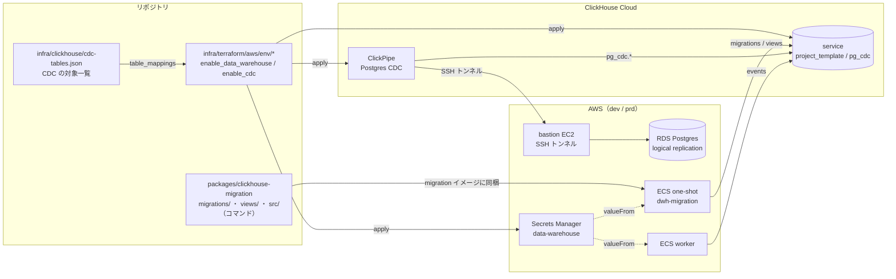
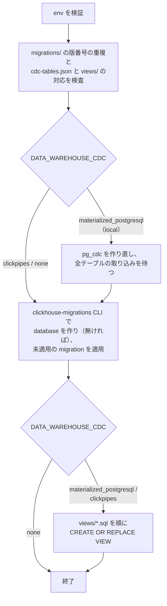
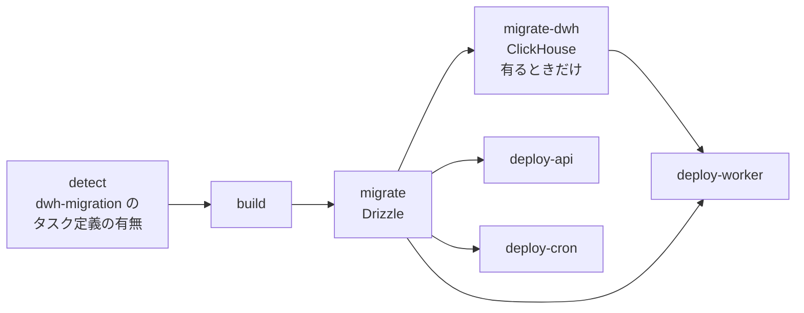
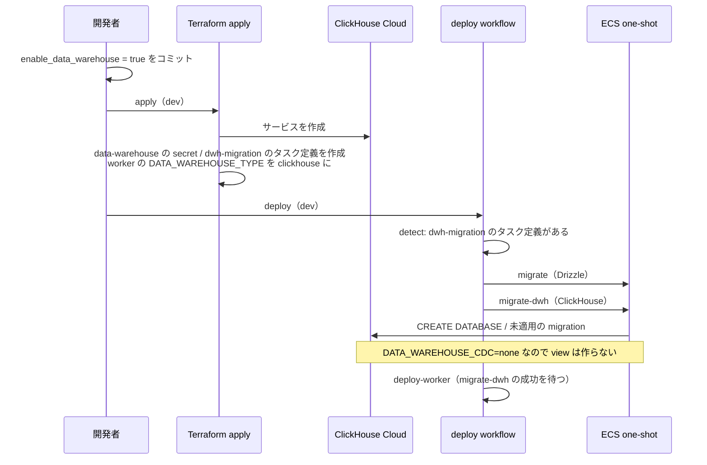
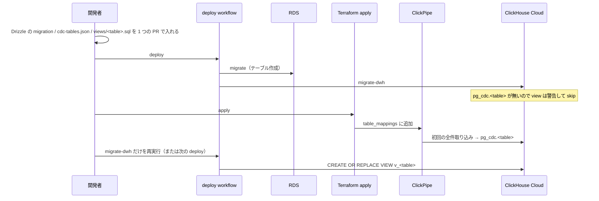

# ClickHouse の migration と環境ごとの有効化

ClickHouse に置くテーブル・view を **Postgres と同じように版管理して、local / dev / min / prd に同じ手順で適用できるようにする。** あわせて、dev でも ClickHouse を持てるようにし、どの環境に ClickHouse と CDC（Postgres からの同期）を作るかを Terraform のフラグで切り替える。deploy はそのフラグを見て、ClickHouse の migration を流すかどうかを判定する。

現状、ClickHouse の DDL は `infra/clickhouse/init/` に置かれ、docker の初回起動時（volume が空のとき）にしか実行されない。適用の履歴が無いため既存のローカル環境には変更が届かず、ClickHouse Cloud（prd）には適用する手段そのものが無い。また ClickHouse Cloud のサービスは Terraform の管理外で、接続情報は dummy の placeholder のまま置かれている。

このドキュメントは **仕様（What）** と **設計（How）** を分けて記述する：

- **仕様**：環境ごとの構成、ClickHouse に置くものの種類、変更のケースごとに開発者がやること、deploy での判定
- **設計**：migration ツール、migration コマンドの処理、環境の差の吸収、Terraform と deploy workflow の構成

## 関連 spec

- [`../user-behavior-events/README.md`](../user-behavior-events/README.md) — `events` テーブルの出どころ。テーブル定義の置き場所が `infra/clickhouse/init/` から本 spec の migration に移る
- [`../minimal-deploy/README.md`](../minimal-deploy/README.md) — min 環境。「Terraform のフラグを唯一の正本にし、deploy は AWS のリソースの有無で判定する」作法（`enable_worker`）を本 spec でも踏襲する
- [`../../../packages/data-warehouse/README.md`](../../../packages/data-warehouse/README.md) — ClickHouse を採用した理由、CDC と view を経由する規約の正本。本 spec の実装でホスティングの表と CDC の手順を更新する
- [`./deferred-cdc-operations.md`](./deferred-cdc-operations.md) — MVP 対象外。min の CDC、専用のレプリケーションユーザー、replication slot の監視など

## 目次

- [仕様](#仕様)
  - [環境ごとの構成](#環境ごとの構成)
  - [ClickHouse に置くもの](#clickhouse-に置くもの)
  - [変更のケースごとの作業](#変更のケースごとの作業)
  - [ローカルでの使い方](#ローカルでの使い方)
  - [deploy での判定](#deploy-での判定)
  - [制約](#制約)
  - [スコープ外](#スコープ外)
- [設計](#設計)
  - [全体構成](#全体構成)
  - [migration ツール](#migration-ツール)
  - [migration コマンドの処理](#migration-コマンドの処理)
  - [環境の差の吸収](#環境の差の吸収)
  - [ローカルの CDC](#ローカルの-cdc)
  - [ClickHouse Cloud のサービス（Terraform）](#clickhouse-cloud-のサービスterraform)
  - [CDC（ClickPipes）](#cdcclickpipes)
  - [deploy への組み込み](#deploy-への組み込み)
  - [secret と環境変数](#secret-と環境変数)
  - [既存ファイルの扱い](#既存ファイルの扱い)
  - [リスクと実装時の確認事項](#リスクと実装時の確認事項)
  - [MVP 対象外（将来検討）](#mvp-対象外将来検討)
- [必要な画面](#必要な画面)
- [必要な API](#必要な-api)
- [必要な DB 設計](#必要な-db-設計)
- [フロー図](#フロー図)
- [実装ステップ](#実装ステップ)

---

## 仕様

### 環境ごとの構成

**ClickHouse を作るか（`enable_data_warehouse`）と、CDC を張るか（`enable_cdc`）を、環境ごとに Terraform の変数で選ぶ。** 2 つに分けているのは、CDC を張るには RDS の設定変更と ClickPipes からの接続経路が要り、「行動イベントだけ見たい」場面と切り離したいため。`enable_cdc` は `enable_data_warehouse` が `true` のときだけ有効にできる。

| | local | dev | min | prd |
| --- | --- | --- | --- | --- |
| ClickHouse | docker compose（常にある） | `enable_data_warehouse`（既定 `false`）。`true` なら ClickHouse Cloud | 同左（既定 `false`） | 同左（既定 `true`） |
| CDC | MaterializedPostgreSQL（常にある） | `enable_cdc`（既定 `false`）。`true` なら ClickPipes | **なし**（MVP 対象外） | `enable_cdc`（既定 `true`）。ClickPipes |
| worker の書き込み先 | ClickHouse | フラグが `false` なら書かない（`DATA_WAREHOUSE_TYPE=none`） | 同左 | 同左 |
| ClickHouse の migration | 手元でコマンドを実行 | deploy で実行（フラグが `true` のときだけ） | 同左 | 同左 |

- **フラグが `false` の環境には ClickHouse 関連のリソースを 1 つも作らない。** 費用は今と変わらない
- `enable_data_warehouse` を `true` にしても、ClickHouse Cloud はアイドル時に止まる設定にするため、使っていない間の費用はほぼストレージ代だけになる
- **`enable_cdc` を `true` にすると、月 $80 強の固定費が増える。** 内訳は ClickPipes の CDC 用の計算資源（Basic tier で $0.10/時、約 $73/月。ClickPipe がある間はサービスのアイドルに関係なくかかる）と bastion（EC2、月 $10 未満）。加えて取り込んだデータ量に応じた課金（初回 $0.10/GB、以降 $0.20/GB）がある
- min は現在 `DATA_WAREHOUSE_TYPE=clickhouse`（接続先は dummy で insert は失敗し続ける）になっている。本 spec の既定値 `false` で `none` に変わる
- 切り替えは min の `enable_worker` と同じく、`variables.tf` の既定値を変えてコミットし、Terraform の apply → deploy の順に流す（CI の apply は変数を渡さないため）

### ClickHouse に置くもの

ClickHouse に置くものは 4 種類あり、それぞれ管理のしかたが違う。

| 種類 | 例 | 置き場所 | 適用のしかた |
| --- | --- | --- | --- |
| **版管理する migration** | `events` テーブル、将来のマテリアライズドビュー・集計テーブル | `packages/clickhouse-migration/migrations/` | 各ファイルを **1 回だけ** 適用する。適用済みかどうかは ClickHouse 内の履歴テーブルに記録する |
| **CDC の view** | `v_users` / `v_memos` | `packages/clickhouse-migration/views/` | migration を流すたびに **全部作り直す**（`CREATE OR REPLACE VIEW`） |
| **CDC の対象テーブルの一覧** | `users` / `memos` | `infra/clickhouse/cdc-tables.json` | local は migration コマンドが、Cloud は Terraform の apply が反映する |
| **CDC のテーブル本体** | `pg_cdc.users` | （取り込み側が作る） | migration からは作らない・変えない。消すときだけ migration で消す |

- **view を作り直しても過去のデータは消えない。** 通常の view はデータを持たず、中身は保存された SELECT 文だけだから。データは CDC のテーブル本体にある
- **「毎回作り直す」のは CDC の view だけにする。** マテリアライズドビューは作り直し方によってデータが消えるため、版管理する migration に入れて 1 回だけ適用する
- 分析クエリは今までどおり CDC のテーブル本体ではなく `v_*` の view を参照する（規約の正本は `packages/data-warehouse/README.md`）

### 変更のケースごとの作業

Postgres（Drizzle）の変更と同じ PR で、ClickHouse 側に必要な変更も入れる。

| ケース | Postgres | CDC の対象一覧（`cdc-tables.json`） | ClickHouse（`migrations/` / `views/`） | 反映の順序（dev / prd） |
| --- | --- | --- | --- | --- |
| 1. CDC 対象テーブルの追加 | テーブルを作る | テーブル名を足す | `views/<table>.sql` を足す | deploy（テーブル作成）→ apply（ClickPipe に追加し、初回の取り込み）→ ClickHouse の migration を再実行（view 作成） |
| 2. テーブルの名前変更・削除 | **2 回に分けて出す。** 1 回目は ClickHouse 側だけ。2 回目で Postgres を変える | 1 回目で外す | 1 回目: `views/<table>.sql` を消し、`DROP VIEW IF EXISTS` の migration を足す。2 回目: `DROP TABLE IF EXISTS pg_cdc.<table>` の migration を足す。名前変更なら 2 回目に新しい名前でケース 1 も行う | 1 回目: deploy → apply（ClickPipe から外す）→ 2 回目: deploy |
| 3. 列の追加 | 列を足す | 不要 | **不要** | deploy のみ。ClickHouse に列が増えた後の migration 実行で view に出る |
| 4. 列の型・名前の変更 | 型・名前を変える | 不要 | 不要 | deploy → ClickPipe 全体を再同期（ClickHouse Cloud のコンソールの Resync）→ ClickHouse の migration を再実行 |
| 5. 列の削除 | 列を消す | 不要 | 消した列名を view の除外列に足す | deploy のみ |
| 6. ClickHouse だけの変更 | - | - | `migrations/` にファイルを足す | deploy のみ |

- **ローカルは どのケースでも Postgres の migration（`pnpm --filter api db:migrate`）→ ClickHouse の migration の順に流すだけでよい。** ローカルの migration コマンドは CDC を毎回作り直す（[後述](#ローカルの-cdc)）ため、テーブルや列の変更に自動で追いつく
- ケース 1 で view の元テーブルがまだ ClickHouse に無いとき（初回の取り込み前）、migration コマンドはその view だけ作らずに警告を出して成功する。次の実行で作られる
- ケース 3 で ClickPipes が ClickHouse 側に列を足すのは、**そのテーブルに次の書き込みが来たとき**。それまでは view にも出ない
- ケース 4 では、Resync が終わるまでその間の変更が ClickHouse に届かない。Resync は新しいテーブルを裏で作ってから入れ替えるため、view が空になる時間は無い
- ケース 2 の名前変更では、新しい名前のテーブルの初回の取り込みが終わるまで、新しい名前の view が無い
- 手順の詳細は step3（CDC）と step4（deploy）に書く

### ローカルでの使い方

```bash
docker compose up -d
pnpm --filter api db:migrate                       # Postgres
pnpm --filter @repo/clickhouse-migration migrate   # ClickHouse（events / CDC / view）
```

- これまでの `docker exec ... 03-postgres-cdc-views.sh` は不要になる
- **ClickHouse の migration は何度実行してもよい。** 版管理する migration は未適用のものだけを流し、CDC と view は毎回作り直す

### deploy での判定

- **判定の正本は Terraform のフラグだけにする。** `enable_data_warehouse = true` の環境にだけ ClickHouse の migration 用の ECS タスク定義を作り、deploy workflow はそのタスク定義があるかどうかで migration の job を実行するか skip するかを決める。GitHub 側に同じ設定は持たない
- CDC の有無は Terraform がタスクの環境変数で渡し、migration コマンドが view を作るかどうかを決める。**ClickPipe の作成・同期対象の変更は deploy ではなく Terraform の apply で行う**
- ClickHouse の migration が失敗しても **api の deploy は止めない**（分析用のため）。worker は ClickHouse に書き込むので、migration の成功を待ってから deploy する
- skip した場合は GitHub の画面で job が skipped として見える

### 制約

- CDC は非同期。Postgres の変更が ClickHouse に届くまで、ローカルは数秒、ClickPipes は同期間隔（60 秒に設定する）程度かかる
- ClickHouse の DDL にはトランザクションが無い。版管理する migration の途中で失敗すると、それまでの文は適用されたまま残り、次回はそのファイルを最初からやり直す。**DDL は `IF NOT EXISTS` / `IF EXISTS` で何度流しても同じ結果になるように書く**
- 適用済みの migration ファイルは書き換えない（チェックサムが変わるとコマンドがエラーで止まる）。直すときは新しいファイルを足す

### スコープ外

- min の CDC（PlanetScale Postgres を ClickPipes の取り込み元にする）
- 再同期（ケース 4）や同期対象の付け外し（ケース 1・2）を deploy で自動化すること
- ClickHouse の migration の down（巻き戻し）

詳細は [`./deferred-cdc-operations.md`](./deferred-cdc-operations.md)。

---

## 設計

### 全体構成



| 構成要素 | 置き場所 | 内容 |
| --- | --- | --- |
| migration コマンド | `packages/clickhouse-migration`（新設、`@repo/clickhouse-migration`） | 版管理する migration の適用、ローカルの CDC の作り直し、view の作り直し |
| CDC の対象一覧 | `infra/clickhouse/cdc-tables.json`（新設） | ClickPipe の `table_mappings`（Terraform）とローカルの CDC（migration コマンド）の両方が読む唯一の一覧 |
| ClickHouse Cloud | `modules/clickhouse-service`（新設） | サービス、パスワード、接続情報の secret |
| CDC | `modules/clickpipes-postgres-cdc`（新設）/ `modules/rds`（パラメータグループを追加） | ClickPipe、SSH の鍵、bastion、RDS の論理レプリケーション |
| migration の実行 | `modules/ecs-workload`（既存）で one-shot のタスク定義 `{env}-dwh-migration` | `enable_data_warehouse` のときだけ作る |
| deploy | `deploy-aws-{dev,min,prd}.yml` | タスク定義の有無を見て `migrate-dwh` job を実行 / skip |

`packages/data-warehouse` には DDL を持ち込まない。同パッケージは「書き込み経路の抽象」で、DDL はバックエンドの方言そのものなので抽象化の対象外とする方針（`data-warehouse.ts` のコメント）を維持する。

### migration ツール

**版管理する migration には npm の [`clickhouse-migrations`](https://github.com/VVVi/clickhouse-migrations)（MIT、v1.5.0 以上）を使う。** view の作り直しとローカルの CDC は自前のコードで足す。

| 候補 | 採否 | 理由 |
| --- | --- | --- |
| Drizzle | ✗ | ClickHouse に対応していない（ClickHouse dialect の PR #6125 は未マージ） |
| **clickhouse-migrations** | **採用** | worker と同じ `@clickhouse/client`（HTTPS 8443）で動き、pnpm と既存の migration イメージ（Node）にそのまま載る。無料 |
| Atlas | ✗ | ClickHouse のドライバは有料の Atlas Pro だけ（dev / min / prd で約 $98/月〜）。対象が events と view 数個の規模では宣言的管理の利点が費用に見合わない |
| goose | ✗ | Go のバイナリを migration イメージと各開発者の手元に入れる必要がある。Cloud へは native の 9440 |
| dbmate | ✗ | SQL に環境変数を差し込めない。後続の文が失敗しても適用済みとして記録される不具合が未解決（issue #675） |
| golang-migrate | ✗ | HTTPS で繋げない。既定の履歴テーブル（TinyLog）が ClickHouse Cloud で使えない |

`clickhouse-migrations` の使い方で注意する点:

- **ライブラリとして呼ばず、CLI を子プロセスで起動する。** ライブラリの関数はエラー時に `process.exit(1)` するため、呼び出し元で後続の処理やログを制御できない
- ファイル名は `<版番号>_<説明>.sql`（例: `1_create_events.sql`）。版番号は `UInt32` で、**タイムスタンプ形式（14 桁）は桁あふれする**ので連番にする。同じ版番号が 2 つあっても検知されないため、migration コマンドが実行前に重複を検査する
- 履歴は `<database>._migrations`（MergeTree。Cloud では自動で SharedMergeTree になる）。ファイルの md5 を記録し、適用済みのファイルが変わるとエラーで止まる
- ロックは無い。deploy は workflow の `concurrency` で環境ごとに直列化されているため問題にならない
- SQL への環境変数の差し込み（`CH_MIGRATIONS_SUBSTITUTE_ENV`）は使わない。版管理する migration は環境に依存しない DDL だけにする（環境で変わるのは CDC の view だけで、それは自前で処理する）

### migration コマンドの処理

`pnpm --filter @repo/clickhouse-migration migrate`（コンテナでは同じスクリプトをタスク定義の `command` で起動）は、次の順に処理する。



- **ローカルの CDC の作り直しを最初にやる。** 版管理する migration に `DROP TABLE IF EXISTS pg_cdc.<table>`（ケース 2）が入っていても、ローカルではその時点でテーブルがもう無く、何もせずに通るようにするため（MaterializedPostgreSQL のテーブルを直接 DROP させない）
- **版管理する migration は view より先に流す。** view が参照する可能性のあるテーブル（将来の集計テーブル等）を先に揃えるため
- view の元テーブル（`pg_cdc.<table>`）が無いとき、local ではエラー（取り込みを待った上で無いのは異常）、Cloud では警告して skip（ケース 1 の初回の取り込み前）
- `cdc-tables.json` にあるのに `views/<table>.sql` が無い、またはその逆はエラーにする。一覧と view のずれを PR の段階で気づけるようにする
- 消えた view の後片付け（ケース 2）は自動ではやらず、版管理する migration に `DROP VIEW IF EXISTS` を書く。view を名前のパターンで自動削除すると、手で作った view を巻き込むため

### 環境の差の吸収

**view の名前・列・型は環境間で揃え、定義だけを変える。** CDC の実装によってメタ列と削除の表現が違うため、view の SQL に置き換え用の変数を置き、migration コマンドが `DATA_WAREHOUSE_CDC` に応じて埋める。

| 変数 | `materialized_postgresql`（local） | `clickpipes`（dev / prd） |
| --- | --- | --- |
| `${CDC_DATABASE}` | `pg_cdc` | `pg_cdc`（ClickPipe の出力先 DB を同じ名前にする） |
| `${CDC_META_COLUMNS}` | `_sign, _version` | `_peerdb_synced_at, _peerdb_is_deleted, _peerdb_version` |
| `${CDC_LIVE_FILTER}` | `_sign = 1` | `_peerdb_is_deleted = 0` |

```sql
-- views/users.sql
CREATE OR REPLACE VIEW v_users AS
SELECT * EXCEPT (${CDC_META_COLUMNS}) REPLACE (toUInt64(id) AS id)
FROM ${CDC_DATABASE}.users FINAL
WHERE ${CDC_LIVE_FILTER}
```

- **`SELECT *` で定義し、毎回作り直す。** ClickHouse の view の列は作成時に固定されるため（実機で確認。元テーブルに列を足しても view に出ず、列を消すと view を読むクエリが落ちる）、作り直すことで Postgres 側の列の増減に追いつく
- **列の削除（ケース 5）は `EXCEPT` に列名を足して隠す。** ClickPipes は削除した列を ClickHouse 側に残す（以降は NULL）が、ローカルでは列ごと無くなる。`EXCEPT`（STRICT を付けない形）は無い列を無視するので、同じ定義が両方で動く（実機で確認）
- 置き換えの構文は `${NAME}`。未定義の変数があればエラーにする
- 型合わせ（`toUInt64(id)`）と `FINAL`・削除行の除外を view に閉じ込める理由は `packages/data-warehouse/README.md` の「view を経由する規約」のとおり

### ローカルの CDC

**ローカルの migration コマンドは、CDC の database（`pg_cdc`）を毎回消して作り直す。**

- MaterializedPostgreSQL は、Postgres 側で列の追加・削除・型の変更があると、そのテーブルの同期を止める（`Table users is skipped from replication stream because its structure has changes`）
- ClickHouse のドキュメントは「テーブルを `DETACH ... PERMANENTLY` して `ATTACH` し直す」ことで戻せるとしているが、**ClickHouse 24.10 で試すと、付け直した後の変更が反映されなかった**（replication slot の位置は進むが、テーブルに行が入らない）
- `DROP DATABASE pg_cdc SYNC` → `CREATE DATABASE` で作り直すと、replication slot と publication も作り直され、全件を取り込み直した上でその後の変更も反映される（実機で確認）
- ローカルのデータは seed 程度なので、毎回の全件取り込みは数秒で終わる。作り直しは「付け直しが要るか」の判定より単純で、判定漏れも無い
- 作り直しの後、`cdc-tables.json` の全テーブルが ClickHouse に現れるまで待つ（最大 60 秒）。現れなければ「Postgres にテーブルが無い。`db:migrate` を先に実行する」旨を出して失敗する
- MaterializedPostgreSQL が接続する Postgres の情報（docker のネットワーク内のホスト名 `postgres:5432` など）は migration コマンドの env の既定値に持つ
- `infra/clickhouse/users.d/materialized-postgresql.xml`（experimental 機能の有効化）はそのまま残す
- **作り直す前に、既にある `pg_cdc` がこのプロジェクトの Postgres（ホストと DB 名）を取り込むものか確かめ、違えば消さずに止める。** 同じテンプレートから作った別プロジェクトの ClickHouse が同じポート（8124）で動いていると、接続先を取り違えたまま別プロジェクトの CDC を消してしまうため（実装中に、turbo が環境変数を渡さず既定の接続先に繋がって実際に起きた）

### ClickHouse Cloud のサービス（Terraform）

**ClickHouse 公式の Terraform provider（`ClickHouse/clickhouse`）で、サービスを `enable_data_warehouse` のときだけ作る。** 新設の `modules/clickhouse-service` にまとめる。

- サービスは環境ごとに 1 つ（例: `project-template-dev`）。AWS `ap-northeast-1`
- **Basic tier を前提にする。** `tier` は指定しない（新しい tier の organization では指定してはいけない）。メモリは Basic の固定値に合わせて `min_replica_memory_gb = max_replica_memory_gb = 8`（provider が必須にしている）
- アイドル時に止める（`idle_scaling = true`、`idle_timeout_minutes = 15`）
- パスワードは `random_password` で作り、サービスには書き込み専用の `password_wo` で、Secrets Manager には secret の値として渡す。`random_password` の値は tfstate に残るが、JWT の鍵と同じく S3 の暗号化で保護する前提（既存方針）
- 接続を許可する IP（`ip_access`）は、dev / prd は NAT Gateway の固定 IP（worker と migration のタスクはここから出る）、min は `0.0.0.0/0`（タスクに付く public IP が毎回変わるため。パスワードで守る）
- データベース（`project_template`）は Terraform では作らず、`clickhouse-migrations` が `CREATE DATABASE IF NOT EXISTS`（ENGINE を指定しない。Cloud では自動で Shared になる）で作る。ローカルと同じ経路にする

**provider の認証情報。** organization ID と API キー（key / secret）を GitHub Environment の secret に置き、Terraform の apply の workflow が `TF_VAR_*` で渡す。

- provider は、ClickHouse のリソースが 0 個でも**空でない**認証情報を要求する（API は呼ばない）。そのため provider には `coalesce(var.clickhouse_org_id, "unused")` のように渡し、フラグが `false` の環境では secret を置かなくても plan / apply が通るようにする
- フラグが `true` なのに認証情報が無いときは、`clickhouse_service` の `precondition` で分かりやすいエラーにする
- **既存のサービスを消す（フラグを `true` → `false`）ときは本物の認証情報が要る。** 削除に API を呼ぶため
- Terraform CI（`terraform-aws-env-ci.yml`）も dev / min を plan するので、apply の workflow と同じく `TF_VAR_*` を渡す（ClickHouse のリソースの refresh に API を呼ぶため）。フラグが `false` の環境では secret が未設定のまま通る。`.terraform.lock.hcl` に ClickHouse provider のハッシュを足す（`-lockfile=readonly` のため）

### CDC（ClickPipes）

**ClickPipe も Terraform で作る。** 同期するテーブルは `infra/clickhouse/cdc-tables.json` を `jsondecode(file(...))` で読んで `table_mappings` にする。

| 項目 | 内容 |
| --- | --- |
| 取り込み元 | RDS Postgres 16 の `project_template` DB、`public` スキーマ（`type = "rdspostgres"`） |
| 出力先 | 同じサービスの `pg_cdc` database（テーブル名は Postgres と同じ） |
| 方式 | `replication_mode = "cdc"`（初回に全件を取り込み、以降は論理レプリケーション）。publication と replication slot は ClickPipes が作る |
| 同期間隔 | 60 秒（`sync_interval_seconds`）。取り込むデータが無ければサービスはアイドルのまま |
| 認証 | RDS のマスターユーザー。パスワードは app secret の `DB_PASSWORD` を ephemeral で読み、書き込み専用の `password_wo` で渡す（RDS と同じ。tfstate に残らない）。専用ユーザーは MVP 対象外（後述） |
| 接続経路 | SSH トンネル（bastion EC2） |

- ClickPipe は同期対象の変更（`table_mappings` の追加・削除）を 1 回の apply で反映する（provider が一時停止・再開する）。既存の mapping の設定は変えられず、外す → apply → 戻す（= 再取り込み）になる
- **apply が成功しても ClickPipe が `Failed` のことがある。** provider は作成時に `Failed` を警告で済ませるため、apply の後に `state` の output を確認する手順を入れる
- **再同期（ケース 4）は Terraform でやらない。** provider の `trigger_resync` は「`true` にすると再同期し、state では `false` に戻る」ため、設定に残すと apply のたびに再同期が走る。ClickHouse Cloud のコンソールの Resync ボタンで行う
- サービスを作り直すと、SSH の鍵 → bastion → ClickPipe の順に作り直しが連鎖し、全件の再取り込みになる。サービスの属性を変える plan では replace が出ていないか確認する

**RDS の論理レプリケーションは `enable_cdc` に関係なく常に有効にする。**

- `rds.logical_replication = 1` は再起動が要るパラメータで、`enable_cdc` に連動させると「apply → 再起動 → もう一度 apply（ClickPipe 作成）」の 2 段になる
- 常に有効にしておけば、パラメータグループを入れるときの **1 回だけ** 再起動すれば、以降は `enable_cdc` を切り替えるだけで済む。ローカルの docker compose が常に `wal_level=logical` なのとも揃う
- replication slot が無い間は WAL を溜め込まないので、常に有効にしても WAL の量が少し増える程度
- **slot が保持できる WAL に上限（`max_slot_wal_keep_size`）を付ける。** ClickPipe が止まったまま気づかないと WAL が溜まり続け、ディスクが埋まると Postgres の書き込みが止まる。上限を超えると slot が無効になって CDC は止まるが、DB は止まらない（再同期で戻せる）。値は割り当てストレージの 1/4 程度（20 GB なら 5 GB）

**接続経路は SSH トンネルにする。** RDS は外に出られない isolated subnet にあり、ClickHouse Cloud から直接は届かないため。

- public subnet に bastion（`t4g.nano`、Amazon Linux 2023、Elastic IP 付き）を置き、ClickPipes の固定 IP（`ap-northeast-1` の 6 個）からだけ 22 番を許可する。bastion から RDS へは 5432 だけ許可する
- SSH の鍵は provider の `clickhouse_clickpipes_ssh_key` で作る。鍵ペアは ClickHouse Cloud が作り、秘密鍵は外に出ない。公開鍵を cloud-init で bastion の専用ユーザー（`clickpipes`）の `authorized_keys` に入れる
- 鍵の接続先に bastion の IP が要り、bastion の user_data に公開鍵が要るため、Elastic IP を先に作って循環を切る
- bastion には SSH のポートフォワード以外をさせない（`PermitOpen` で転送先を RDS の 5432 に絞り、TTY・エージェント転送・X11 を禁止する）
- ClickPipe は bastion の cloud-init が終わってから作る（`time_sleep` で待つ）
- ClickPipes の固定 IP は provider から取れないため、Terraform の変数に一覧で持つ（[公式の一覧](https://clickhouse.com/docs/integrations/clickpipes/networking/static-ips)。2026-04-15 以降に作ったサービスが対象）
- PrivateLink は ClickHouse Cloud の Basic tier で使えない可能性が高く、AWS 側の時間課金（約 $73/月相当）もかかるため採らなかった

**認証にマスターユーザーを使う理由。** app もすでにマスターユーザーで接続しており、専用ユーザーを作るには「Terraform がパスワードを作る → VPC 内から `CREATE ROLE` する → その後に ClickPipe を作る」という順序の制御が要る。MVP では単純さを取り、最小権限の専用ユーザーは将来検討にする。ClickPipes が publication を作るにはテーブルの所有者である必要があり、テーブルは Drizzle の migration（マスターユーザー）で作られるので条件を満たす。

### deploy への組み込み



- **detect**: `aws ecs describe-task-definition --task-definition <prefix>-dwh-migration` が成功すれば `dwh_enabled=true`。min は既存の detect job（worker の有無）に足す
- **migrate-dwh**: Drizzle の `migrate` の後に、同じ migration イメージで one-shot タスクを起動する（タスク定義の `command` で ClickHouse のコマンドを指定）。ケース 1 で view の元テーブルが Postgres に先にできている必要があるため、Drizzle の後にする
- **deploy-worker** は `migrate` と `migrate-dwh` の両方を待つ。`migrate-dwh` が skip のときも進める（`!cancelled()` と各 job の結果で条件を書く）
- **deploy-api / deploy-cron** は今までどおり `migrate` だけを待つ
- 「タスク定義を最新のイメージで register → run-task → 停止を待つ → 終了コードで成否を判定し、失敗ならログを出す」処理は `migrate` と同じなので、composite action（`.github/actions/run-one-shot-task`）に切り出して両方から使う
- **イメージは既存の migration イメージ（`project-template-migration`）に同梱する。** ECR リポジトリと `account/` 層の権限を増やさずに済む。`packages/db/Dockerfile.migration` の `turbo prune` の対象に `@repo/clickhouse-migration` を足す

### secret と環境変数

ClickHouse の接続情報は、Terraform が管理する専用の secret（`/<prefix>/data-warehouse`）に置く。

| キー | 値 |
| --- | --- |
| `DATA_WAREHOUSE_URL` | `https://<サービスのホスト>:8443` |
| `DATA_WAREHOUSE_USER` | `default` |
| `DATA_WAREHOUSE_PASSWORD` | `random_password` の値 |
| `DATA_WAREHOUSE_DATABASE` | `project_template` |

- 今の app secret（`/<prefix>/app`）は初回の apply のあと Terraform が触らない（`ignore_changes`）ため、Terraform が作るサービスの接続情報を後から書き込めない。そのため分ける
- prd / min の app secret の `initial_values` にある dummy の `DATA_WAREHOUSE_*` を消し、worker の `secret_keys` からも外す。既存環境の secret に残っている dummy の値は使われなくなるだけで害は無い
- `modules/ecs-workload` に、app secret 以外の secret から値を引くための変数（`additional_secrets`、環境変数名 → `valueFrom`）を足す。既定値は空で、既存の plan に差分は出ない
- `modules/ecs-cluster` の `secret_arns_readable` に data-warehouse の secret を足す（タスク実行ロールが読めるようにする）

| 変数 | 対象 | 値 |
| --- | --- | --- |
| `DATA_WAREHOUSE_TYPE` | worker | `enable_data_warehouse` が `true` なら `clickhouse`、`false` なら `none` |
| `DATA_WAREHOUSE_URL` / `USER` / `PASSWORD` / `DATABASE` | worker / dwh-migration | data-warehouse の secret から（`enable_data_warehouse` のときだけ） |
| `DATA_WAREHOUSE_CDC` | dwh-migration | `enable_cdc` が `true` なら `clickpipes`、`false` なら `none`。ローカルの既定値は `materialized_postgresql` |

### 既存ファイルの扱い

| ファイル | 扱い |
| --- | --- |
| `infra/clickhouse/init/01-events.sql` | `packages/clickhouse-migration/migrations/1_create_events.sql` に移す（中身は同じ。DB 名の修飾は外す） |
| `infra/clickhouse/init/02-postgres-cdc.sql` | 削除。migration コマンドが作る |
| `infra/clickhouse/init/03-postgres-cdc-views.sh` | 削除。`views/*.sql` と migration コマンドに置き換える |
| `docker-compose.yaml` | ClickHouse の `docker-entrypoint-initdb.d` の mount を外す |
| ルートの `README.md` / `docs/setup/api.md` | セットアップ手順の `docker exec ... 03-postgres-cdc-views.sh` を migration コマンドに置き換える |
| `packages/db/README.md` | DB の作り直し手順の「CDC を張り直す」を migration コマンドに置き換える |
| `packages/data-warehouse/README.md` | ホスティングの表（dev は持たない → フラグで選ぶ）と CDC の手順を更新する |

既存のローカル環境の ClickHouse には、init スクリプトで作られた `events` テーブルと view がすでにある。migration の DDL は `IF NOT EXISTS` なので、そのまま migration コマンドを流せば履歴に記録されて揃う（volume を作り直す必要は無い）。

### リスクと実装時の確認事項

| リスク | 確認方法 | だめだった場合 |
| --- | --- | --- |
| Basic tier の organization で、メモリ 8 / 8 GB の指定が API に拒否される | step2 で dev に apply する | エラーに出る値に合わせる |
| ClickPipe が出力先の database（`pg_cdc`）を自動では作らない | step3 で dev に apply し、ClickPipe の `state` と `pg_cdc` の有無を確認する | 出力先を `default` にし、migration コマンドの `clickpipes` の `CDC_DATABASE` を `default` に変える |
| ClickPipe の作成時に、論理レプリケーションが有効になっていない（RDS の再起動漏れ） | step3 で apply の前に `SHOW wal_level` が `logical` か確認する手順を入れる | RDS を再起動してから apply し直す |
| ClickPipes が RDS の証明書を既定で信頼せず、TLS で失敗する | step3 で ClickPipe の `state` を確認する | `ca_certificate` に RDS のリージョンの CA バンドルを渡す |
| SSH の鍵の検証（`active` になること）が ClickPipe の作成より遅れる、または鍵の API が organization で使えない | step3 で鍵の `status` と ClickPipe の `state` を確認する | `time_sleep` を延ばす。使えなければ判断し直す（PrivateLink か IP 許可リスト） |
| ローカルで、同じテンプレートから作った別プロジェクトの ClickHouse に誤って繋ぐ（既定のポートが同じ） | step1 で、別の DB を取り込む `pg_cdc` があると消さずに止まることを確認する | ― （作り直しの前の確認で防ぐ） |
| min の ClickHouse Cloud が `0.0.0.0/0` を許可しているため、インターネットのスキャンでアイドルから起こされて費用が増える | min で有効にした後、ClickHouse Cloud の使用量を 1 週間見る | min の worker を固定 IP（NAT）経由にするか、min では ClickHouse を使わない |
| ClickHouse Cloud の Shared database で `CREATE OR REPLACE VIEW` が一瞬 view を消す | step4 で dev に対して、migration を流しながら view を読み続けて失敗しないか確認する | 分析クエリは数秒のリトライで十分なので、README に注意を書くだけにする |
| ClickPipe の列の反映（ケース 3）が遅れ、view に新しい列が出ないまま気づかない | step4 の動作確認で、列を足した後に書き込み → migration の再実行で view に出ることを確認する | ClickHouse の migration だけを流す workflow を手動で実行できるようにする |
| ClickPipes の固定 IP が変わり、bastion に繋がらなくなる | ClickPipe の状態を ClickHouse Cloud のコンソールで確認する運用にする | IP の一覧を Terraform の変数にしてあるので、更新して apply する |

### MVP 対象外（将来検討）

以下は MVP では実装しない。CDC を本番の分析に使い始めた時点、または運用で困った時点で着手する。

- min の CDC（PlanetScale Postgres を取り込み元にする。PlanetScale Postgres 自体が ClickPipes では early access）
- 最小権限の専用レプリケーションユーザー
- replication slot のラグの監視とアラート
- ケース 1・2・4 の付け外し・再同期を deploy で自動化すること
- CI（PR）で ClickHouse の migration を実際の ClickHouse に流して検証すること
- Drizzle の migration が CDC 対象のテーブルを変えたときに、ClickHouse 側の変更漏れを CI で検知すること

詳細：[`./deferred-cdc-operations.md`](./deferred-cdc-operations.md)

---

## 必要な画面

なし（インフラと開発基盤の変更のみ）。

## 必要な API

なし。

## 必要な DB 設計

Postgres のスキーマは変えない。ClickHouse に置くもの:

| database | オブジェクト | 種類 | 管理 |
| --- | --- | --- | --- |
| `project_template` | `events` | ReplacingMergeTree（定義は今と同じ） | 版管理する migration（`1_create_events.sql`） |
| `project_template` | `v_users` / `v_memos` | view | 毎回作り直す（`views/*.sql`） |
| `project_template` | `_migrations` | MergeTree（`clickhouse-migrations` の履歴） | `clickhouse-migrations` が作る |
| `pg_cdc` | `users` / `memos` | local: MaterializedPostgreSQL / Cloud: ReplacingMergeTree（ClickPipes が作る） | 取り込み側 |

## フロー図

### dev で ClickHouse を有効にして deploy する



### CDC 対象のテーブルを追加する（ケース 1）



---

## 実装ステップ

1 step = 1 PR。step1 はローカルだけの変更で、AWS の環境には影響しない。step2・3 は Terraform で、フラグの既定値が `false` の環境（dev / min）の plan には ClickHouse のリソースが出ない。step4 で deploy に組み込む。

| step | 内容 |
| --- | --- |
| [step1-clickhouse-migration-command](./tasks/step1-clickhouse-migration-command.md) | `packages/clickhouse-migration`（コマンド、`migrations/`、`views/`）、`cdc-tables.json`、ローカルの CDC の作り直し、init スクリプトの廃止、migration イメージへの同梱、関連 README の更新 |
| [step2-infra-data-warehouse-flag](./tasks/step2-infra-data-warehouse-flag.md) | `enable_data_warehouse`、ClickHouse の provider、`modules/clickhouse-service`、data-warehouse の secret、`ecs-workload` の `additional_secrets`、worker の切り替え、dwh-migration のタスク定義、Terraform の workflow への認証情報 |
| [step3-infra-cdc](./tasks/step3-infra-cdc.md) | `enable_cdc`、RDS のパラメータグループ、`modules/clickpipes-postgres-cdc`（ClickPipe と SSH bastion）、ケース 1・2・4 の手順 |
| [step4-ci-deploy-dwh-migration](./tasks/step4-ci-deploy-dwh-migration.md) | 3 環境の deploy workflow の detect / `migrate-dwh` / worker の待ち合わせ、composite action、ClickHouse の migration だけを流す手動実行、AWS 上での動作確認 |
