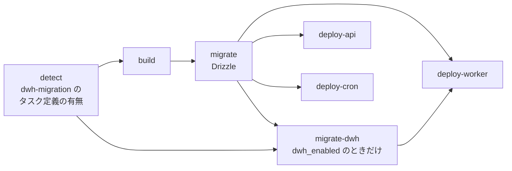

# step4-ci-deploy-dwh-migration

3 環境の deploy workflow（`deploy-aws-{dev,min,prd}.yml`）に ClickHouse の migration（`migrate-dwh` job）を組み込む。`enable_data_warehouse = true` の環境（= dwh-migration のタスク定義がある環境）でだけ実行し、無ければ skip する。あわせて、ClickHouse の migration だけを手動で流す workflow を足し、AWS 上で一通り動作確認する。

設計: [`../README.md`](../README.md#deploy-への組み込み) / [deploy での判定](../README.md#deploy-での判定)

前提: [step3-infra-cdc](./step3-infra-cdc.md)（dwh-migration のタスク定義は step2 で、CDC は step3 で作られている）

## 対応内容

### workflow の全体



- dev / prd には detect job が無いので新設する。min は既存の detect job（worker の有無）に step を足す
- build は変えない（migration イメージは step1 で ClickHouse のコマンドを同梱済み）

### detect

```bash
if aws ecs describe-task-definition --task-definition "${ECS_DWH_MIGRATION_TASK_DEF}" >/dev/null 2>&1; then
  echo "dwh_enabled=true" >> "$GITHUB_OUTPUT"
else
  echo "dwh_enabled=false" >> "$GITHUB_OUTPUT"
fi
```

- `ECS_DWH_MIGRATION_TASK_DEF: project-template-<env>-dwh-migration` を各 workflow 先頭の `env:` に足す
- タスク定義は `terraform destroy`（`count = 0`）で INACTIVE になる。`describe-task-definition` は INACTIVE でも成功するため、`--query 'taskDefinition.status'` が `ACTIVE` かどうかで判定する
- min の `push_only=true`（初回）では調べない（既存の worker の判定と同じ）

### composite action `.github/actions/run-one-shot-task`

`migrate` と `migrate-dwh`、手動実行の workflow の 3 箇所で同じ処理になるため切り出す。

| input | 内容 |
| --- | --- |
| `cluster` | ECS cluster 名 |
| `task-definition` | タスク定義の family |
| `image` | 省略可。指定したら、最新のタスク定義の image をこれに差し替えて新しい revision を register してから起動する。省略したら最新の revision をそのまま起動する |
| `subnets` / `security-group` | run-task の network 設定 |
| `assign-public-ip` | `ENABLED`（min）/ `DISABLED`（dev / prd） |

処理（既存の migrate job の step をそのまま移す）:

1. `image` があれば register（`jq` で image を差し替え、メタ情報を消して `register-task-definition`）
2. `run-task` → `aws ecs wait tasks-stopped`
3. `describe-tasks` で停止理由と終了コードを出す
4. 終了コードが 0 以外なら CloudWatch Logs を出して失敗する。**ログはそのタスクのログストリーム（`ecs/<コンテナ名>/<タスク ID>`）に絞る**（既存の `filter-log-events` はロググループ全体の古い順になり、前回以前の実行のログが出ることがあるため）

network 設定の解決（タグから VPC / subnet / SG を引く step）は環境ごとに違う（dev / prd は private subnet、min は public subnet）ので、各 workflow に残す。

### migrate（既存）

composite action を使う形に書き換える。挙動は変えない。

### migrate-dwh（新設）

```yaml
migrate-dwh:
  name: Run ClickHouse Migration
  needs: [detect, build, migrate]
  if: ${{ needs.detect.outputs.dwh_enabled == 'true' }}
  runs-on: ubuntu-latest
  environment: <env>
  steps:
    - uses: actions/checkout@v4   # composite action を使うため
    - name: Configure AWS credentials with OIDC
      ...
    - name: Resolve network configuration from tags
      ...                         # migrate と同じ
    - uses: ./.github/actions/run-one-shot-task
      with:
        cluster: ${{ env.ECS_CLUSTER }}
        task-definition: ${{ env.ECS_DWH_MIGRATION_TASK_DEF }}
        image: ${{ needs.build.outputs.registry }}/${{ env.ECR_MIGRATION_REPO }}:${{ needs.build.outputs.image_tag }}
        ...
```

- **Drizzle の migrate の後に流す。** ケース 1 で、view の元テーブルが Postgres に先にできている必要があるため
- min は `if` に `!inputs.push_only` も入れる

### deploy-worker

```yaml
deploy-worker:
  needs: [build, migrate, migrate-dwh]
  if: >-
    ${{ !cancelled()
      && needs.migrate.result == 'success'
      && (needs.migrate-dwh.result == 'success' || needs.migrate-dwh.result == 'skipped') }}
```

- `needs` の中に skipped の job があると、既定では後続も skip されるため、`!cancelled()` と各 job の結果で条件を書く
- min は既存の `worker_enabled` の条件も残す
- **deploy-api / deploy-cron は `migrate-dwh` を待たない。** ClickHouse は分析用で、その失敗で api を止めない

### ClickHouse の migration だけを流す workflow（`clickhouse-migrate.yml`、新設）

ケース 1（ClickPipe の初回の取り込み後に view を作る）とケース 4（再同期の後）で、deploy をやり直さずに ClickHouse の migration だけを流すために使う。

- `on: workflow_dispatch`、input は `environment`（`dev` / `min` / `prd`）
- **最後に deploy したイメージで、最新のタスク定義の設定を使って起動する。** 最新の revision をそのまま起動しないのは、Terraform の apply（`enable_cdc` の切り替え等）でできた revision の image が `:latest` の placeholder で、ECR に存在しないため
  - revision を新しい順に見て、image のタグが `:latest` でない最初のものを「最後に deploy したイメージ」とする（`aws ecs list-task-definitions --family-prefix ... --sort DESC`）
  - それを composite action の `image` に渡す（最新の revision の設定に image だけ差し替えて register してから起動する）
- タスク定義が無い（`enable_data_warehouse = false`）環境を選んだら、何もせずにその旨を出して失敗する
- `concurrency: deploy-aws-<env>` にして、同じ環境の deploy と同時に走らないようにする
- network 設定は environment ごとに違うので、`if` で min とそれ以外の step を分ける

### ドキュメント

- 各 deploy workflow 先頭の「Job 構成」のコメントに detect / migrate-dwh を足す
- `docs/deploy/*.md` のデプロイ手順に、ClickHouse の migration が自動で流れることと、手動実行の workflow の使いどころ（ケース 1・4）を書く
- 設計書 `README.md` の「変更のケースごとの作業」の「ClickHouse の migration を再実行」を、この workflow へのリンクにする

### 有効化・無効化の手順

**dev で ClickHouse を有効にする**

1. `env/dev/variables.tf` の `enable_data_warehouse` の既定値を `true` にして PR → マージ
2. Terraform AWS Env Apply（dev）を実行（サービス・secret・タスク定義ができる）
3. Deploy to AWS dev を実行（detect が `dwh_enabled=true` になり、migrate-dwh が `events` を作る。worker が ClickHouse に書き始める）

**無効にする**

1. 既定値を `false` にして PR → マージ → apply → deploy
2. **ClickHouse Cloud のサービスは削除され、データも消える。** 残したい場合は先にバックアップを取る（prd では `false` にしない）

## 動作確認

dev で `enable_data_warehouse` / `enable_cdc` を切り替えて確認する。

### フラグが `false`（現状）

- deploy で detect が `dwh_enabled=false`、migrate-dwh が skipped、deploy-worker が実行される
- worker の環境変数が `DATA_WAREHOUSE_TYPE=none`

### `enable_data_warehouse = true`、`enable_cdc = false`

- migrate-dwh が成功し、ログに「CDC が無いので view を作らない」旨が出る
- ClickHouse Cloud のコンソールで `project_template.events` と `_migrations` がある
- web でメモを操作し、`events` に行が入る（worker → ClickHouse Cloud）
- deploy をもう一度実行しても migrate-dwh が成功する（未適用が無く、何もしない）
- migrate-dwh をわざと失敗させる（存在しない列を参照する migration を一時的に足す）と、deploy-worker は実行されず、deploy-api は成功する

### `enable_cdc = true`

- migrate-dwh で `v_users` / `v_memos` ができる。`SELECT count() FROM project_template.v_users` が RDS の件数と一致する
- RDS で users を更新・削除すると、ClickPipes の同期間隔のうちに view に反映される
- **ケース 3**: users に列を足す migration を deploy → users に 1 行書き込む → `clickhouse-migrate.yml` を実行 → view に列が出る
- **ケース 1**: 新しいテーブルを CDC 対象に足して deploy → migrate-dwh のログに skip の警告 → apply → 初回の取り込み後に `clickhouse-migrate.yml` → view ができる
- migration を流しながら別のセッションで view を読み続け、エラーにならない（`CREATE OR REPLACE VIEW` が Cloud でも原子的か）

### min / prd

- min（`enable_data_warehouse = false` のまま）: detect が false、worker の deploy は今までどおり
- prd: 本番の運用開始時に、dev と同じ確認を行う
