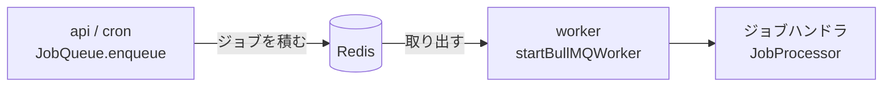

# BullMQ

Redis をバックエンドにしたジョブキュー。api / cron が積んだジョブを、常駐の worker が取り出して処理する。
アプリは BullMQ を直接使わず、[`@repo/queue`](../../packages/queue/README.md) の interface（`JobQueue<T>` / `JobProcessor<T>`）越しに使う。

## 目次

- [何に使っているか](#何に使っているか)
- [採用した理由](#採用した理由)
- [挙動と注意点](#挙動と注意点)
  - [同じジョブが 2 回以上実行される](#同じジョブが-2-回以上実行される)
  - [jobId で重複した enqueue を防ぐ](#jobid-で重複した-enqueue-を防ぐ)
  - [失敗とリトライ](#失敗とリトライ)
  - [Redis との接続](#redis-との接続)
  - [ジョブが無くても Redis にアクセスし続ける](#ジョブが無くても-redis-にアクセスし続ける)
- [差し替えられるようにしている](#差し替えられるようにしている)
- [関連ドキュメント](#関連ドキュメント)

## 何に使っているか

| Queue 名 | 積む側 | 処理 |
| --- | --- | --- |
| `track-event` | api（`@repo/events` の `QueueEventTracker`） | 行動イベントを ClickHouse に書き込む（[`clickhouse.md`](./clickhouse.md)） |
| `process-memo` | （サンプル。今は積む側が無い） | memo を読んでログに出す。通知などの処理に差し替える起点 |

キューに積むのは「何をするか」のデータ（ペイロード）だけで、処理の中身は worker の `src/jobs/` に書く。
Redis はローカルが docker compose、AWS は ElastiCache（dev / prd）と Upstash（min）。

## 採用した理由

- **Redis を既に使っている。** api が refresh token の保存先として Redis を使っているので、キューのために新しいミドルウェアを足さずに済む
- **ローカルと AWS で同じ実装が動く。** docker compose の Redis で本番と同じキューを動かせる。マネージドのキュー（SQS など）は、ローカルで動かすのにエミュレータが要る
- **ジョブキューに要る機能が揃っている。** リトライと指数バックオフ、遅延実行、`jobId` による重複 enqueue の防止、完了・失敗したジョブの保持、並行数の指定を、オプションだけで使える
- **TypeScript で書かれている。** ジョブのデータに型を付けられ、producer と worker で同じ型を共有できる
- **後から差し替えられる。** [後述](#差し替えられるようにしている)のとおり interface の裏に閉じているので、規模や費用の都合で別のキューに移るときもジョブハンドラは変えずに済む

## 挙動と注意点

### 同じジョブが 2 回以上実行される

BullMQ の配送は **at-least-once** で、次のときに同じジョブがもう一度実行される。

- ハンドラが失敗して、リトライされたとき
- worker が処理中に止まり、ジョブが stalled と判定されたとき（ECS の deploy で SIGKILL されたときなど）
- ハンドラが書き込みを終えた後、完了を Redis に記録する前に worker が止まったとき

**ジョブハンドラは、何度実行されても結果が壊れないように書く**（[`apps/worker/CLAUDE.md`](../../apps/worker/CLAUDE.md#冪等性は必須)）。
行動イベントは enqueue 時に `eventId` を振り（[`packages/events`](../../packages/events/README.md#重複排除は-eventid-の採番場所で決まる)）、
ClickHouse 側でその値をキーに重複を畳んでいる（[`clickhouse.md`](./clickhouse.md#events-テーブル)）。

### jobId で重複した enqueue を防ぐ

enqueue に `jobId` を渡すと、同じ `jobId` のジョブが Redis に残っている間は、もう一度 enqueue しても追加されない。
`buildProcessMemoJobId` のように、データから決まる ID を作って渡す。

ジョブが Redis に残るのは、完了したものが 1 時間（最大 1000 件）、最終的に失敗したものが 24 時間（[失敗とリトライ](#失敗とリトライ)の `removeOnComplete` / `removeOnFail`）。
**消えた後に同じ `jobId` で enqueue すると、もう一度実行される。** 重複の防止はこの期間に限られる。

### 失敗とリトライ

既定のジョブ設定は `packages/queue/src/bullmq-queue.ts` の `defaultJobOptions`。

| 設定 | 値 | 意味 |
| --- | --- | --- |
| `attempts` | 3 | 初回を含めて 3 回まで実行する |
| `backoff` | 指数、5 秒から | リトライの間隔（5 秒 → 10 秒） |
| `removeOnComplete` | 1 時間・1000 件 | 完了したジョブを残す期間 |
| `removeOnFail` | 24 時間 | 最終的に失敗したジョブを残す期間。この間に気付けば再投入できる |

- **ハンドラは失敗を throw する。** catch して握りつぶすと BullMQ は成功とみなし、リトライされない
- リトライしても直らない失敗は `UnrecoverableError` を投げる。回数の上限を待たずに失敗が確定する
- ログは、まだリトライされる失敗を `warn`、もうリトライされない失敗（終局）を `error` に分けている。アラートを終局だけに絞るため

終局かの判定（`isTerminalJobFailure`）に条件が 2 つあるのは、試行回数だけでは判定できないため。

| 条件 | 理由 |
| --- | --- |
| `attemptsMade >= maxAttempts` | `attemptsMade` は `failed` イベントの発火時点で**既に加算済み**（1 オリジン）。`JobProcessor` に渡る値は初回 0 なので混同しないこと |
| `error instanceof UnrecoverableError` | BullMQ はこれを `attempts` の上限を待たず即 failed set に移すため、回数で見ると初回失敗を「リトライされる」と誤判定する |

### Redis との接続

- **`Queue` / `Worker` に `error` リスナが無いと、プロセスが落ちる。** どちらも EventEmitter で、Redis の瞬断などで `error` を emit する。Node.js では `error` のリスナが無い EventEmitter は例外を投げるため、producer も worker もプロセスごと落ちる。`@repo/queue` は `Queue` / `Worker` を作るときに必ずリスナを登録している（[`@repo/redis`](../../packages/redis/README.md) の `error` 対策と同じ理由）
- **Worker に渡す Redis の接続は `maxRetriesPerRequest: null` にする。** BullMQ の要件で、用途ごとに接続を分ける理由でもある（[`@repo/redis`](../../packages/redis/README.md)）

### ジョブが無くても Redis にアクセスし続ける

Worker はジョブを待つ間も、取り出しや stalled の検出のために Redis へ定期的にコマンドを送る。
**コマンド数で課金される Redis（Upstash の Pay as You Go）では、ジョブが無くても費用が積み上がる。**
min で worker を作るときは Upstash を Fixed プランにする（[`docs/spec/minimal-deploy/README.md`](../spec/minimal-deploy/README.md)）。

## 差し替えられるようにしている

producer もジョブハンドラも `@repo/queue` の interface だけを知っていて、BullMQ に依存するのは
`packages/queue/src/bullmq-queue.ts` と、Queue / Worker を作る各 app の生成箇所だけ（[`apps/worker/CLAUDE.md`](../../apps/worker/CLAUDE.md)）。
SQS / Cloud Tasks / pg-boss などに移るときは、同じ interface の実装を足して生成箇所を差し替えれば、ジョブハンドラは変えずに済む。
その実装でも、`jobId` による重複の防止と at-least-once の前提が同じになるかを確かめる。

**Factory ではなく Strategy にしている。** producer（enqueue）と consumer（取り出し）で生成の仕方が違い、
必要なクライアントも実装ごとに Redis / SQS / Cloud Tasks とばらばら。1 つの生成関数にまとめると無理が出るので、
生成は各 app の `src/index.ts` に任せ、使う側を interface に依存させている。

## 関連ドキュメント

- [`packages/queue/README.md`](../../packages/queue/README.md) — interface と BullMQ 実装のパッケージ
- [`apps/worker/CLAUDE.md`](../../apps/worker/CLAUDE.md) — ジョブの追加手順・冪等性・graceful shutdown・環境変数
- [`packages/redis/README.md`](../../packages/redis/README.md) — Redis の接続
- [`clickhouse.md`](./clickhouse.md) — `track-event` の書き込み先
- [BullMQ 公式ドキュメント](https://docs.bullmq.io/)
