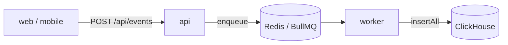
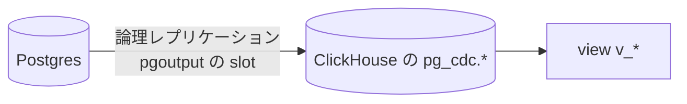

# ClickHouse

行動イベントを集計するためのデータウェアハウス。列指向で、追記だけの大量の書き込みと大量行の集計に向く。
ローカルは docker compose、AWS は ClickHouse Cloud で動かし、worker が [`@repo/data-warehouse`](../../packages/data-warehouse/README.md) の interface 越しに書き込む。

- コード: 書き込みの実装は `packages/data-warehouse/src/clickhouse/`、テーブル・view の定義と migration コマンドは [`packages/data-warehouse/clickhouse/`](../../packages/data-warehouse/clickhouse/README.md)
- 設計: [`docs/spec/clickhouse-migration/README.md`](../spec/clickhouse-migration/README.md)（migration と環境ごとの有効化）

## 目次

- [何に使っているか](#何に使っているか)
  - [行動イベント](#行動イベント)
  - [業務データ](#業務データ)
- [採用した理由](#採用した理由)
  - [求める要件](#求める要件)
  - [他の候補と却下理由](#他の候補と却下理由)
  - [他のデータウェアハウスへ移るとき](#他のデータウェアハウスへ移るとき)
- [ホスティング](#ホスティング)
- [events テーブル](#events-テーブル)
  - [集計時に FINAL を忘れると静かに数字が狂う](#集計時に-final-を忘れると静かに数字が狂う)
- [CDC（Postgres からの取り込み）](#cdcpostgres-からの取り込み)
  - [ローカルと ClickHouse Cloud の違い](#ローカルと-clickhouse-cloud-の違い)
  - [運用上の注意](#運用上の注意)
  - [ローカルの CDC](#ローカルの-cdc)
  - [ClickHouse Cloud の CDC（ClickPipes）](#clickhouse-cloud-の-cdcclickpipes)
  - [CDC の対象を変えるとき](#cdc-の対象を変えるとき)
- [view を経由する規約](#view-を経由する規約)
- [migration コマンド](#migration-コマンド)
  - [ClickHouse に置くもの](#clickhouse-に置くもの)
  - [版管理する migration の書き方](#版管理する-migration-の書き方)
  - [CDC の view の書き方](#cdc-の-view-の書き方)
  - [環境変数](#環境変数)
- [関連ドキュメント](#関連ドキュメント)

## 何に使っているか

### 行動イベント

DB に痕跡が残らない操作（閲覧・削除・離脱・ユーザー行動）を記録して集計する。送出は fire-and-forget で、
ユーザーのリクエストを待たせない。**Postgres は通らない。**



- 送出の抽象は `@repo/events` の `EventTracker`。api は ClickHouse を知らない
- 配送は [BullMQ](./bullmq.md) なので、同じイベントが 2 回届くことがある（[events テーブル](#events-テーブル)で畳む）
- 詳細は [`docs/spec/user-behavior-events/README.md`](../spec/user-behavior-events/README.md)

### 業務データ

業務データの正本は Postgres。アプリから二重に書かずに **CDC（論理レプリケーション）で ClickHouse に写す**
（[後述](#cdcpostgres-からの取り込み)）。この経路は `@repo/data-warehouse` を通らない。

## 採用した理由

### 求める要件

行動イベントは業務データと**性質が正反対**で、同じデータベースに置くと互いの足を引っ張る。

| | 行動イベント | 業務データ（User / Memo） |
| --- | --- | --- |
| 書き込み量 | 1 セッションで数十件 | 操作ごとに 1 件 |
| 更新 | しない（append only） | する |
| トランザクション | 不要 | 必要 |
| 読み方 | 大量行を集計 | 1 行を id で引く |
| 消し方 | TTL で自動失効 | 明示的に削除 |

ClickHouse は、行動イベントの置き場所に求めることを次のように満たす。

| 求めること | ClickHouse での実現 |
| --- | --- |
| 追記だけの大量の書き込みと、大量行の集計 | 列指向で、この用途に最適化されている |
| 古いイベントを TTL で自動で消す | テーブル定義の `TTL` |
| 同じイベントを 1 件に畳む | `ReplacingMergeTree`（[後述](#events-テーブル)） |
| Postgres の業務データを CDC で取り込む | ローカルは `MaterializedPostgreSQL`、ClickHouse Cloud は ClickPipes（[後述](#cdcpostgres-からの取り込み)） |
| リクエストが無いときの費用が小さい | ClickHouse Cloud は月額最低額が無く、アイドル時に compute がゼロへスケールダウンする |

### 他の候補と却下理由

| 候補 | 却下理由 |
| --- | --- |
| **Postgres のまま** | OLTP と資源競合する。TTL による自動失効も自前実装が必要 |
| **BigQuery** | 本テンプレートは AWS 前提なのでクロスクラウドの前提ごと変わる場面でしか選ばない |
| **S3 + Athena** | スキャン課金でダッシュボードの常時参照に向かない。低レイテンシのクエリも期待できない |
| **運用ログ（pino）に混ぜる** | 保持期間が短く、量が行動イベントの数十倍。混ぜると分析基盤のコストが跳ね上がりスキーマが汚れる |

### 他のデータウェアハウスへ移るとき

`@repo/data-warehouse` の interface（`insertAll` / `close`）が吸収するのは書き込み経路だけで、**移行コスト全体の
1〜2 割程度にすぎない。** 移行コストの大半はクエリとダッシュボードの作り直しで、同じ SQL 方言のサービスへなら
テーブル定義とクエリがそのまま使えるが、別の方言へはこの抽象化はほとんど効かない。

## ホスティング

| | ローカル | dev / min | prd |
| --- | --- | --- | --- |
| ClickHouse | docker-compose（8124 / 9003） | `enable_data_warehouse` で選ぶ（既定は**持たない**） | ClickHouse Cloud（`enable_data_warehouse` の既定が `true`） |
| `DATA_WAREHOUSE_TYPE` | `clickhouse` | フラグに合わせて `clickhouse` / `none` | フラグに合わせて `clickhouse` / `none`（既定は `clickhouse`） |

**AWS の環境が ClickHouse を持つかは、Terraform の `enable_data_warehouse` で選ぶ。**

- `true` の環境にだけ、ClickHouse Cloud のサービス・接続情報の secret・migration 用のタスク定義を作る
- `false` の環境では worker の `DATA_WAREHOUSE_TYPE` が `none` になり、イベントは書き込まれない（[`apps/worker/CLAUDE.md`](../../apps/worker/CLAUDE.md#データウェアハウスを持たない環境)）
- dev / min が既定で持たないのは、dev は行動ログに分析価値が薄く、min は固定費を抑える構成のため
- organization は dev / min / prd で分ける（API キーが organization 全体の Admin 権限のため。[`docs/setup/infra.md`](../setup/infra.md)）
- 接続を許すのは、dev / prd は NAT の IP と `clickhouse_additional_ip_access_cidrs` に足した IP だけ。min はタスクの IP が毎回変わるので絞らない
- deploy は接続情報の secret の有無で、ClickHouse の migration（migrate-dwh）を流すかを決める

## events テーブル

`events`（`packages/data-warehouse/clickhouse/migrations/1_create_events.sql`）は `ReplacingMergeTree` で、
`ORDER BY` の末尾に `event_id` を置いている。同じ `event_id` の行はマージ時に 1 件に畳まれる。
BullMQ の配送は at-least-once で同じイベントが 2 回届くことがあり（[`bullmq.md`](./bullmq.md#同じジョブが-2-回以上実行される)）、
`event_id` は enqueue 時に振っているので再配信でも同じ値になる（[`packages/events`](../../packages/events/README.md#重複排除は-eventid-の採番場所で決まる)）。
月ごとにパーティションを切り、2 年で TTL により消える。

**マージは非同期**なので、insert 直後は重複が見えている状態がありうる。

### 集計時に FINAL を忘れると静かに数字が狂う

畳み込みを待たずに正しい結果を得るには `FINAL` を付けるか `argMax` で最新を取る。
**忘れてもエラーにならず、件数が多く出るだけ**なので気付きにくい。

同じ罠は CDC したテーブルにもあり、そちらは削除行（タンブストーン）も絡む。
そのため**分析クエリは [view を経由する](#view-を経由する規約)**規約にしている。

## CDC（Postgres からの取り込み）



同期対象は `infra/clickhouse/cdc-tables.json` に並べたテーブル（今は `users` / `memos`）。publication と
replication slot は取り込み側が自動作成する。取り込んだテーブルは `pg_cdc` database に入り、
分析クエリは `project_template.v_*` の view から読む。ローカルの CDC（MaterializedPostgreSQL）と、両方の環境の view は
[migration コマンド](#migration-コマンド)が作る。ClickHouse Cloud の CDC（ClickPipe）は Terraform が作る。

### ローカルと ClickHouse Cloud の違い

**同じ「Postgres の論理レプリケーション」を使うが、WAL を読む主体が違う。**

| | ローカル | ClickHouse Cloud |
| --- | --- | --- |
| 取り込み | ClickHouse 内蔵 `MaterializedPostgreSQL` | **ClickPipes** |
| 成熟度 | experimental | Beta |
| 削除の表現 | `_sign = -1` のタンブストーン | `_peerdb_is_deleted = 1` |
| 追加コンテナ | **なし** | （マネージド） |

ClickPipes はマネージドサービスなのでローカルでは動かせない。逆にローカルの
`MaterializedPostgreSQL` は experimental なので ClickHouse Cloud では使わない。

**揃えているのは Postgres 側の契約**（`wal_level=logical` / publication の自動作成 /
`pgoutput` の replication slot）で、運用で実際に事故るのはこの層。ClickHouse 側の差分は
view 定義に閉じ込めている。

ClickPipes と同じエンジン（PeerDB）をローカルでセルフホストする選択肢もあるが、
catalog Postgres / Temporal / MinIO を含む **11 サービス**が増え、ダッシュボードが
ポート 3000 で `apps/web` と衝突するため採らなかった。

### 運用上の注意

- **replication slot は WAL を保持する。** 取り込み側が止まると Postgres のディスクが WAL で
  埋まって書き込み不能になる。AWS の RDS は `max_slot_wal_keep_size`（5 GB）で上限を付けていて、
  超えると slot が無効になり CDC は止まるが、DB は止まらない（再同期で戻す）。slot ラグの監視は**未実装**
- 反映は同期ではない。ローカルでの実測は数秒〜10 秒程度で、再起動直後は長めに出る
- ローカルで `pg_cdc` を消すときは `DROP DATABASE pg_cdc`。slot と publication も一緒に消える。
  手で消さずに放置すると docker volume が WAL で膨らみ続ける

### ローカルの CDC

ローカルでは ClickHouse の MaterializedPostgreSQL で Postgres を取り込む。**migration コマンドは毎回 `pg_cdc` を消して作り直す。**

- MaterializedPostgreSQL は Postgres 側で列が変わるとそのテーブルの同期を止める。ClickHouse のドキュメントにある「テーブルを付け直す」では、ClickHouse 24.10 で付け直した後の変更が反映されなかったため、database ごと作り直している
- 作り直すと replication slot と publication も作り直され、全件を取り込み直す。ローカルのデータは少ないので数秒で終わる
- 作り直す前に、既にある `pg_cdc` がこのプロジェクトの Postgres を取り込むものか確かめ、違えば消さずに止まる（同じテンプレートから作った別プロジェクトの ClickHouse が同じポートで動いているときに、その CDC を消さないため）
- Postgres にテーブルが無いと 60 秒待って失敗する。先に `pnpm --filter api db:migrate` を流す
- ローカルの Postgres の DB を消すときは、先に `pg_cdc` を消す（replication slot が残っていると `DROP DATABASE` できない）。手順は [`packages/db/README.md`](../../packages/db/README.md#ローカル-db-の作り直し)

### ClickHouse Cloud の CDC（ClickPipes）

AWS では Terraform の `enable_cdc` が `true` の環境にだけ、ClickPipe と SSH bastion を作る。**既定はすべての環境で `false`** で、仕組みだけを用意している（行動イベントの分析には要らず、業務データを ClickHouse で分析する必要が出たときに有効にする）。
`enable_cdc` は `enable_data_warehouse` が `true` のときだけ有効にできる。

**AWS 上ではまだ一度も動かしていない。** 有効にする前に、dev で [設計書の step3・step4 の動作確認](../spec/clickhouse-migration/tasks/step3-infra-cdc.md#動作確認) を行う。

- ClickPipes は VPC の外から RDS に繋ぐため、public subnet の SSH bastion を経由する。bastion は ClickPipes の固定 IP からの SSH だけを受け、RDS の 5432 にだけ出る
- RDS の論理レプリケーション（`rds.logical_replication`）は `enable_cdc` に関係なく有効にしている。`enable_cdc` に連動させると、有効にするたびに RDS の再起動が要るため
- 固定費は ClickPipes の CDC 用の計算資源（約 $73/月。ClickPipe がある間はサービスのアイドルに関係なくかかる）と bastion（月 $10 未満）
- 同期の対象を変えるときは `infra/clickhouse/cdc-tables.json` を変えて apply する（ClickPipe に反映される）。順序は [CDC の対象を変えるとき](#cdc-の対象を変えるとき)
- RDS（isolated subnet）に SQL を流す手段は用意していない。replication slot の状態は CloudWatch の RDS のメトリクス（`OldestReplicationSlotLag` / `TransactionLogsDiskUsage`）で見る

**パラメータグループを入れたとき（既存の環境で 1 回だけ）**

論理レプリケーションは再起動するまで効かない。新しく作る環境では作成時から効くので不要。

1. apply（dev / prd）
2. `aws rds reboot-db-instance --db-instance-identifier <prefix>-db`（dev は日中でよい。prd はメンテナンス時間帯に）
3. `aws rds describe-db-instances --db-instance-identifier <prefix>-db --query 'DBInstances[0].DBParameterGroups'` の `ParameterApplyStatus` が `in-sync` になったことを確かめる

**CDC を有効にする**

ClickPipe を作る前に、論理レプリケーションが効いていること（上の再起動）と、同期するテーブルが Postgres にあること（deploy で流す Drizzle の migration）が要る。新しく作る環境では、最初の deploy が終わってから有効にする。

1. `enable_cdc` の既定値を `true` にして PR → マージ → apply
2. ClickHouse Cloud のコンソールで SSH の鍵を検証（Validate）し、`active` になることを確かめる（検証は自動では走らず、apply の出力の `ssh_key_status` は `pending` のまま）
3. apply の出力の `clickpipe_state` が `Running` か `Snapshot` であることを確かめる（`Failed` でも apply は成功するため、必ず見る）
4. deploy か、ClickHouse の migration だけを流す workflow（`clickhouse-migrate.yml`）で view を作る

先に ClickPipe ができて `Failed` になったとき（再起動や deploy の前に有効にしたときなど）は、準備ができてから `terraform apply -replace='module.cdc[0].clickhouse_clickpipe.this'` で作り直す（差分の無い apply では動き出さない）。

**CDC を無効にする**

1. `enable_cdc` を `false` にして apply（ClickPipe・bastion・SSH の鍵が消える。replication slot は ClickPipe の削除で消える想定）
2. CloudWatch の `OldestReplicationSlotLag` が出なくなる（slot が無くなる）ことを確かめる。slot が残っても、`max_slot_wal_keep_size`（5 GB）を超えると無効になって WAL は解放される
3. `pg_cdc` のテーブルと view は残る。不要なら migration で消す

**bastion を作り直す（OS の更新）**

bastion は AMI を固定していて、外へは RDS にしか出られないので、OS をその場で更新する手段が無い。定期的に、または sshd に脆弱性が出たら、`terraform apply -replace='module.cdc[0].aws_instance.bastion'` で最新の AMI に作り直す（IP は EIP で変わらない。ClickPipe は数分切れて、再接続する）。

### CDC の対象を変えるとき

Postgres の変更と同じ PR で、ClickHouse 側の変更も入れる。ファイルはすべて `packages/data-warehouse/clickhouse/` と
`infra/clickhouse/cdc-tables.json`。ローカルはどのケースも `db:migrate` → `dwh:migrate` を流し直すだけでよい（CDC を毎回作り直すため）。

| ケース | 変えるもの | ClickHouse Cloud への反映の順序 |
| --- | --- | --- |
| テーブルを足す | `cdc-tables.json` に足し、`views/<table>.sql` を足す（Drizzle の migration と同じ PR） | マージ → deploy（テーブルを作る。view はまだ元テーブルが無いので飛ばされる）→ apply（ClickPipe に足し、初回の取り込み）→ `clickhouse-migrate.yml`（view を作る） |
| テーブルを消す・名前を変える | 1 回目の PR: `cdc-tables.json` と `views/<table>.sql` から消し、`DROP VIEW IF EXISTS` の migration を足す。2 回目の PR: Drizzle の変更と `DROP TABLE IF EXISTS pg_cdc.<table>` の migration（名前を変えるなら、新しい名前で「テーブルを足す」も） | 1 回目: deploy → apply（ClickPipe から外す）。2 回目: deploy |
| 列を足す | 不要 | deploy（Drizzle）→ そのテーブルに書き込みがあった後に `clickhouse-migrate.yml`（足した列は次の書き込みで ClickHouse に現れ、view の列は作り直すまで増えない） |
| 列の型・名前を変える | 不要 | deploy（Drizzle）→ ClickHouse Cloud のコンソールで ClickPipe を Resync → 終わったら `clickhouse-migrate.yml` |
| 列を消す | view の `EXCEPT` に列名を足す（ClickPipes は消した列を NULL で残す） | deploy |
| ClickHouse だけの変更 | `migrations/` にファイルを足す | deploy |

`clickhouse-migrate.yml` は、同じ環境の deploy と同じ concurrency group で動く。deploy の実行中は終わるまで待ち、待っている間に deploy をもう一度実行すると、待っていた方は取り消される。

各ケースを選んだ理由は設計書の [変更のケースごとの作業](../spec/clickhouse-migration/README.md#変更のケースごとの作業)。

## view を経由する規約

CDC テーブルは更新を「新しい版の追記」、削除を「タンブストーン行」で表現する。
**分析クエリはこれらを直接参照せず、`project_template.v_*` の view を見る。**

```sql
-- ✓ OK
SELECT u.name, count() FROM events AS e
INNER JOIN v_users AS u ON u.id = e.user_id GROUP BY u.name
```

view が吸収しているのは 3 つ。

1. **`FINAL`** — 付け忘れると古い版が二重に数えられる
2. **削除行の除外** — ローカルは `_sign = 1`、ClickHouse Cloud は `_peerdb_is_deleted = 0`
3. **`id` の型** — Postgres の `integer` は `Int32` にマップされるが `events.user_id` は `UInt64` で、
   符号の有無が違うと共通型が無く `NO_COMMON_TYPE` で JOIN が落ちる。view 側で `toUInt64` する

**view の名前・列・型を両環境で揃え、定義だけを環境ごとに変える。** これで分析クエリは
どちらの環境でもそのまま動く。

## migration コマンド

ClickHouse に置くテーブル・view を適用する。ローカルでは手元で流し、AWS では deploy が ECS の one-shot タスクで流す。

```bash
pnpm --filter api db:migrate                      # 先に Postgres
pnpm --filter @repo/data-warehouse dwh:migrate    # ClickHouse
```

- **何度実行してもよい。** 版管理する migration は未適用のものだけを流し、CDC（ローカル）と view は毎回作り直す
- `dwh:migrate` は依存パッケージ（`@repo/logger`）を turbo でビルドしてから `dwh:migrate:run` を実行する。コンテナ（migration イメージ）ではビルド済みなので `dwh:migrate:run` を直接起動する
- 環境変数は turbo の `passThroughEnv`（`turbo.json` の `dwh:migrate:run`）で渡している。**新しい環境変数を足したらそこにも足す。** 足さないと turbo が渡さず、既定値のまま動く
- `DATA_WAREHOUSE_CDC=materialized_postgresql`（既定値）は `http` の ClickHouse にだけ使える。`https`（ClickHouse Cloud）に向けると env の検証で止まる

処理の順序:

1. `migrations/` のファイル名と、`infra/clickhouse/cdc-tables.json` と `views/` の対応を検査する（問題があれば DB に触る前に止まる）
2. ローカル（`DATA_WAREHOUSE_CDC=materialized_postgresql`）なら CDC を作り直し、全テーブルの取り込みを待つ（[ローカルの CDC](#ローカルの-cdc)）
3. [`clickhouse-migrations`](https://github.com/VVVi/clickhouse-migrations) で未適用の migration を適用する（database が無ければ作る）
4. CDC があれば（`DATA_WAREHOUSE_CDC` が `none` 以外）、`views/` の view を全部作り直す

### ClickHouse に置くもの

置き場所は `packages/data-warehouse/clickhouse/` からの相対パス。

| 種類 | 置き場所 | 適用のしかた |
| --- | --- | --- |
| 版管理する migration（`events`、将来のマテリアライズドビュー・集計テーブル） | `migrations/` | 各ファイルを 1 回だけ。適用済みは `<database>._migrations` に記録される |
| CDC の view（`v_users` / `v_memos`） | `views/` | 毎回作り直す（`CREATE OR REPLACE VIEW`） |
| CDC の対象テーブルの一覧 | `infra/clickhouse/cdc-tables.json`（リポジトリのルートから） | ローカルはこのコマンドが、ClickHouse Cloud は Terraform が反映する |
| CDC のテーブル本体（`pg_cdc.*`） | （取り込み側が作る） | ClickHouse Cloud ではこのコマンドから作らない・変えない。ローカルは毎回作り直す |

**view を作り直しても過去のデータは消えない。** 通常の view はデータを持たないため。マテリアライズドビューは作り直し方によってデータが消えるので、`views/` ではなく `migrations/` に書く。

### 版管理する migration の書き方

- ファイル名は `<版番号>_<説明>.sql`（例: `2_create_daily_active_users.sql`）。**版番号は連番にする。** 履歴の列が UInt32 なので、タイムスタンプ形式（14 桁）は桁あふれする。同じ版番号が 2 つあるとコマンドが止まる
- **適用済みのファイルは書き換えない。** チェックサムが変わると `clickhouse-migrations` がエラーで止まる。直すときは新しいファイルを足す
- **何度流しても同じ結果になるように書く（`IF NOT EXISTS` / `IF EXISTS`）。** ClickHouse の DDL にはトランザクションが無く、途中で失敗すると次回はそのファイルを最初からやり直す
- テーブル名は database で修飾しない（接続先の `DATA_WAREHOUSE_DATABASE` に作られる）
- **環境で変わる内容を書かない。** local と ClickHouse Cloud で同じ SQL が通るようにする（ENGINE は `MergeTree` 系を書けば Cloud では自動で Shared 系になる。`ON CLUSTER` は書かない）
- `ALTER TABLE ... UPDATE / DELETE` などの mutation は非同期なので、終わるまで待たせたいときはファイルに `SET mutations_sync = 2;` を書く（そのファイルの全文に効く）。ただし**各文は 120 秒以内に終わること**（migration の request timeout）。超えると client 側がタイムアウトし、mutation はサーバーで続くのに履歴には記録されない。大きなテーブルへの重い mutation は `mutations_sync` を付けずに非同期に任せる
- **`pg_cdc` のテーブルを参照しない**（`DROP TABLE IF EXISTS pg_cdc.<table>` は除く。database が無くても通る）。参照するとコマンドが DB に触る前に止まる。CDC の無い環境（`DATA_WAREHOUSE_CDC=none`）や、ClickPipe の初回の取り込みの前には `pg_cdc` が無く、migration が失敗するため。CDC のデータを元にした集計は `views/` に書く（CDC のデータを元にしたマテリアライズドビューが要るときの扱いは未定）

### CDC の view の書き方

`views/<CDC 対象のテーブル名>.sql` に 1 文だけ書く。ファイル名と `cdc-tables.json` のテーブル名を 1 対 1 にする。

```sql
CREATE OR REPLACE VIEW v_users AS
SELECT * EXCEPT (${CDC_META_COLUMNS}) REPLACE (toUInt64(id) AS id)
FROM ${CDC_DATABASE}.users FINAL
WHERE ${CDC_LIVE_FILTER}
```

| 変数 | local（MaterializedPostgreSQL） | ClickHouse Cloud（ClickPipes） |
| --- | --- | --- |
| `${CDC_DATABASE}` | `pg_cdc` | `pg_cdc` |
| `${CDC_META_COLUMNS}` | `_sign, _version` | `_peerdb_synced_at, _peerdb_is_deleted, _peerdb_version` |
| `${CDC_LIVE_FILTER}` | `_sign = 1` | `_peerdb_is_deleted = 0` |

- **`SELECT *` で書く。** ClickHouse の view の列は作成時に固定されるが、毎回作り直すので Postgres 側の列の増減に追いつく
- **Postgres で列を消したら、`EXCEPT` にその列名を足す**（`EXCEPT (${CDC_META_COLUMNS}, old_column)`）。ClickPipes は消した列を ClickHouse 側に残す（以降は NULL）ため。`EXCEPT` は無い列を無視するので、列が本当に無くなるローカルでも同じ定義で動く
- view を消すときは、ファイルを消すだけでなく `migrations/` に `DROP VIEW IF EXISTS v_<table>;` を足す（このコマンドは消えた view を自動では消さない）
- view が何を吸収しているかは [view を経由する規約](#view-を経由する規約)

### 環境変数

既定値はローカルの docker compose で動く値なので、ローカルでは設定しなくてよい。AWS では ECS のタスク定義が設定する。

**docker compose の ClickHouse のポートを変えている（`CLICKHOUSE_HTTP_PORT`）ときは、`DATA_WAREHOUSE_URL=http://localhost:<port>` を付けて実行する。** 既定の `localhost:8124` で別のプロジェクトの ClickHouse が動いていると、そちらに繋がる。

| 変数 | 既定値 | 説明 |
| --- | --- | --- |
| `DATA_WAREHOUSE_URL` | `http://localhost:8124` | ClickHouse の HTTP(S) の URL |
| `DATA_WAREHOUSE_USER` / `DATA_WAREHOUSE_PASSWORD` | `default` / `password` | |
| `DATA_WAREHOUSE_DATABASE` | `project_template` | migration と view を置く database |
| `DATA_WAREHOUSE_CDC` | `materialized_postgresql` | `materialized_postgresql`（ローカル）/ `clickpipes`（ClickHouse Cloud）/ `none`（CDC なし。view を作らない） |
| `LOCAL_CDC_POSTGRES_HOST` / `_DATABASE` / `_USER` / `_PASSWORD` | `postgres:5432` / `project-template_dev` / `postgres` / `password` | ローカルの MaterializedPostgreSQL が繋ぐ Postgres。**ClickHouse のコンテナから見た**接続先 |

## 関連ドキュメント

- [`packages/data-warehouse/README.md`](../../packages/data-warehouse/README.md) — 書き込み先の抽象（`DataWarehouse`）のパッケージ
- [`packages/data-warehouse/clickhouse/README.md`](../../packages/data-warehouse/clickhouse/README.md) — テーブル・view の定義と migration コマンドのディレクトリ
- [`bullmq.md`](./bullmq.md) — 行動イベントの配送
- [`docs/spec/clickhouse-migration/README.md`](../spec/clickhouse-migration/README.md) — migration と、環境ごとの有効化の設計
- [`docs/spec/user-behavior-events/README.md`](../spec/user-behavior-events/README.md) — 行動イベント基盤の設計
- [`docs/setup/infra.md`](../setup/infra.md#7-clickhouse-cloud-の準備) — ClickHouse Cloud の organization と API キーの準備
