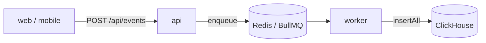

# ClickHouse

行動イベントを集計するためのデータウェアハウス。列指向で、追記だけの大量の書き込みと大量行の集計に向く。
ローカルは docker compose、AWS は ClickHouse Cloud で動かし、worker が [`@repo/data-warehouse`](../../../packages/data-warehouse/README.md) の interface 越しに書き込む。

- コード: 書き込みの実装は `packages/data-warehouse/src/clickhouse/`、テーブル・view の定義と migration コマンドは [`packages/data-warehouse/clickhouse/`](../../../packages/data-warehouse/clickhouse/README.md)
- 設計: [`docs/spec/clickhouse-migration/README.md`](../../spec/clickhouse-migration/README.md)（migration と環境ごとの有効化）

| ドキュメント | 内容 |
| --- | --- |
| この README | 何に使っているか・採用した理由・方式の選択・ホスティング |
| [`query.md`](./query.md) | `events` テーブルと、集計クエリを書くときの注意（`FINAL`・view を経由する規約） |
| [`cdc.md`](./cdc.md) | Postgres からの取り込み（CDC）の仕組み・ClickPipes の運用手順・対象を変えるときの順序 |
| [`migration.md`](./migration.md) | migration コマンド・migration と view の書き方・環境変数 |

## 目次

- [何に使っているか](#何に使っているか)
  - [行動イベント](#行動イベント)
  - [業務データ](#業務データ)
- [採用した理由](#採用した理由)
  - [求める要件](#求める要件)
  - [他の候補と却下理由](#他の候補と却下理由)
  - [他のデータウェアハウスへ移るとき](#他のデータウェアハウスへ移るとき)
- [方式の選択](#方式の選択)
- [ホスティング](#ホスティング)
- [関連ドキュメント](#関連ドキュメント)

## 何に使っているか

### 行動イベント

DB に痕跡が残らない操作（閲覧・削除・離脱・ユーザー行動）を記録して集計する。送出は fire-and-forget で、
ユーザーのリクエストを待たせない。**Postgres は通らない。**

- 送出の抽象は `@repo/events` の `EventTracker`。api は ClickHouse を知らない
- 配送は [BullMQ](../bullmq.md) なので、同じイベントが 2 回届くことがある（[`events` テーブル](./query.md#events-テーブル)で畳む）
- 詳細は [`docs/spec/user-behavior-events/README.md`](../../spec/user-behavior-events/README.md)

### 業務データ

業務データの正本は Postgres。アプリから二重に書かずに **CDC（論理レプリケーション）で ClickHouse に写す**
（[`cdc.md`](./cdc.md)）。この経路は `@repo/data-warehouse` を通らない。AWS では既定で無効にしている（[方式の選択](#方式の選択)）。

## 採用した理由

### 求める要件

行動イベントは業務データと**性質が正反対**で、同じデータベースに置くと互いの足を引っ張る。

| | 行動イベント | 業務データ（User / Memo） |
| --- | --- | --- |
| 書き込み量 | 1 セッションで数十件 | 操作ごとに 1 件 |
| 更新 | しない（append only） | する |
| トランザクション | 不要 | 必要 |
| 読み方 | 大量行を集計 | 1 行を id で引く |
| 消し方 | TTL で自動失効 | 明示的に削除 |

ClickHouse は、行動イベントの置き場所に求めることを次のように満たす。

| 求めること | ClickHouse での実現 |
| --- | --- |
| 追記だけの大量の書き込みと、大量行の集計 | 列指向で、この用途に最適化されている |
| 古いイベントを TTL で自動で消す | テーブル定義の `TTL` |
| 同じイベントを 1 件に畳む | `ReplacingMergeTree`（[`query.md`](./query.md#events-テーブル)） |
| Postgres の業務データを CDC で取り込む | ローカルは `MaterializedPostgreSQL`、ClickHouse Cloud は ClickPipes（[`cdc.md`](./cdc.md)） |
| リクエストが無いときの費用が小さい | ClickHouse Cloud は月額最低額が無く、アイドル時に compute がゼロへスケールダウンする |

### 他の候補と却下理由

| 候補 | 却下理由 |
| --- | --- |
| **Postgres のまま** | OLTP と資源競合する。TTL による自動失効も自前実装が必要 |
| **BigQuery** | 本テンプレートは AWS 前提なのでクロスクラウドの前提ごと変わる場面でしか選ばない |
| **S3 + Athena** | スキャン課金でダッシュボードの常時参照に向かない。低レイテンシのクエリも期待できない |
| **運用ログ（pino）に混ぜる** | 保持期間が短く、量が行動イベントの数十倍。混ぜると分析基盤のコストが跳ね上がりスキーマが汚れる |

### 他のデータウェアハウスへ移るとき

`@repo/data-warehouse` の interface（`insertAll` / `close`）が吸収するのは書き込み経路だけで、**移行コスト全体の
1〜2 割程度にすぎない。** 移行コストの大半はクエリとダッシュボードの作り直しで、同じ SQL 方言のサービス（Tinybird など）へなら
テーブル定義とクエリがそのまま使えるが、別の方言へはこの抽象化はほとんど効かない。

## 方式の選択

ClickHouse を使うと決めた後、動かし方と取り込み方に選択肢があった。

| 決めたこと | 採用した案 | 採らなかった案と理由 |
| --- | --- | --- |
| AWS でのホスティング | **ClickHouse Cloud**（AWS の東京リージョン・Basic tier・アイドル時に停止） | **AWS 上に自前で立てる（EC2 / ECS）**: ClickHouse はメモリを多く使うので、相応のインスタンスを常に動かし続けることになる。ディスク・バックアップ・バージョンアップ・障害対応も自前で持つ。ClickHouse Cloud は月額最低額が無く、この規模ではほぼストレージ代（年に数 GB）だけで済む |
| ClickHouse Cloud への CDC | **ClickPipes**（ClickHouse Cloud 公式のマネージド CDC。Beta） | **MaterializedPostgreSQL**: ClickHouse の experimental 機能なので本番では使わない |
| ローカルの CDC | **MaterializedPostgreSQL**（ClickHouse 内蔵。追加のコンテナが要らない） | **ClickPipes**: マネージドサービスなのでローカルでは動かせない。**PeerDB（ClickPipes と同じエンジン）のセルフホスト**: catalog Postgres / Temporal / MinIO を含む 11 サービスが増え、ダッシュボードがポート 3000 で `apps/web` と衝突する |
| ClickPipes から RDS への経路 | **SSH bastion**（public subnet の小さな EC2。月 $10 未満） | **PrivateLink**: Basic tier で使えない可能性が高く、AWS 側の時間課金（約 $73/月相当）もかかる。**RDS をインターネットに公開**: bastion は要らないが、DB をインターネットに出すことになる |
| AWS で CDC を有効にするか | **既定で無効**（`enable_cdc = false`。仕組みだけ用意する） | **有効にする**: ClickPipes の計算資源と bastion で月 $80 強の固定費がかかる。行動イベントに `userId` と分析に要る属性を載せれば、業務データと JOIN しなくても分析できる |

環境ごとの違い（ローカルの MaterializedPostgreSQL と ClickPipes で削除の表現が違うなど）は view に閉じ込めて、分析クエリはどちらでもそのまま動くようにしている（[`query.md`](./query.md#view-を経由する規約)）。

## ホスティング

| | ローカル | dev / min | prd |
| --- | --- | --- | --- |
| ClickHouse | docker-compose（8124 / 9003） | `enable_data_warehouse` で選ぶ（既定は**持たない**） | ClickHouse Cloud（`enable_data_warehouse` の既定が `true`） |
| `DATA_WAREHOUSE_TYPE` | `clickhouse` | フラグに合わせて `clickhouse` / `none` | フラグに合わせて `clickhouse` / `none`（既定は `clickhouse`） |

**AWS の環境が ClickHouse を持つかは、Terraform の `enable_data_warehouse` で選ぶ。**

- `true` の環境にだけ、ClickHouse Cloud のサービス・接続情報の secret・migration 用のタスク定義を作る
- `false` の環境では worker の `DATA_WAREHOUSE_TYPE` が `none` になり、イベントは書き込まれない（[`apps/worker/CLAUDE.md`](../../../apps/worker/CLAUDE.md#データウェアハウスを持たない環境)）
- dev / min が既定で持たないのは、dev は行動ログに分析価値が薄く、min は固定費を抑える構成のため
- organization は dev / min / prd で分ける（API キーが organization 全体の Admin 権限のため。[`docs/setup/infra.md`](../../setup/infra.md)）
- 接続を許すのは、dev / prd は NAT の IP と `clickhouse_additional_ip_access_cidrs` に足した IP だけ。min はタスクの IP が毎回変わるので絞らない
- deploy は接続情報の secret の有無で、ClickHouse の migration（migrate-dwh）を流すかを決める

## 関連ドキュメント

- [`packages/data-warehouse/README.md`](../../../packages/data-warehouse/README.md) — 書き込み先の抽象（`DataWarehouse`）のパッケージ
- [`packages/data-warehouse/clickhouse/README.md`](../../../packages/data-warehouse/clickhouse/README.md) — テーブル・view の定義と migration コマンドのディレクトリ
- [`../bullmq.md`](../bullmq.md) — 行動イベントの配送
- [`docs/spec/clickhouse-migration/README.md`](../../spec/clickhouse-migration/README.md) — migration と、環境ごとの有効化の設計
- [`docs/spec/user-behavior-events/README.md`](../../spec/user-behavior-events/README.md) — 行動イベント基盤の設計
- [`docs/setup/infra.md`](../../setup/infra.md#7-clickhouse-cloud-の準備) — ClickHouse Cloud の organization と API キーの準備
