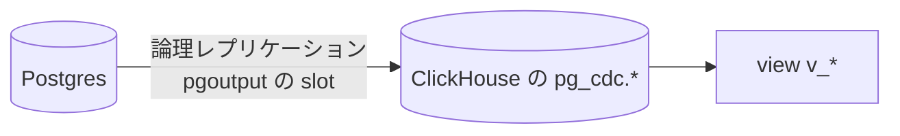

# CDC（Postgres からの取り込み）

Postgres の業務データを、論理レプリケーションで ClickHouse に写す仕組み。ローカルは ClickHouse 内蔵の MaterializedPostgreSQL、
ClickHouse Cloud は ClickPipes で取り込む。この方式を選んだ理由は [`README.md`](./README.md#方式の選択)。

## 目次

- [仕組み](#仕組み)
- [ローカルと ClickHouse Cloud の違い](#ローカルと-clickhouse-cloud-の違い)
- [運用上の注意](#運用上の注意)
- [ローカルの CDC](#ローカルの-cdc)
- [ClickHouse Cloud の CDC（ClickPipes）](#clickhouse-cloud-の-cdcclickpipes)
- [CDC の対象を変えるとき](#cdc-の対象を変えるとき)

## 仕組み

同期対象は `infra/clickhouse/cdc-tables.json` に並べたテーブル（今は `users` / `memos`）。publication と
replication slot は取り込み側が自動作成する。取り込んだテーブルは `pg_cdc` database に入り、
分析クエリは `project_template.v_*` の view から読む（[view を経由する規約](./query.md#view-を経由する規約)）。
ローカルの CDC（MaterializedPostgreSQL）と、両方の環境の view は [migration コマンド](./migration.md)が作る。ClickHouse Cloud の CDC（ClickPipe）は Terraform が作る。

## ローカルと ClickHouse Cloud の違い

**同じ「Postgres の論理レプリケーション」を使うが、WAL を読む主体が違う。**

| | ローカル | ClickHouse Cloud |
| --- | --- | --- |
| 取り込み | ClickHouse 内蔵 `MaterializedPostgreSQL` | **ClickPipes** |
| 成熟度 | experimental | Beta |
| 削除の表現 | `_sign = -1` のタンブストーン | `_peerdb_is_deleted = 1` |
| 追加コンテナ | **なし** | （マネージド） |

**揃えているのは Postgres 側の契約**（`wal_level=logical` / publication の自動作成 /
`pgoutput` の replication slot）で、運用で実際に事故るのはこの層。ClickHouse 側の差分は
view 定義に閉じ込めている。

## 運用上の注意

- **replication slot は WAL を保持する。** 取り込み側が止まると Postgres のディスクが WAL で
  埋まって書き込み不能になる。AWS の RDS は `max_slot_wal_keep_size`（5 GB）で上限を付けていて、
  超えると slot が無効になり CDC は止まるが、DB は止まらない（再同期で戻す）。slot ラグの監視は**未実装**
- 反映は同期ではない。ローカルでの実測は数秒〜10 秒程度で、再起動直後は長めに出る
- ローカルで `pg_cdc` を消すときは `DROP DATABASE pg_cdc`。slot と publication も一緒に消える。
  手で消さずに放置すると docker volume が WAL で膨らみ続ける

## ローカルの CDC

ローカルでは ClickHouse の MaterializedPostgreSQL で Postgres を取り込む。**migration コマンドは毎回 `pg_cdc` を消して作り直す。**

- MaterializedPostgreSQL は Postgres 側で列が変わるとそのテーブルの同期を止める。ClickHouse のドキュメントにある「テーブルを付け直す」では、ClickHouse 24.10 で付け直した後の変更が反映されなかったため、database ごと作り直している
- 作り直すと replication slot と publication も作り直され、全件を取り込み直す。ローカルのデータは少ないので数秒で終わる
- 作り直す前に、既にある `pg_cdc` がこのプロジェクトの Postgres を取り込むものか確かめ、違えば消さずに止まる（同じテンプレートから作った別プロジェクトの ClickHouse が同じポートで動いているときに、その CDC を消さないため）
- Postgres にテーブルが無いと 60 秒待って失敗する。先に `pnpm --filter api db:migrate` を流す
- ローカルの Postgres の DB を消すときは、先に `pg_cdc` を消す（replication slot が残っていると `DROP DATABASE` できない）。手順は [`packages/db/README.md`](../../../packages/db/README.md#ローカル-db-の作り直し)

## ClickHouse Cloud の CDC（ClickPipes）

AWS では Terraform の `enable_cdc` が `true` の環境にだけ、ClickPipe と SSH bastion を作る。**既定はすべての環境で `false`** で、仕組みだけを用意している（行動イベントの分析には要らず、業務データを ClickHouse で分析する必要が出たときに有効にする）。
`enable_cdc` は `enable_data_warehouse` が `true` のときだけ有効にできる。

**AWS 上ではまだ一度も動かしていない。** 有効にする前に、dev で [設計書の step3・step4 の動作確認](../../spec/clickhouse-migration/tasks/step3-infra-cdc.md#動作確認) を行う。

- ClickPipes は VPC の外から RDS に繋ぐため、public subnet の SSH bastion を経由する。bastion は ClickPipes の固定 IP からの SSH だけを受け、RDS の 5432 にだけ出る
- RDS の論理レプリケーション（`rds.logical_replication`）は `enable_cdc` に関係なく有効にしている。`enable_cdc` に連動させると、有効にするたびに RDS の再起動が要るため
- 固定費は ClickPipes の CDC 用の計算資源（約 $73/月。ClickPipe がある間はサービスのアイドルに関係なくかかる）と bastion（月 $10 未満）
- 同期の対象を変えるときは `infra/clickhouse/cdc-tables.json` を変えて apply する（ClickPipe に反映される）。順序は [CDC の対象を変えるとき](#cdc-の対象を変えるとき)
- RDS（isolated subnet）に SQL を流す手段は用意していない。replication slot の状態は CloudWatch の RDS のメトリクス（`OldestReplicationSlotLag` / `TransactionLogsDiskUsage`）で見る

**パラメータグループを入れたとき（既存の環境で 1 回だけ）**

論理レプリケーションは再起動するまで効かない。新しく作る環境では作成時から効くので不要。

1. apply（dev / prd）
2. `aws rds reboot-db-instance --db-instance-identifier <prefix>-db`（dev は日中でよい。prd はメンテナンス時間帯に）
3. `aws rds describe-db-instances --db-instance-identifier <prefix>-db --query 'DBInstances[0].DBParameterGroups'` の `ParameterApplyStatus` が `in-sync` になったことを確かめる

**CDC を有効にする**

ClickPipe を作る前に、論理レプリケーションが効いていること（上の再起動）と、同期するテーブルが Postgres にあること（deploy で流す Drizzle の migration）が要る。新しく作る環境では、最初の deploy が終わってから有効にする。

1. `enable_cdc` の既定値を `true` にして PR → マージ → apply
2. ClickHouse Cloud のコンソールで SSH の鍵を検証（Validate）し、`active` になることを確かめる（検証は自動では走らず、apply の出力の `ssh_key_status` は `pending` のまま）
3. apply の出力の `clickpipe_state` が `Running` か `Snapshot` であることを確かめる（`Failed` でも apply は成功するため、必ず見る）
4. deploy か、ClickHouse の migration だけを流す workflow（`clickhouse-migrate.yml`）で view を作る

先に ClickPipe ができて `Failed` になったとき（再起動や deploy の前に有効にしたときなど）は、準備ができてから `terraform apply -replace='module.cdc[0].clickhouse_clickpipe.this'` で作り直す（差分の無い apply では動き出さない）。

**CDC を無効にする**

1. `enable_cdc` を `false` にして apply（ClickPipe・bastion・SSH の鍵が消える。replication slot は ClickPipe の削除で消える想定）
2. CloudWatch の `OldestReplicationSlotLag` が出なくなる（slot が無くなる）ことを確かめる。slot が残っても、`max_slot_wal_keep_size`（5 GB）を超えると無効になって WAL は解放される
3. `pg_cdc` のテーブルと view は残る。不要なら migration で消す

**bastion を作り直す（OS の更新）**

bastion は AMI を固定していて、外へは RDS にしか出られないので、OS をその場で更新する手段が無い。定期的に、または sshd に脆弱性が出たら、`terraform apply -replace='module.cdc[0].aws_instance.bastion'` で最新の AMI に作り直す（IP は EIP で変わらない。ClickPipe は数分切れて、再接続する）。

## CDC の対象を変えるとき

Postgres の変更と同じ PR で、ClickHouse 側の変更も入れる。ファイルはすべて `packages/data-warehouse/clickhouse/` と
`infra/clickhouse/cdc-tables.json`。ローカルはどのケースも `db:migrate` → `dwh:migrate` を流し直すだけでよい（CDC を毎回作り直すため）。

| ケース | 変えるもの | ClickHouse Cloud への反映の順序 |
| --- | --- | --- |
| テーブルを足す | `cdc-tables.json` に足し、`views/<table>.sql` を足す（Drizzle の migration と同じ PR） | マージ → deploy（テーブルを作る。view はまだ元テーブルが無いので飛ばされる）→ apply（ClickPipe に足し、初回の取り込み）→ `clickhouse-migrate.yml`（view を作る） |
| テーブルを消す・名前を変える | 1 回目の PR: `cdc-tables.json` と `views/<table>.sql` から消し、`DROP VIEW IF EXISTS` の migration を足す。2 回目の PR: Drizzle の変更と `DROP TABLE IF EXISTS pg_cdc.<table>` の migration（名前を変えるなら、新しい名前で「テーブルを足す」も） | 1 回目: deploy → apply（ClickPipe から外す）。2 回目: deploy |
| 列を足す | 不要 | deploy（Drizzle）→ そのテーブルに書き込みがあった後に `clickhouse-migrate.yml`（足した列は次の書き込みで ClickHouse に現れ、view の列は作り直すまで増えない） |
| 列の型・名前を変える | 不要 | deploy（Drizzle）→ ClickHouse Cloud のコンソールで ClickPipe を Resync → 終わったら `clickhouse-migrate.yml` |
| 列を消す | view の `EXCEPT` に列名を足す（ClickPipes は消した列を NULL で残す） | deploy |
| ClickHouse だけの変更 | `migrations/` にファイルを足す | deploy |

`clickhouse-migrate.yml` は、同じ環境の deploy と同じ concurrency group で動く。deploy の実行中は終わるまで待ち、待っている間に deploy をもう一度実行すると、待っていた方は取り消される。

各ケースを選んだ理由は設計書の [変更のケースごとの作業](../../spec/clickhouse-migration/README.md#変更のケースごとの作業)。
