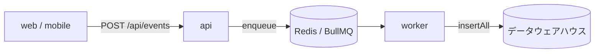

# @repo/data-warehouse

分析用データの書き込み先（データウェアハウス）を抽象化するパッケージ。`DataWarehouse` interface と、
何も書き込まない no-op 実装、実装を選ぶ factory を持つ。

バックエンドごとの実装・テーブル定義・migration は、バックエンド名のディレクトリにまとめる。
今のバックエンドは ClickHouse だけで、実現方法と採用理由は [`clickhouse/README.md`](./clickhouse/README.md) に書く。

## 目次

- [役割](#役割)
- [構成](#構成)
- [集計するデータ](#集計するデータ)
  - [行動イベント](#行動イベント)
  - [業務データ](#業務データ)
- [データウェアハウスに求める要件](#データウェアハウスに求める要件)
  - [同じイベントが 2 回届く](#同じイベントが-2-回届く)
  - [分析クエリは view を経由する](#分析クエリは-view-を経由する)
- [抽象化の範囲](#抽象化の範囲)
- [実装の選び方](#実装の選び方)
- [エラーの扱い](#エラーの扱い)
- [関連](#関連)

## 役割

- `DataWarehouse` interface を定義し、書き込み先の実装を隠す
- `createDataWarehouse` factory で実装を選ぶ。各 app の `src/index.ts` で 1 回呼んで Repository に DI する
- **クエリは持たない。** interface は書き込み専用で、分析クエリは BI ツールや管理画面側の責務
- テーブル・view の定義と、それを適用する migration コマンドもこのパッケージに置く（バックエンドのディレクトリの中）

## 構成

```
packages/data-warehouse/
├── src/                          ライブラリ（build して worker が使う）
│   ├── data-warehouse.ts         DataWarehouse interface
│   ├── create-data-warehouse.ts  実装を選ぶ factory
│   ├── noop-data-warehouse.ts    何も書き込まない実装
│   └── clickhouse/               ClickHouse の実装
└── clickhouse/                   ClickHouse のテーブル・view の定義と migration コマンド（build に含めない）
```

`packages/db` の `src/drizzle/`（実行時のコード）と `drizzle/`（migration などの CLI 用）と同じ分け方にしている。
migration だけが使う依存は devDependencies に置き、worker のイメージ（`pnpm deploy --prod`）には入れない。

## 集計するデータ

### 行動イベント

DB に痕跡が残らない操作（閲覧・削除・離脱）を取るのが主目的。送出は fire-and-forget で、
ユーザーのリクエストを待たせない。**Postgres は通らない。**



- 送出の抽象は `@repo/events` の `EventTracker`。api はデータウェアハウスを知らない
- worker のハンドラは **`await` する**（送出側と逆）。握りつぶすと BullMQ がリトライしない
- 詳細は [`docs/spec/user-behavior-events/README.md`](../../docs/spec/user-behavior-events/README.md)

### 業務データ

行動イベントには `user_id` しか入っていないため、「どんな属性のユーザーが何をしたか」を出すには
業務データ（`users` / `memos` など）もデータウェアハウス側に必要になる。

業務データの正本は Postgres で、アプリから二重に書かずに **CDC（論理レプリケーション）でデータウェアハウスに写す。**
この経路は `DataWarehouse` interface を通らない。同期対象は `infra/clickhouse/cdc-tables.json` に並べたテーブル。

## データウェアハウスに求める要件

行動イベントは業務データと**性質が正反対**で、同じデータベースに置くと互いの足を引っ張る。

| | 行動イベント | 業務データ（User / Memo） |
| --- | --- | --- |
| 書き込み量 | 1 セッションで数十件 | 操作ごとに 1 件 |
| 更新 | しない（append only） | する |
| トランザクション | 不要 | 必要 |
| 読み方 | 大量行を集計 | 1 行を id で引く |
| 消し方 | TTL で自動失効 | 明示的に削除 |

Postgres に相乗りさせると、イベントの書き込み量が業務テーブルと同じインスタンスを圧迫し、
集計クエリが本番の OLTP と資源を奪い合う。そのため別のデータウェアハウスに置き、次を満たすものを選ぶ。

- 追記だけの大量の書き込みと、大量行の集計に向いている
- 古いイベントを TTL で自動で消せる
- 同じイベントが 2 回届いても 1 件に畳める（[後述](#同じイベントが-2-回届く)）
- Postgres の業務データを CDC で取り込める
- リクエストが無いときの費用が小さい

### 同じイベントが 2 回届く

イベントの配送は BullMQ（`@repo/queue`）経由で、**at-least-once** である。worker が
insert した後にクラッシュすると、同じジョブが再配信されて同じイベントが 2 回届く。

対策は **`eventId` を enqueue 時に採番する**こと（`packages/events/src/queue-tracker.ts`）。
データウェアハウス側はこのキーで重複を畳む。worker 側で採番すると再配信のたびに別 ID になり、
重複排除のキーが成立しない。

### 分析クエリは view を経由する

**分析クエリは CDC のテーブル本体を直接読まず、`v_*` の view を見る。** CDC のテーブルは更新や削除を
行の追記で表すため、読み方を間違えると件数が静かに狂う。その吸収を view に閉じ込め、
分析クエリはどの環境でもそのまま動くようにする。何を吸収しているかは
[`clickhouse/README.md`](./clickhouse/README.md#view-を経由する規約)。

## 抽象化の範囲

`DataWarehouse` は **`insertAll` と `close` だけ**に絞っている。クエリ・DDL・migration はバックエンドごとに
差が大きく（ClickHouse は database / BigQuery は dataset、TTL の構文も別物）、汎用化すると必ず漏れるため
interface に入れない。テーブル定義と migration は、バックエンドのディレクトリに方言のまま置く。

役割名の `@repo/data-warehouse` にして interface を挟んでいるが、**これが吸収するのは書き込み経路だけで、
移行コスト全体の 1〜2 割程度にすぎない。** 移行コストの大半はクエリとダッシュボードの作り直しで、
同じ SQL 方言のサービスへならテーブル定義とクエリがそのまま使えるが、別の方言へはこの抽象化はほとんど効かない。

## 実装の選び方

worker の `DATA_WAREHOUSE_TYPE` で選ぶ。

| `DATA_WAREHOUSE_TYPE` | 実装 | 使う環境 |
| --- | --- | --- |
| `clickhouse` | `ClickHouseDataWarehouse` | ローカル / prd |
| `none` | `NoopDataWarehouse` | dev（行動ログに分析価値が無い環境） |

`none` にすると insert はスキップされる（ジョブは成功扱い）。

**本番で `none` にしてはいけない。** 呼び出し側から見ると insert は成功するので、
設定を間違えるとイベントが無言で消える。気付けるように insert のたびに debug ログを出している。

接続先などの環境変数は [`apps/worker/CLAUDE.md`](../../apps/worker/CLAUDE.md#環境変数)。

## エラーの扱い

`insertAll` は失敗を `logger.error` に出してから re-throw する。リトライは呼び出し側
（worker / BullMQ）の責務で、ここでログを出さないと queue の汎用的なジョブ失敗としか残らない。

## 関連

- [`clickhouse/README.md`](./clickhouse/README.md) — ClickHouse での実現方法・採用理由・migration コマンド
- [`docs/spec/user-behavior-events/README.md`](../../docs/spec/user-behavior-events/README.md) — 行動イベント基盤の設計
- [`docs/spec/clickhouse-migration/README.md`](../../docs/spec/clickhouse-migration/README.md) — ClickHouse の migration と、環境ごとの有効化の設計
- [`packages/events/`](../events) — 送出の抽象（`EventTracker`）
- [`packages/queue/`](../queue) — 配送の抽象（BullMQ）
- [`apps/worker/CLAUDE.md`](../../apps/worker/CLAUDE.md) — 消費側の実装と env
